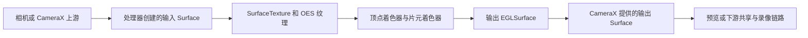
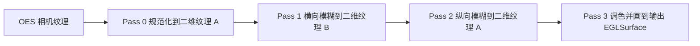
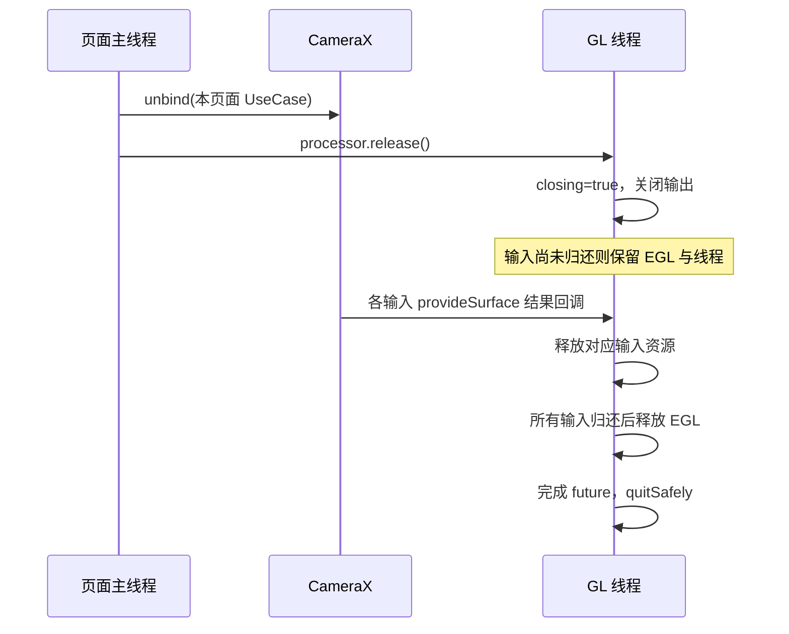

# 使用 CameraEffect、SurfaceProcessor 和 OpenGL ES 实现相机滤镜

> 本文面向第一次实现 GPU 相机滤镜的 Android 开发者。示例使用 Kotlin、CameraX **1.4.2**、OpenGL ES 2.0、EGL14 和普通 View。以本项目的依赖版本为基准，不把较新版本 API 混入示例。示例限定为单相机、8 位 SDR；先实现灰度预览，再扩展到录像和多通道滤镜。
>
> 本文中的代码是供读者在独立示例工程中创建的完整教学实现，包名统一为 `com.example.camerafilter`。它不依赖 Grafika 的 `GlUtil`、`EglCore` 等工具类。项目现有 `day09` 代码可用来对照，但本文不直接改动那些源码。

校验范围：四个完整 Kotlin 类已使用 Android 35 平台类和 CameraX 1.4.2 依赖进行独立编译检查；录像、Controller 和分析坐标映射中使用的 API 也已编译核对。未执行真机 GPU 渲染验证，shader 驱动编译、画面方向、录像与设备兼容性请按第 19 节实测。

## 阅读路线

1. 第 1～3 节：理解数据流、对象和 CameraX API。
2. 第 4～7 节：建立工程，复制三个核心类和 Activity，运行灰度预览。
3. 第 8～11 节：逐步解释 SurfaceProcessor、EGL、GLES、坐标矩阵和释放流程。
4. 第 12～16 节：动态滤镜、录像、FBO、多通道处理、LUT、水印与拍照。
5. 第 17～20 节：API 速查、排错、验证和源码查证。

第一遍可以先复制完整类，让画面出现；第二遍按每帧的数据流回看 GLES 调用。真正需要记住的是对象的职责、线程和资源所有权，GL 函数名可以随时查表。

## 1. 这套方案到底在做什么

相机持续生产图像。我们把相机原本要输出的帧接入一个自己创建的 `Surface`，通过 `SurfaceTexture` 把帧交给 GPU 纹理，再用片元着色器修改颜色，最后将处理结果画到 CameraX 提供的输出 `Surface`。



“输入”“输出”以 **SurfaceProcessor** 为参照：

- 输入 Surface：处理器创建，CameraX 向它写原始帧。
- 输出 Surface：CameraX 提供，处理器向它写滤镜帧。

不要把 `onInputSurface()` 理解成“CameraX 给我一张输入图像”。它给的是**申请 Surface 的请求**。也不要把 `onOutputSurface()` 理解成“输出图像已经处理好了”。它给的是**你应该往哪里绘制的输出端**。

这种路径避免应用每帧把 YUV 数据读到 CPU 再上传 GPU。底层可能仍有格式转换、缓存复制和驱动同步，因此更准确的说法是“避免应用层每帧 CPU 像素搬运”，不能笼统保证全链路零复制。

### 1.1 三个核心对象的分工

| 对象 | 主要职责 | 你需要实现什么 |
|---|---|---|
| `CameraEffect` | 声明滤镜作用于哪些 UseCase，指定处理器、回调线程和错误监听 | 一个很薄的子类 |
| `SurfaceProcessor` | 接入输入、管理输出、接收帧、渲染、处理 Surface 生命周期 | 本文的重点 |
| OpenGL ES / EGL | GPU 采样、颜色计算和绘制；把 GL 连接到 Android Surface | 着色器、纹理、EGL 环境和 draw 方法 |

`CameraEffect` 不负责自动执行你的 shader；`SurfaceProcessor` 也没有要求你一定用 OpenGL。它定义的是输入/输出 Surface 的处理契约，OpenGL 是一种实现方式。

### 1.2 为什么还需要 EGL

OpenGL ES 能描述“画什么”，但需要一个上下文保存程序、纹理和 GL 状态，也需要一个实际绘制目标。EGL 把这些条件准备好：

```text
EGLDisplay：与设备图形系统的连接
EGLConfig：颜色位数、ES 版本、Surface 能力等配置
EGLContext：GL 对象和状态所属的上下文
EGLSurface：GL 实际绘制的目标
```

Android 的 `Surface` 和 EGL 的 `EGLSurface` 是两个对象。前者连接 Android 图像队列；后者是通过 `eglCreateWindowSurface()` 包装前者后得到的 EGL 绘制目标。

## 2. 先掌握五个基础概念

### 2.1 Surface 是图像队列的一端

`Surface` 不是一个 `Bitmap`，也不是一个 GL 纹理 ID。它代表生产图像的接口，其后通常有 BufferQueue。相机把图像写入输入 Surface，消费者从队列取得帧。

### 2.2 SurfaceTexture 是消费者

`SurfaceTexture(textureId)` 将接收到的图像关联到一个外部纹理。新帧到达时会收到 `OnFrameAvailableListener` 通知；GL 线程调用 `updateTexImage()`，才把最新可用图像更新到纹理。

通知的含义是“有帧可以消费”，不是“纹理已经自动换成新帧”。

### 2.3 OES 纹理与普通二维纹理不同

普通图片通常上传到 `GL_TEXTURE_2D`，用 `sampler2D` 采样。相机 `SurfaceTexture` 使用 `GL_TEXTURE_EXTERNAL_OES`，用 `samplerExternalOES` 采样。

```glsl
#extension GL_OES_EGL_image_external : require
precision mediump float;
uniform samplerExternalOES uTexture;
```

对应的纹理 target、GLSL sampler 类型和扩展声明必须配套。不要对相机 OES 纹理调用 `glTexImage2D()` 上传像素，也不要把它直接当成 FBO 的颜色附件。多通道处理时先把它绘制到普通二维纹理。

### 2.4 顶点着色器决定覆盖范围和采样位置

为了处理整张画面，画一个铺满输出面的矩形。四个顶点经过光栅化形成大量片元；每个片元得到插值后的纹理坐标。

### 2.5 片元着色器决定每个输出像素的颜色

灰度滤镜只需采样一次，再计算亮度并输出：

```glsl
vec4 color = texture2D(uTexture, vTexCoord);
float gray = dot(color.rgb, vec3(0.299, 0.587, 0.114));
gl_FragColor = vec4(vec3(gray), color.a);
```

`dot()` 是三个通道与权重的乘积之和。这里是常见的显示编码 RGB 灰度近似，不是严格线性光空间的物理亮度计算。视觉调色通常可以从它开始，色彩精度要求高时再引入线性化和正确的色彩空间。

## 3. CameraX API 和必须遵守的契约

### 3.1 CameraEffect 的构造函数

本文使用的 Java 签名如下。由于是 `protected`，需要继承后调用：

```java
protected CameraEffect(
        int targets,
        Executor executor,
        SurfaceProcessor surfaceProcessor,
        androidx.core.util.Consumer<Throwable> errorListener);
```

| 参数 | 含义 | 本文选择 |
|---|---|---|
| `targets` | 目标 UseCase 的位标志组合 | 先用 `PREVIEW` |
| `executor` | 调用处理器入口和错误监听的执行器 | 专用 GL 线程 |
| `surfaceProcessor` | 自定义 GPU 处理器 | `TutorialSurfaceProcessor` |
| `errorListener` | 入口处理发生不可恢复错误时的通知 | 日志和应用回调 |

Kotlin 使用 `or` 组合标志，例如 `PREVIEW or VIDEO_CAPTURE`。这是位标志，不是普通加法，也不是布尔逻辑。

**经 CameraX 1.4.2 的 `CameraEffect.java` 源码核对，SurfaceProcessor 构造路径允许下列组合：**

| 组合 | 用途 |
|---|---|
| `PREVIEW` | 预览滤镜 |
| `VIDEO_CAPTURE` | 录像滤镜，仍需实际绑定支持该目标的 UseCase |
| `PREVIEW or VIDEO_CAPTURE` | 预览和录像共同处理 |
| `PREVIEW or VIDEO_CAPTURE or IMAGE_CAPTURE` | 允许的声明组合，拍照是否走该链路还取决于实际绑定和内部拓扑 |

不能使用 `IMAGE_CAPTURE` 单独作为这个 SurfaceProcessor 构造函数的目标，也不能任意拼出 `PREVIEW or IMAGE_CAPTURE`。本文后面专门讨论拍照，避免把“构造函数允许”误认为“所有绑定组合都会得到滤镜照片”。

**不是所有 SurfaceProcessor 目标都必须含 `VIDEO_CAPTURE`：单独 `PREVIEW` 在 1.4.2 就有效。** 目标标志也不会自动帮你创建或启用录像 UseCase。

多个 CameraEffect 的目标不能互相重叠。需要给同一帧连续加灰度、模糊、水印时，把它们组织在一个处理器的渲染链里，而不是向同一个 UseCase 挂几个重叠目标的 Effect。

### 3.2 SurfaceProcessor 的两个入口

```java
void onInputSurface(SurfaceRequest request) throws ProcessingException;
void onOutputSurface(SurfaceOutput surfaceOutput) throws ProcessingException;
```

二者是**管线创建或重建回调**，不是每帧回调。不能假设它们只执行一次，也不能依赖“输入一定先来”“输出一定先来”。切换摄像头、重新绑定或输出视图重建都可能引起新的回调。

每帧通知来自 `SurfaceTexture.OnFrameAvailableListener`。

### 3.3 SurfaceRequest：回答输入申请

| API | 用法和注意事项 |
|---|---|
| `getResolution()` / Kotlin `resolution` | CameraX 请求的输入缓冲尺寸，用于 `setDefaultBufferSize()` |
| `getDynamicRange()` / `dynamicRange` | 请求的动态范围；本文只接受 `DynamicRange.SDR` |
| `provideSurface(surface, executor, resultListener)` | 提交输入 Surface；**此回调返回后才回收对应输入资源** |
| `willNotProvideSurface()` | 不能提供或正在退出时，明确拒绝请求，避免请求一直悬空 |
| `addRequestCancellationListener()` | 监听未完成/被取消的请求，适合取消准备任务；不是所有已提交输入的统一释放信号 |
| `invalidate()` | 告知输入失效并要求重建；不是直接释放输入的授权 |
| `setTransformationInfoListener()` | 获取裁剪、旋转等元信息；自绘几何、坐标映射时有用 |

`provideSurface()` 的 resultListener 不是“每帧结果”，也不是“提供成功后立即可以释放”。对于正常使用的 Surface，它通常等到相机不再使用该 Surface 时才调用。

| `SurfaceRequest.Result` | 含义 |
|---|---|
| `RESULT_SURFACE_USED_SUCCESSFULLY` | 曾成功使用，现已脱离使用，可以回收 |
| `RESULT_REQUEST_CANCELLED` | 未被成功使用，请求已取消 |
| `RESULT_INVALID_SURFACE` | Surface 无效，例如尺寸不符合请求或过早关闭 |
| `RESULT_SURFACE_ALREADY_PROVIDED` | 这个请求已有提交，当前这次提交没有接入 |
| `RESULT_WILL_NOT_PROVIDE_SURFACE` | 请求已被拒绝，当前提交没有接入 |

本文对每个请求只提交一次，创建新资源，不复用旧请求中的 Surface。因此这一次提交的 resultListener 可以作为对应资源的收尾入口。

### 3.4 SurfaceOutput：领取输出和关闭协议

| API | 用法和注意事项 |
|---|---|
| `getSurface(executor, listener)` | 取得下游 Surface，并注册停止使用通知；多次调用只有最后一次 listener 有效 |
| `getSize()` / `size` | **这个输出**的缓冲尺寸，用于 viewport；不能用输入尺寸或 View 尺寸代替 |
| `getTargets()` / `targets` | 输出用途的位标志，可能代表共享链路；用位运算判断 |
| `updateTransformMatrix(updated, original)` | 把 SurfaceTexture 原始矩阵与 CameraX 附加变换组合到 `updated` |
| `close()` | 告诉 CameraX“我已停止写这个输出”，后续不能继续画 |
| `getSensorToBufferTransform()` | 传感器到输出缓冲区的二维变换，用于分析结果叠加；不是 shader 的 4×4 矩阵 |

收到 `EVENT_REQUEST_CLOSE` 后：停止对此输出绘制，解绑它作为当前绘制目标，销毁自己创建的 EGLSurface，调用 `SurfaceOutput.close()`。

**不要对 `getSurface()` 得到的 Surface 调用 `release()`。** 它由 CameraX/下游拥有。我们拥有的是包装它的 EGLSurface；输入 Surface 则由我们创建，确实需要我们回收。

### 3.5 两个入口都可能出现新旧交叠

官方契约允许新输入到达时旧输入仍未释放，也允许新输出到达时旧输出还未收到关闭请求。正确做法是：

- 一个集合保存所有尚未归还的输入资源；另有 `currentInput` 决定当前显示哪一路。
- 一个集合或 Map 保存所有尚未关闭的输出资源。
- 关闭回调携带哪个对象，就关闭那个对象。
- 旧输入归还时，不能顺带把新输入置空或释放。

本文允许同时保留多个输出，并用同一最新输入绘制它们。公共构造函数下实际输出可能是一个共享中间 Surface；这里支持多个对象也解决新旧输出交接，**不意味着 CameraX 必定逐个给你 Preview 和 Recorder 的最终 Surface**。

## 4. 创建最小工程

建议新建 Empty Views Activity 工程，包名 `com.example.camerafilter`，`minSdk = 24`，`compileSdk = 35` 或以上。使用 Kotlin 和 AndroidX。Kotlin/AGP 版本沿用工程本身能正常编译的配置。

### 4.1 依赖

以下为模块 `build.gradle.kts` 的依赖片段，仓库应已包含 `google()` 和 `mavenCentral()`：

```kotlin
dependencies {
    val cameraxVersion = "1.4.2"
    implementation("androidx.camera:camera-core:$cameraxVersion")
    implementation("androidx.camera:camera-camera2:$cameraxVersion")
    implementation("androidx.camera:camera-lifecycle:$cameraxVersion")
    implementation("androidx.camera:camera-view:$cameraxVersion")
    implementation("androidx.camera:camera-video:$cameraxVersion")
    implementation("androidx.appcompat:appcompat:1.7.1")
}
```

所有 CameraX 模块使用相同版本。OpenGL ES 和 EGL 类来自 Android 平台，无须第三方 GL 依赖。只做预览可不引入 `camera-video`，本文列出它方便后面扩展录像。

### 4.2 权限与 GLES 能力声明

把以下两项加到 Manifest 的 `<application>` 外：

```xml
<uses-permission android:name="android.permission.CAMERA" />
<uses-feature android:glEsVersion="0x00020000" android:required="true" />
```

在 `<application>` 内注册本文 Activity；若替换工程原来的 launcher，删除原 launcher 的 intent-filter，避免留下两个启动入口：

```xml
<activity
    android:name=".FilterActivity"
    android:exported="true">
    <intent-filter>
        <action android:name="android.intent.action.MAIN" />
        <category android:name="android.intent.category.LAUNCHER" />
    </intent-filter>
</activity>
```

Activity 继承 `AppCompatActivity`，使用工程生成的 AppCompat/Material 兼容主题。这里只做预览，不需要存储权限，也不需要录音权限。

### 4.3 最终文件列表

```text
app/src/main/java/com/example/camerafilter/
├── FilterGlRenderer.kt           EGL 与 GLES
├── TutorialSurfaceProcessor.kt   CameraX Surface 接入及生命周期
├── TutorialCameraEffect.kt       Effect 声明
└── FilterActivity.kt             权限与相机绑定
```

下面四个完整代码块分别对应四个文件。类名特意与本项目现有类区分，避免复制时混用不同版本实现。

## 5. 完整 EGL / GLES 渲染器

先创建 `FilterGlRenderer.kt`。它只负责 GPU：初始化上下文，创建纹理和输出 EGLSurface，绘制一帧，删除 GPU 资源。它不知道 Activity 或 CameraX 请求的生命周期。

```kotlin
package com.example.camerafilter

import android.opengl.EGL14
import android.opengl.EGLConfig
import android.opengl.EGLContext
import android.opengl.EGLDisplay
import android.opengl.EGLSurface
import android.opengl.EGLExt
import android.opengl.GLES11Ext
import android.opengl.GLES20
import android.view.Surface
import java.nio.ByteBuffer
import java.nio.ByteOrder
import java.nio.FloatBuffer

internal class FilterGlRenderer {
    private var display: EGLDisplay = EGL14.EGL_NO_DISPLAY
    private var context: EGLContext = EGL14.EGL_NO_CONTEXT
    private var pbuffer: EGLSurface = EGL14.EGL_NO_SURFACE
    private lateinit var config: EGLConfig
    private var program = 0
    private var positionLocation = -1
    private var texCoordLocation = -1
    private var matrixLocation = -1
    private var samplerLocation = -1
    private var intensityLocation = -1

    private val vertices = floatBuffer(
        floatArrayOf(-1f, -1f, 1f, -1f, -1f, 1f, 1f, 1f)
    )
    private val texCoords = floatBuffer(
        floatArrayOf(0f, 0f, 1f, 0f, 0f, 1f, 1f, 1f)
    )

    init {
        try {
            initializeEgl()
            makePbufferCurrent()
            val extensions = GLES20.glGetString(GLES20.GL_EXTENSIONS).orEmpty()
            check(extensions.split(' ').contains("GL_OES_EGL_image_external")) {
                "设备不支持外部 OES 纹理"
            }
            program = createProgram(VERTEX_SHADER, FRAGMENT_SHADER)
            positionLocation = attribute("aPosition")
            texCoordLocation = attribute("aTexCoord")
            matrixLocation = uniform("uTexMatrix")
            samplerLocation = uniform("uTexture")
            intensityLocation = uniform("uIntensity")
        } catch (e: Exception) {
            // 初始化进行到一半也需要清理已创建的资源。
            release()
            throw e
        }
    }

    private fun initializeEgl() {
        display = EGL14.eglGetDisplay(EGL14.EGL_DEFAULT_DISPLAY)
        check(display != EGL14.EGL_NO_DISPLAY) { eglMessage("eglGetDisplay") }
        val version = IntArray(2)
        check(EGL14.eglInitialize(display, version, 0, version, 1)) {
            eglMessage("eglInitialize")
        }
        val extensions = EGL14.eglQueryString(display, EGL14.EGL_EXTENSIONS).orEmpty()
        check(extensions.split(' ').contains("EGL_ANDROID_presentation_time")) {
            "设备不支持 EGL 时间戳扩展"
        }
        check(extensions.split(' ').contains("EGL_ANDROID_recordable")) {
            "设备不支持可录像 EGL 配置"
        }
        val attributes = intArrayOf(
            EGL14.EGL_RED_SIZE, 8,
            EGL14.EGL_GREEN_SIZE, 8,
            EGL14.EGL_BLUE_SIZE, 8,
            EGL14.EGL_ALPHA_SIZE, 8,
            EGL14.EGL_RENDERABLE_TYPE, EGL14.EGL_OPENGL_ES2_BIT,
            EGL14.EGL_SURFACE_TYPE,
            EGL14.EGL_WINDOW_BIT or EGL14.EGL_PBUFFER_BIT,
            EGLExt.EGL_RECORDABLE_ANDROID, EGL14.EGL_TRUE,
            EGL14.EGL_NONE
        )
        val configs = arrayOfNulls<EGLConfig>(1)
        val count = IntArray(1)
        check(EGL14.eglChooseConfig(display, attributes, 0, configs, 0, 1, count, 0)) {
            eglMessage("eglChooseConfig")
        }
        check(count[0] > 0 && configs[0] != null) { "没有符合条件的 EGLConfig" }
        config = requireNotNull(configs[0])
        context = EGL14.eglCreateContext(
            display, config, EGL14.EGL_NO_CONTEXT,
            intArrayOf(EGL14.EGL_CONTEXT_CLIENT_VERSION, 2, EGL14.EGL_NONE), 0
        )
        check(context != EGL14.EGL_NO_CONTEXT) { eglMessage("eglCreateContext") }
        pbuffer = EGL14.eglCreatePbufferSurface(
            display, config,
            intArrayOf(EGL14.EGL_WIDTH, 1, EGL14.EGL_HEIGHT, 1, EGL14.EGL_NONE), 0
        )
        check(pbuffer != EGL14.EGL_NO_SURFACE) { eglMessage("eglCreatePbufferSurface") }
    }

    fun makePbufferCurrent() = makeCurrent(pbuffer)

    private fun makeCurrent(surface: EGLSurface) {
        check(EGL14.eglMakeCurrent(display, surface, surface, context)) {
            eglMessage("eglMakeCurrent")
        }
    }

    fun createInputTexture(): Int {
        makePbufferCurrent()
        val names = IntArray(1)
        GLES20.glGenTextures(1, names, 0)
        try {
            check(names[0] != 0) { "创建输入纹理失败" }
            GLES20.glBindTexture(GLES11Ext.GL_TEXTURE_EXTERNAL_OES, names[0])
            GLES20.glTexParameteri(
                GLES11Ext.GL_TEXTURE_EXTERNAL_OES,
                GLES20.GL_TEXTURE_MIN_FILTER, GLES20.GL_LINEAR
            )
            GLES20.glTexParameteri(
                GLES11Ext.GL_TEXTURE_EXTERNAL_OES,
                GLES20.GL_TEXTURE_MAG_FILTER, GLES20.GL_LINEAR
            )
            GLES20.glTexParameteri(
                GLES11Ext.GL_TEXTURE_EXTERNAL_OES,
                GLES20.GL_TEXTURE_WRAP_S, GLES20.GL_CLAMP_TO_EDGE
            )
            GLES20.glTexParameteri(
                GLES11Ext.GL_TEXTURE_EXTERNAL_OES,
                GLES20.GL_TEXTURE_WRAP_T, GLES20.GL_CLAMP_TO_EDGE
            )
            checkGl("配置 OES 纹理")
            return names[0]
        } catch (e: Exception) {
            GLES20.glDeleteTextures(1, names, 0)
            throw e
        } finally {
            GLES20.glBindTexture(GLES11Ext.GL_TEXTURE_EXTERNAL_OES, 0)
        }
    }

    fun deleteInputTexture(textureId: Int) {
        makePbufferCurrent()
        GLES20.glDeleteTextures(1, intArrayOf(textureId), 0)
        checkGl("删除输入纹理")
    }

    fun createOutputSurface(surface: Surface): EGLSurface {
        val result = EGL14.eglCreateWindowSurface(
            display, config, surface, intArrayOf(EGL14.EGL_NONE), 0
        )
        check(result != EGL14.EGL_NO_SURFACE) { eglMessage("eglCreateWindowSurface") }
        return result
    }

    fun destroyOutputSurface(surface: EGLSurface) {
        // 当前目标可能就是将要销毁的输出，先切回自己的离屏目标。
        try {
            makePbufferCurrent()
        } finally {
            check(EGL14.eglDestroySurface(display, surface)) {
                eglMessage("eglDestroySurface")
            }
        }
    }

    fun draw(
        output: EGLSurface,
        width: Int,
        height: Int,
        textureId: Int,
        textureMatrix: FloatArray,
        timestampNs: Long,
        intensity: Float
    ) {
        makeCurrent(output)
        GLES20.glBindFramebuffer(GLES20.GL_FRAMEBUFFER, 0)
        GLES20.glViewport(0, 0, width, height)
        GLES20.glDisable(GLES20.GL_BLEND)
        GLES20.glDisable(GLES20.GL_DEPTH_TEST)
        GLES20.glDisable(GLES20.GL_SCISSOR_TEST)
        GLES20.glClearColor(0f, 0f, 0f, 1f)
        GLES20.glClear(GLES20.GL_COLOR_BUFFER_BIT)
        GLES20.glUseProgram(program)

        vertices.position(0)
        texCoords.position(0)
        GLES20.glEnableVertexAttribArray(positionLocation)
        GLES20.glVertexAttribPointer(
            positionLocation, 2, GLES20.GL_FLOAT, false, 0, vertices
        )
        GLES20.glEnableVertexAttribArray(texCoordLocation)
        GLES20.glVertexAttribPointer(
            texCoordLocation, 2, GLES20.GL_FLOAT, false, 0, texCoords
        )
        GLES20.glUniformMatrix4fv(matrixLocation, 1, false, textureMatrix, 0)
        GLES20.glUniform1f(intensityLocation, intensity)
        GLES20.glActiveTexture(GLES20.GL_TEXTURE0)
        GLES20.glBindTexture(GLES11Ext.GL_TEXTURE_EXTERNAL_OES, textureId)
        GLES20.glUniform1i(samplerLocation, 0)
        GLES20.glDrawArrays(GLES20.GL_TRIANGLE_STRIP, 0, 4)
        checkGl("绘制滤镜帧")

        GLES20.glDisableVertexAttribArray(positionLocation)
        GLES20.glDisableVertexAttribArray(texCoordLocation)
        GLES20.glBindTexture(GLES11Ext.GL_TEXTURE_EXTERNAL_OES, 0)
        check(EGLExt.eglPresentationTimeANDROID(display, output, timestampNs)) {
            eglMessage("eglPresentationTimeANDROID")
        }
        check(EGL14.eglSwapBuffers(display, output)) { eglMessage("eglSwapBuffers") }
    }

    fun release() {
        if (display == EGL14.EGL_NO_DISPLAY) return
        // 初始化失败或上下文丢失时不一定还能 makeCurrent；销毁上下文也会回收其 GL 对象。
        if (context != EGL14.EGL_NO_CONTEXT && pbuffer != EGL14.EGL_NO_SURFACE) {
            if (EGL14.eglMakeCurrent(display, pbuffer, pbuffer, context)) {
                if (program != 0) GLES20.glDeleteProgram(program)
            }
        }
        program = 0
        EGL14.eglMakeCurrent(
            display, EGL14.EGL_NO_SURFACE, EGL14.EGL_NO_SURFACE, EGL14.EGL_NO_CONTEXT
        )
        if (pbuffer != EGL14.EGL_NO_SURFACE) EGL14.eglDestroySurface(display, pbuffer)
        if (context != EGL14.EGL_NO_CONTEXT) EGL14.eglDestroyContext(display, context)
        EGL14.eglTerminate(display)
        EGL14.eglReleaseThread()
        pbuffer = EGL14.EGL_NO_SURFACE
        context = EGL14.EGL_NO_CONTEXT
        display = EGL14.EGL_NO_DISPLAY
    }

    private fun attribute(name: String): Int =
        GLES20.glGetAttribLocation(program, name).also {
            check(it >= 0) { "找不到 attribute：$name" }
        }

    private fun uniform(name: String): Int =
        GLES20.glGetUniformLocation(program, name).also {
            check(it >= 0) { "找不到 uniform：$name" }
        }

    private fun compileShader(type: Int, source: String): Int {
        val shader = GLES20.glCreateShader(type)
        check(shader != 0) { "无法创建 Shader" }
        try {
            GLES20.glShaderSource(shader, source)
            GLES20.glCompileShader(shader)
            val status = IntArray(1)
            GLES20.glGetShaderiv(shader, GLES20.GL_COMPILE_STATUS, status, 0)
            check(status[0] == GLES20.GL_TRUE) {
                "Shader 编译失败：${GLES20.glGetShaderInfoLog(shader)}"
            }
            return shader
        } catch (e: Exception) {
            GLES20.glDeleteShader(shader)
            throw e
        }
    }

    private fun createProgram(vertexSource: String, fragmentSource: String): Int {
        val vertex = compileShader(GLES20.GL_VERTEX_SHADER, vertexSource)
        var fragment = 0
        var result = 0
        try {
            fragment = compileShader(GLES20.GL_FRAGMENT_SHADER, fragmentSource)
            result = GLES20.glCreateProgram()
            check(result != 0) { "无法创建 Program" }
            GLES20.glAttachShader(result, vertex)
            GLES20.glAttachShader(result, fragment)
            GLES20.glLinkProgram(result)
            val status = IntArray(1)
            GLES20.glGetProgramiv(result, GLES20.GL_LINK_STATUS, status, 0)
            check(status[0] == GLES20.GL_TRUE) {
                "Program 链接失败：${GLES20.glGetProgramInfoLog(result)}"
            }
            return result
        } catch (e: Exception) {
            if (result != 0) GLES20.glDeleteProgram(result)
            throw e
        } finally {
            GLES20.glDeleteShader(vertex)
            if (fragment != 0) GLES20.glDeleteShader(fragment)
        }
    }

    private fun checkGl(operation: String) {
        val error = GLES20.glGetError()
        check(error == GLES20.GL_NO_ERROR) {
            "$operation：GL 错误 0x${Integer.toHexString(error)}"
        }
    }

    private fun eglMessage(operation: String): String =
        "$operation：EGL 错误 0x${Integer.toHexString(EGL14.eglGetError())}"

    companion object {
        private fun floatBuffer(values: FloatArray): FloatBuffer =
            ByteBuffer.allocateDirect(values.size * 4)
                .order(ByteOrder.nativeOrder())
                .asFloatBuffer()
                .apply { put(values); position(0) }

        private val VERTEX_SHADER = """
            attribute vec4 aPosition;
            attribute vec2 aTexCoord;
            uniform mat4 uTexMatrix;
            varying vec2 vTexCoord;

            void main() {
                gl_Position = aPosition;
                vTexCoord = (uTexMatrix * vec4(aTexCoord, 0.0, 1.0)).xy;
            }
        """.trimIndent()

        private val FRAGMENT_SHADER = """
            #extension GL_OES_EGL_image_external : require
            precision mediump float;
            uniform samplerExternalOES uTexture;
            uniform float uIntensity;
            varying vec2 vTexCoord;

            void main() {
                vec4 source = texture2D(uTexture, vTexCoord);
                float gray = dot(source.rgb, vec3(0.299, 0.587, 0.114));
                vec3 filtered = mix(source.rgb, vec3(gray), uIntensity);
                gl_FragColor = vec4(filtered, source.a);
            }
        """.trimIndent()
    }
}
```

这个版本主动要求 `EGL_ANDROID_recordable` 和 `EGL_ANDROID_presentation_time`，以便后面复用到录像。纯预览且目标设备缺少这些扩展时，可分别移除 recordable 配置和时间戳调用；应在初始化时确定能力，而不是每帧忽略错误。普通现代 Android 真机通常具备它们，模拟器需要单独检查。

这里每个 Renderer 独占自己的 EGLContext，便于解释状态。后面若引入共享上下文或第三方渲染器，需要增加状态隔离和同步，不能认为 GL 状态永远保持为本类上一次设置的值。

## 6. 完整 SurfaceProcessor

创建 `TutorialSurfaceProcessor.kt`。先通读成员变量，再看三个关键路径：`onInputSurface()` 建输入、`onFrameAvailable()` 消费帧、`onOutputSurface()` 建输出。

```kotlin
package com.example.camerafilter

import android.graphics.SurfaceTexture
import android.opengl.EGLSurface
import android.os.Handler
import android.os.HandlerThread
import android.os.Looper
import android.util.Log
import android.view.Surface
import androidx.camera.core.DynamicRange
import androidx.camera.core.ProcessingException
import androidx.camera.core.SurfaceOutput
import androidx.camera.core.SurfaceProcessor
import androidx.camera.core.SurfaceRequest
import java.util.concurrent.CompletableFuture
import java.util.concurrent.Executor
import java.util.concurrent.RejectedExecutionException
import java.util.concurrent.atomic.AtomicBoolean

class TutorialSurfaceProcessor(
    private val onFatalError: (Throwable) -> Unit
) : SurfaceProcessor {
    private val thread = HandlerThread("CameraFilterGL").apply { start() }
    private val handler = Handler(thread.looper)
    val executor: Executor = Executor { command ->
        if (!handler.post(command)) {
            throw RejectedExecutionException("相机滤镜 GL 线程已停止")
        }
    }

    // AtomicBoolean 只负责跨线程阻止重复 release 和退出后的参数更新。
    private val releaseStarted = AtomicBoolean(false)
    private val releasedFuture = CompletableFuture<Void>()

    // 以下状态仅由 GL 线程访问。
    private var closing = false
    private var fatalError: Throwable? = null
    private var renderer: FilterGlRenderer? = null
    private val inputs = linkedSetOf<Input>()
    private val outputs = linkedMapOf<SurfaceOutput, Output>()
    private var currentInput: Input? = null
    private var intensity = 1f
    private val inputMatrix = FloatArray(16)
    private val outputMatrix = FloatArray(16)

    private class Input(
        val request: SurfaceRequest,
        val textureId: Int,
        val texture: SurfaceTexture,
        val surface: Surface
    ) {
        var submitted = false
        var hasFrame = false
        var lastTimestampNs: Long? = null
    }

    private class Output(
        val cameraOutput: SurfaceOutput,
        val eglSurface: EGLSurface
    )

    override fun onInputSurface(request: SurfaceRequest) {
        checkGlThread()
        if (closing || releaseStarted.get()) {
            request.willNotProvideSurface()
            return
        }
        fatalError?.let {
            request.willNotProvideSurface()
            throw processingException(it)
        }
        var input: Input? = null
        try {
            check(request.dynamicRange == DynamicRange.SDR) {
                "教学处理器只支持 8 位 SDR，请关闭 HDR"
            }
            input = createInput(request)
            inputs += input
            currentInput = input
            val ownedInput = input
            ownedInput.texture.setOnFrameAvailableListener(
                { onFrameAvailable(ownedInput) }, handler
            )
            // 只提交一次。提交后必须等这个回调，不能在 release 中抢先销毁。
            ownedInput.submitted = true
            request.provideSurface(ownedInput.surface, executor) { result ->
                Log.d(TAG, "输入归还：${result.resultCode}")
                releaseInput(ownedInput)
            }
        } catch (e: Exception) {
            if (input != null && !input.submitted) releaseInput(input)
            request.willNotProvideSurface()
            fail(e)
            throw processingException(e)
        }
    }

    private fun createInput(request: SurfaceRequest): Input {
        val gl = ensureRenderer()
        gl.makePbufferCurrent()
        val textureId = gl.createInputTexture()
        var texture: SurfaceTexture? = null
        var surface: Surface? = null
        try {
            val createdTexture = SurfaceTexture(textureId)
            texture = createdTexture
            val size = request.resolution
            createdTexture.setDefaultBufferSize(size.width, size.height)
            val createdSurface = Surface(createdTexture)
            surface = createdSurface
            return Input(request, textureId, createdTexture, createdSurface)
        } catch (e: Exception) {
            surface?.release()
            texture?.release()
            gl.deleteInputTexture(textureId)
            throw e
        }
    }

    override fun onOutputSurface(surfaceOutput: SurfaceOutput) {
        checkGlThread()
        if (closing || releaseStarted.get()) {
            surfaceOutput.close()
            return
        }
        fatalError?.let {
            surfaceOutput.close()
            throw processingException(it)
        }
        try {
            val gl = ensureRenderer()
            check(!outputs.containsKey(surfaceOutput)) { "重复提供同一个输出对象" }
            val surface = surfaceOutput.getSurface(executor) { event ->
                if (event.eventCode == SurfaceOutput.Event.EVENT_REQUEST_CLOSE) {
                    releaseOutput(event.surfaceOutput)
                }
            }
            val output = Output(surfaceOutput, gl.createOutputSurface(surface))
            outputs[surfaceOutput] = output
            // 输出可能晚于第一帧到达，立即把已经取得的最新帧画过去。
            // 只补画新输出，避免旧录像输出重复接收同一时间戳。
            currentInput?.takeIf { it.hasFrame }?.let { drawToOutput(it, output) }
        } catch (e: Exception) {
            if (outputs.containsKey(surfaceOutput)) releaseOutput(surfaceOutput)
            else surfaceOutput.close()
            fail(e)
            throw processingException(e)
        }
    }

    private fun onFrameAvailable(input: Input) {
        checkGlThread()
        if (closing || fatalError != null || input !in inputs) return
        try {
            val gl = requireNotNull(renderer)
            // 没有输出时也能取得帧；不要把 updateTexImage 绑死在输出存在的条件上。
            gl.makePbufferCurrent()
            input.texture.updateTexImage()
            // 排队通知可能多于实际取得的新帧，不重复提交同一时间戳。
            val timestampNs = input.texture.timestamp
            if (input.lastTimestampNs == timestampNs) return
            input.lastTimestampNs = timestampNs
            input.hasFrame = true
            // 旧输入的通知仍可能排在队列里，消费后不覆盖新输入的显示。
            if (input !== currentInput) return
            drawToAllOutputs(input)
        } catch (e: Exception) {
            // 帧回调不在 CameraX 的两个入口中，不能只抛异常使 HandlerThread 崩溃。
            fail(e)
        }
    }

    private fun drawToAllOutputs(input: Input) {
        for (output in outputs.values) drawToOutput(input, output)
    }

    private fun drawToOutput(input: Input, output: Output) {
        val gl = requireNotNull(renderer)
        input.texture.getTransformMatrix(inputMatrix)
        val timestampNs = input.texture.timestamp
        output.cameraOutput.updateTransformMatrix(outputMatrix, inputMatrix)
        val size = output.cameraOutput.size
        gl.draw(
            output.eglSurface, size.width, size.height,
            input.textureId, outputMatrix, timestampNs, intensity
        )
    }

    fun setIntensity(value: Float) {
        if (releaseStarted.get()) return
        executor.execute {
            if (!closing && fatalError == null) intensity = value.coerceIn(0f, 1f)
        }
    }

    private fun ensureRenderer(): FilterGlRenderer =
        renderer ?: FilterGlRenderer().also { renderer = it }

    private fun releaseInput(input: Input) {
        checkGlThread()
        // 从集合移除既是幂等保护，也让旧输入回调不影响新输入。
        if (!inputs.remove(input)) return
        if (currentInput === input) currentInput = null
        cleanup("移除帧监听") { input.texture.setOnFrameAvailableListener(null) }
        cleanup("释放输入 Surface") { input.surface.release() }
        cleanup("释放 SurfaceTexture") { input.texture.release() }
        cleanup("删除 OES 纹理") { renderer?.deleteInputTexture(input.textureId) }
        finishReleaseIfReady()
    }

    private fun releaseOutput(surfaceOutput: SurfaceOutput) {
        checkGlThread()
        val output = outputs.remove(surfaceOutput) ?: return
        try {
            renderer?.destroyOutputSurface(output.eglSurface)
        } catch (e: Exception) {
            Log.e(TAG, "销毁输出 EGLSurface 失败", e)
        } finally {
            // 不释放 CameraX 拥有的 Android Surface。
            output.cameraOutput.close()
        }
    }

    private fun fail(error: Throwable) {
        if (fatalError != null) return
        fatalError = error
        Log.e(TAG, "滤镜处理失败", error)
        outputs.keys.toList().forEach { releaseOutput(it) }
        // 请求重建；下一次入口会抛 ProcessingException。此处仍不提前回收输入。
        inputs.toList().forEach { it.request.invalidate() }
        try {
            onFatalError(error)
        } catch (listenerError: Exception) {
            Log.e(TAG, "应用错误监听失败", listenerError)
        }
    }

    // 所有者先解绑相机，再请求释放；方法异步返回，不能在主线程阻塞等待。
    fun release(): CompletableFuture<Void> {
        if (releaseStarted.compareAndSet(false, true)) {
            executor.execute {
                closing = true
                outputs.keys.toList().forEach { releaseOutput(it) }
                finishReleaseIfReady()
            }
        }
        return releasedFuture
    }

    private fun finishReleaseIfReady() {
        if (!closing || inputs.isNotEmpty()) return
        cleanup("释放 EGL") { renderer?.release() }
        renderer = null
        releasedFuture.complete(null)
        // 最后一个输入已归还，才可以停止接收释放回调的线程。
        thread.quitSafely()
    }

    private fun cleanup(operation: String, action: () -> Unit) {
        try {
            action()
        } catch (e: Exception) {
            Log.e(TAG, operation, e)
        }
    }

    private fun checkGlThread() {
        check(Looper.myLooper() === thread.looper) { "必须在 CameraFilterGL 线程执行" }
    }

    private fun processingException(cause: Throwable): ProcessingException =
        ProcessingException().apply { initCause(cause) }

    companion object {
        private const val TAG = "TutorialProcessor"
    }
}
```

`ProcessingException` 在 1.4.2 的类定义只有默认无参构造函数，所以这里使用 `ProcessingException().apply { initCause(cause) }`，不要照其他版本或示意代码写出不存在的带 cause 构造函数。

本例采用明确的失败策略：GL/EGL 错误后停止整个滤镜管线，通知所有者解绑并退出。它没有自动恢复 EGL_CONTEXT_LOST，也没有让一个失效输出拖着其余输出继续运行；第 18 节说明如何演进这些策略。

## 7. Effect 和 Activity 接入

### 7.1 Effect 是一个薄封装

创建 `TutorialCameraEffect.kt`：

```kotlin
package com.example.camerafilter

import androidx.camera.core.CameraEffect
import androidx.core.util.Consumer

class TutorialCameraEffect(
    processor: TutorialSurfaceProcessor,
    targets: Int = CameraEffect.PREVIEW,
    onError: (Throwable) -> Unit
) : CameraEffect(
    targets,
    processor.executor,
    processor,
    Consumer<Throwable> { onError(it) }
)
```

处理器入口、输入归还回调、输出关闭回调、帧监听都使用同一 GL 线程。这比在普通线程池里临时切换 EGLContext 更容易保证正确性。

### 7.2 最小可运行 Activity

创建 `FilterActivity.kt`。为了让示例独立，这里用代码创建 `PreviewView`，无须 XML 布局。相机权限采用平台回调，避免依赖额外 Activity 扩展。

```kotlin
package com.example.camerafilter

import android.Manifest
import android.content.pm.PackageManager
import android.os.Bundle
import android.util.Log
import android.widget.Toast
import androidx.appcompat.app.AppCompatActivity
import androidx.camera.core.CameraSelector
import androidx.camera.core.DynamicRange
import androidx.camera.core.Preview
import androidx.camera.core.UseCaseGroup
import androidx.camera.lifecycle.ProcessCameraProvider
import androidx.camera.view.PreviewView
import androidx.core.content.ContextCompat

class FilterActivity : AppCompatActivity() {
    private lateinit var previewView: PreviewView
    private var provider: ProcessCameraProvider? = null
    private var preview: Preview? = null
    private var processor: TutorialSurfaceProcessor? = null

    override fun onCreate(savedInstanceState: Bundle?) {
        super.onCreate(savedInstanceState)
        previewView = PreviewView(this).apply {
            implementationMode = PreviewView.ImplementationMode.COMPATIBLE
            scaleType = PreviewView.ScaleType.FIT_CENTER
        }
        setContentView(previewView)
        if (checkSelfPermission(Manifest.permission.CAMERA) == PackageManager.PERMISSION_GRANTED) {
            startCamera()
        } else {
            requestPermissions(arrayOf(Manifest.permission.CAMERA), 100)
        }
    }

    override fun onRequestPermissionsResult(
        requestCode: Int,
        permissions: Array<out String>,
        grantResults: IntArray
    ) {
        super.onRequestPermissionsResult(requestCode, permissions, grantResults)
        if (requestCode != 100) return
        if (grantResults.firstOrNull() == PackageManager.PERMISSION_GRANTED) startCamera()
        else {
            Toast.makeText(this, "需要相机权限才能显示滤镜", Toast.LENGTH_LONG).show()
            finish()
        }
    }

    private fun startCamera() {
        val mainExecutor = ContextCompat.getMainExecutor(this)
        val future = ProcessCameraProvider.getInstance(applicationContext)
        future.addListener({
            if (isFinishing || isDestroyed) return@addListener
            try {
                val cameraProvider = future.get()
                provider = cameraProvider
                val reportError: (Throwable) -> Unit = { error ->
                    // 此回调可能来自 GL 线程，UI 操作必须切回主线程。
                    mainExecutor.execute {
                        Log.e("FilterActivity", "相机滤镜失败", error)
                        if (!isFinishing && !isDestroyed) {
                            Toast.makeText(this, "滤镜失败，请查看日志", Toast.LENGTH_LONG).show()
                            finish()
                        }
                    }
                }
                val glProcessor = TutorialSurfaceProcessor(reportError)
                processor = glProcessor
                val cameraPreview = Preview.Builder()
                    .setDynamicRange(DynamicRange.SDR)
                    .build()
                    .also { it.setSurfaceProvider(previewView.surfaceProvider) }
                preview = cameraPreview
                val effect = TutorialCameraEffect(glProcessor, onError = reportError)
                val group = UseCaseGroup.Builder()
                    .addUseCase(cameraPreview)
                    .addEffect(effect)
                    .build()
                cameraProvider.bindToLifecycle(
                    this, CameraSelector.DEFAULT_BACK_CAMERA, group
                )
            } catch (e: Exception) {
                Log.e("FilterActivity", "相机初始化或绑定失败", e)
                stopCamera()
                Toast.makeText(this, "相机启动失败", Toast.LENGTH_LONG).show()
                finish()
            }
        }, mainExecutor)
    }

    private fun stopCamera() {
        // 只解绑本页面拥有的 UseCase。
        preview?.let { provider?.unbind(it) }
        preview = null
        processor?.release()
        processor = null
    }

    override fun onDestroy() {
        stopCamera()
        super.onDestroy()
    }
}
```

运行后应看到灰度实时预览。默认 `intensity = 1f` 为完全灰度；调用 `processor?.setIntensity(0f)` 后恢复原色，`0.5f` 为一半强度。此示例为清晰展示算法选择 `FIT_CENTER`；它可能留黑边，不代表 GL 未铺满输出缓冲区。

`COMPATIBLE` 通常选择 TextureView 路径，方便教学时排查视图层变换；此方案不以 TextureView 为必需条件，也可以评估 `PERFORMANCE` 模式。

### 7.3 已使用 LifecycleCameraController 的项目怎么接

如果项目原来就使用 Controller，无须切换到 Provider。下面是已有 `LifecycleOwner` 和 `PreviewView` 时的替代绑定片段，**不要与上面的 Provider 同时操作同一预览**：

```kotlin
val glProcessor = TutorialSurfaceProcessor { error ->
    Log.e("CameraFilter", "处理失败", error)
    // 应用在主线程解绑 Controller，并请求 glProcessor.release()。
}
val effect = TutorialCameraEffect(glProcessor) { error ->
    Log.e("CameraFilter", "Effect 入口失败", error)
}
val controller = LifecycleCameraController(context).apply {
    // Preview 总会启用。0 表示关闭额外的拍照、分析、录像 UseCase。
    setEnabledUseCases(0)
    cameraSelector = CameraSelector.DEFAULT_BACK_CAMERA
    setEffects(setOf(effect))
}
previewView.controller = controller
controller.bindToLifecycle(lifecycleOwner)

// 页面真正结束时，在主线程执行：
// controller.unbind()
// glProcessor.release()
```

这个片段需要导入 `androidx.camera.view.LifecycleCameraController`、`androidx.camera.core.CameraSelector`、`android.util.Log`。Controller 的 `setEffects()` 是 CameraX Effect；不要把 Media3 普通 `Effect` 列表直接传给它。

## 8. SurfaceProcessor 为什么要这样实现

### 8.1 专用 GL 线程是正确性的基础

`SurfaceTexture.updateTexImage()` 必须在持有对应 EGLContext 的线程上执行。`glCreateProgram()`、纹理创建、draw 和 GL 对象删除也需要正确上下文。

EGLContext 在某一时刻只能作为一个线程的 current context。直接使用 `Executors.newFixedThreadPool()` 可能导致输入回调在 A 线程创建纹理、帧通知在 B 线程更新纹理、输出回调在 C 线程绘制，结果就会黑屏或出现 `GL_INVALID_OPERATION`。

本例建立如下关系：

```text
CameraEffect.executor ────────────────┐
provideSurface 的 result executor ──┤
getSurface 的 event executor ────────┤──> CameraFilterGL / 同一个 Looper
SurfaceTexture 帧监听 Handler ──────┤
UI 参数更新任务 ─────────────────────┘
```

执行器始终 `post()`，即使调用者就在 GL 线程上也不立即内联执行。这避免 `provideSurface()` 或 `getSurface()` 内部同步触发通知时，在资源尚未登记完毕前重入释放方法。

`executor` 是入口调度器，不是“执行一次 GPU draw 的魔法对象”。CameraX 把回调放到它上面；你仍然必须 `eglMakeCurrent()`。

### 8.2 输入创建的先后顺序

```text
确认请求可以接收且是 SDR
  → 初始化 EGLContext，并 makeCurrent
  → glGenTextures 创建 OES 纹理
  → SurfaceTexture(textureId)
  → setDefaultBufferSize(request.resolution)
  → Surface(surfaceTexture)
  → 注册帧监听并保存资源记录
  → request.provideSurface(...)
```

为什么这样排列：

- 没有 current EGLContext，无法正确创建 GL 纹理。
- SurfaceTexture 要与已经创建的纹理关联。
- 缓冲区尺寸需要与 CameraX 请求匹配，不能随意使用屏幕尺寸。
- 帧监听应在提交前准备好，避免相机开始生产时错过初始化阶段。
- 完成提交后，资源的寿命由请求的结果回调约束。

`setDefaultBufferSize()` 设置的是期望缓冲尺寸，不代表所有 Surface 生产者都只会服从这个默认值。但对本文 CameraX 输入，按请求尺寸设置是必要的接入步骤。

### 8.3 收到一帧后的先后顺序

```text
在 GL 线程收到通知
  → 确认输入仍有效
  → makePbufferCurrent()
  → updateTexImage()
  → 标记已有帧
  → getTransformMatrix()
  → 读取同一帧的 timestamp
  → 对每个输出组合矩阵并绘制
  → 设置输出时间戳
  → eglSwapBuffers()
```

`updateTexImage()` 放在取得矩阵和时间戳前面，是因为矩阵和时间戳应描述**刚取得的那一帧**。顺序颠倒会拿到上一帧信息。

一次通知不保证对应一次必须保留的帧。SurfaceTexture 的 `updateTexImage()` 可以选择最新图像并跳过较旧图像，适合低延迟预览。排队通知还可能取得同一个最新时间戳，因此本例按输入记录上一次时间戳，避免重复提交。不要将通知次数当作严格录像帧数，也不要承诺无丢帧。

本例即使没有输出，也在 Pbuffer 上消费输入。否则，在视图稍后创建或暂时移除时，你可能长期不消费输入，使生产端受到 BufferQueue 的回压。

旧输入尚未归还时仍可能送来通知。代码捕获 `ownedInput`，消费对应纹理，但只有 `input === currentInput` 才展示它。这样不会因为一个旧输入的排队通知，错误地去更新新输入纹理。

### 8.4 为何使用 Input / Output 资源记录

一个输入不是只有 `textureId`，而是一组一起生存和销毁的资源：

```text
Input = SurfaceRequest + OES textureId + SurfaceTexture + Surface
Output = SurfaceOutput + 我们创建的 EGLSurface
```

资源记录让关闭事件能精确找到对应资源。`inputs.remove(input)` 和 `outputs.remove(surfaceOutput)` 是幂等门：同一对象再次关闭不会重复删纹理或重复销毁 EGLSurface。

如果只保存 `currentInput`，新请求覆盖它后，旧请求的 resultListener 就可能删除新纹理；如果只保存 `currentOutput`，旧输出的关闭事件可能把新 EGLSurface 销毁。

### 8.5 初始化与帧处理的异常不同

`onInputSurface()` / `onOutputSurface()` 入口应将创建失败转换成 `ProcessingException`。CameraX 1.4.2 的 `SurfaceProcessorWithExecutor` 捕获这种异常并调用 Effect 的错误监听；它不会替你捕获所有随意抛出的 RuntimeException。

帧监听是 SurfaceTexture 的回调，**不在这个包装器的 try/catch 里面**。因此本例在帧回调里捕获异常，调用应用监听，并 `invalidate()` 输入让下一次入口明确报告失败。

发生不可恢复错误时应用仍需要决定解绑、重试或关闭页面。不能只打印一条日志继续向失效 Surface 写数据。本文使用退出页面的清晰策略，方便新手定位第一处错误。

## 9. EGL 每一段代码为什么这样写

### 9.1 eglChooseConfig 的属性

```kotlin
EGL14.EGL_SURFACE_TYPE,
EGL14.EGL_WINDOW_BIT or EGL14.EGL_PBUFFER_BIT
```

这个 renderer 同时创建窗口 Surface 和 Pbuffer，所以配置必须明确支持两者。只写 `EGL_WINDOW_BIT` 然后创建 Pbuffer，在部分驱动上会失败；不能因为某台手机刚好能跑就省略。

| 属性 | 本文值 | 理由 |
|---|---|---|
| `EGL_RED/GREEN/BLUE/ALPHA_SIZE` | 每通道 8 位 | 8 位 SDR 的起点，支持 RGBA 输出 |
| `EGL_RENDERABLE_TYPE` | `EGL_OPENGL_ES2_BIT` | shader 使用 ES 2.0 / GLSL ES 1.00 语法 |
| `EGL_SURFACE_TYPE` | Window 与 Pbuffer | 既能画到下游，也能无输出时管理 GL |
| `EGL_RECORDABLE_ANDROID` | `EGL_TRUE` | 选择适合录像 Surface 使用的配置 |
| `EGL_NONE` | 结束标记 | EGL 属性列表是 key/value 列表，需要终止符 |

`eglChooseConfig()` 返回 true 只表示查询本身成功，仍要检查 `count[0] > 0` 和 `configs[0] != null`。

### 9.2 为什么创建 1×1 Pbuffer

初始化时输出可能还没来。删除一个窗口 Surface 后也需要另一个 current 绘制目标。1×1 Pbuffer 提供一个很小的离屏落脚点：

- 在输出到达前编译 shader 和创建输入纹理。
- 没有输出时调用 `updateTexImage()`。
- 删除输出前切回 Pbuffer，避免销毁仍作为 current 目标的 Surface。
- 回收纹理和 program 时保持上下文可用。

它不是保存相机每一帧的滤镜结果，也不是后面多通道滤镜中的 FBO。这里不往它画相机画面。

### 9.3 eglMakeCurrent 的四个实参

```kotlin
EGL14.eglMakeCurrent(display, drawSurface, readSurface, context)
```

本文将 draw 和 read 都设为同一个 EGLSurface。它指定“当前线程之后的 GL 调用，在这个上下文中，以这个目标绘制/读取”。它不上传图像，也不提交帧。

一个上下文可以先画输出 A，再切换到输出 B。纹理和 program 仍属于同一个上下文，不需要重复创建；viewport 和每个输出的变换矩阵要重新设置。

### 9.4 时间戳和 swap 的关系

```kotlin
EGLExt.eglPresentationTimeANDROID(display, output, timestampNs)
EGL14.eglSwapBuffers(display, output)
```

第一句设置下一次提交的帧的展示时间，单位是**纳秒**。第二句把绘制结果交给 Surface 队列下游。对录像及经过共享处理的下游，保留输入时间戳很重要；预览也可以沿用这条链路。

使用 `SurfaceTexture.timestamp`，不要用 `System.currentTimeMillis()`：墙上时间单位是毫秒，可能跳变，而且不是这张相机帧的生产时间。

同一帧绘制到多个输出应沿用同一个 timestamp。参数调整时，本例等下一张相机帧再显示新强度，避免为录像反复提交同一帧的重复时间戳。如果只做预览并想暂停时重绘，可以单独设计预览重绘路径。

`eglSwapBuffers()` 不保证 GPU 已完全执行完所有工作，也不能当作 `glFinish()`。它可能因下游消费慢而阻塞，影响 GL 线程处理下一帧。

## 10. GLES 渲染代码逐项解释

### 10.1 顶点坐标为何是 -1 到 1

```kotlin
floatArrayOf(
    -1f, -1f,  // 左下
     1f, -1f,  // 右下
    -1f,  1f,  // 左上
     1f,  1f   // 右上
)
```

这四点经过 vertex shader 写入 `gl_Position`。这里 z=0、w=1，所以经过透视除法后的 NDC 正好覆盖横纵 -1～1，映射到整个 viewport。

GL 坐标不等于 Android View 的像素坐标。GL 顶点的范围描述相对位置，viewport 再将它映射成实际像素。

### 10.2 纹理坐标为何是 0 到 1

```kotlin
floatArrayOf(
    0f, 0f,  // 左下顶点对应的基础采样坐标
    1f, 0f,  // 右下
    0f, 1f,  // 左上
    1f, 1f   // 右上
)
```

这些是**变换前**的归一化采样坐标。顶点坐标决定往哪里画，纹理坐标决定从相机图像哪里取色。它们是一一配对的两套数组，不能把其中一个当成另一个。

采样坐标最终还会乘 `uTexMatrix`，所以不需要为了不同手机随意交换四组基础坐标来纠正朝向。

### 10.3 为什么 allocateDirect、nativeOrder 和 position(0)

Android 的 GLES Buffer 接口需要可以访问的原生内存，使用 direct buffer 是可靠的方式。`Float` 占 4 字节，`values.size * 4` 才是正确容量。`nativeOrder()` 保证 float 的字节序按本机解释。

`put()` 会把 buffer 的当前位置推进到末尾，之后要 `position(0)`，让 `glVertexAttribPointer()` 从第一个数据读取。它不是复制完数据后自动归零。

本例 buffers 和矩阵数组都只创建一次，避免每帧产生垃圾和触发 GC。不要在 draw 中不断创建新的 `FloatArray`、ByteBuffer 或重新编译 shader。

### 10.4 shader 编译和 program 链接为什么分两步

```text
字符串
  → glShaderSource
  → glCompileShader
  → 检查 GL_COMPILE_STATUS / shader info log
顶点 shader + 片元 shader
  → glAttachShader
  → glLinkProgram
  → 检查 GL_LINK_STATUS / program info log
```

shader 编译检查单个阶段的语法。program 链接检查两个阶段能否配套，例如 varying 的名字和类型是否一致。二者都必须检查。

链接完成后可以删除 shader 对象；已经链接的 program 仍可使用。删除 program 则应等到它不再被用来绘制。

`glGetAttribLocation()` 和 `glGetUniformLocation()` 返回的是当前 program 中的变量位置。它们不是纹理 ID，也不是数组下标。未使用的变量可能被编译器优化掉，导致 location = -1；更换 program 后必须重新查询位置。

### 10.5 attribute、uniform、varying 分别是什么

| GLSL ES 1.00 关键字 | 数据变化范围 | 本文变量 |
|---|---|---|
| `attribute` | 每个顶点可不同，由 CPU 顶点数组提供 | `aPosition`、`aTexCoord` |
| `uniform` | 同一次 draw 中保持一致 | `uTexMatrix`、`uTexture`、`uIntensity` |
| `varying` | 顶点阶段输出，光栅化后插值交给片元阶段 | `vTexCoord` |

片元 shader 需要显式声明 float 精度。`mediump` 对本例的基础颜色混合通常足够；大尺寸 LUT 或复杂坐标运算可能需要 `highp`，ES 2.0 片元 highp 的设备能力需要查询或准备回退。

迁移 ES 3.x 后 shader 语法改为 `in` / `out` 等，而且 OES 扩展也可能需要 `GL_OES_EGL_image_external_essl3`。不能仅把 Context 版本改成 3，就混用所有语法。

### 10.6 glVertexAttribPointer 每个参数的含义

```kotlin
GLES20.glVertexAttribPointer(location, 2, GLES20.GL_FLOAT, false, 0, buffer)
```

| 参数 | 本文值 | 含义 |
|---|---|---|
| index | 查询到的 location | 哪个 attribute 使用这组数据 |
| size | 2 | 每个顶点提供 x、y 或 s、t 两个分量 |
| type | `GL_FLOAT` | 数据元素是 32 位浮点 |
| normalized | false | float 数据不需要整数归一化 |
| stride | 0 | 紧密排列，下一顶点紧接前一个顶点 |
| buffer | direct FloatBuffer | 顶点属性的数据来源 |

为什么 `aPosition` 是 `vec4`，CPU 却只传 2 个分量？未提供的 z 默认补 0、w 默认补 1，所以得到 `(x, y, 0, 1)`。

`glEnableVertexAttribArray()` 启用“从数组取值”，否则 shader 会使用常量属性值，矩形可能退化为一点。

本例没使用 VBO，`GL_ARRAY_BUFFER` 保持独占上下文的默认绑定 0。将它嵌入有 VBO 的渲染系统时，要先显式 `glBindBuffer(GL_ARRAY_BUFFER, 0)` 或改成 VBO offset 重载，不能混淆 Java Buffer 和 GPU 缓冲偏移。

### 10.7 GL_TRIANGLE_STRIP 为什么只需要四个顶点

按左下、右下、左上、右上排列，triangle strip 用相邻的三个顶点组成两个三角形，合起来覆盖矩形。

```text
左上(2) ───────── 右上(3)
  │          ／      │
  │       ／         │
  │    ／            │
左下(0) ───────── 右下(1)
```

`glDrawArrays(GL_TRIANGLE_STRIP, 0, 4)` 的 0 是首个顶点，4 是顶点数，不是三角形数，也不是数组 float 数。

若使用 `GL_TRIANGLES`，需要 6 个顶点或索引表达两个三角形。渲染模式和顶点排列应一起设计。

### 10.8 textureId、纹理单元和 sampler location 是三件事

```kotlin
GLES20.glActiveTexture(GLES20.GL_TEXTURE0)
GLES20.glBindTexture(GLES11Ext.GL_TEXTURE_EXTERNAL_OES, textureId)
GLES20.glUniform1i(samplerLocation, 0)
```

- `textureId`：`glGenTextures()` 创建的纹理对象名称。
- `GL_TEXTURE0`：选择纹理单元 0，让后续 bind 作用于这个单元。
- `samplerLocation`：program 中 `uTexture` 的位置。
- `glUniform1i(..., 0)`：告诉 shader 的 sampler 去**纹理单元 0**取纹理。

最后一个参数必须是整数单元编号 0，不能传 `textureId`，也不能传枚举值 `GL_TEXTURE0`。添加 LUT 时可将它绑定到单元 1，并向 LUT sampler 传 1。

### 10.9 为什么 GL_LINEAR 和 GL_CLAMP_TO_EDGE

放大、缩小和坐标变换后，采样点不一定落在像素中心，`GL_LINEAR` 做临近采样插值，让画面平滑。`GL_NEAREST` 用于有意保留像素块的效果。

`GL_CLAMP_TO_EDGE` 把边界外采样限制在边缘，避免把画面另一侧卷过来。外部 OES 纹理的 wrapping 有限制，也不适合使用 mipmap 采样模式；本例明确设置 MIN/MAG 为 LINEAR，避免默认 min filter 对 mipmap 的要求。

### 10.10 viewport、clear、状态和 framebuffer

`glViewport(0, 0, outputWidth, outputHeight)` 选择当前输出的完整缓冲区。新的 EGLSurface 并不保证你的旧 viewport 自动调整成新尺寸。

`glBindFramebuffer(GL_FRAMEBUFFER, 0)` 指向当前 EGLSurface 的默认 framebuffer。后面使用 FBO 后，如果忘记恢复 0，可能一直画在离屏纹理里，屏幕保持黑色。

clear 把当前颜色缓冲清为不透明黑。本文矩形正常会覆盖整个 viewport，clear 更多是教学和扩展时的安全背景；GL 状态稳定且确定完整覆盖时，可评估省略以减少工作。

关闭 blend、depth test、scissor test，使当前 draw 不被前一段处理遗留状态干扰。以后加水印时要明确开启 blending，再为下一帧相机底图恢复状态。

通常不需要每帧 `glFinish()`，它强制 CPU 等待 GPU，容易降低吞吐。单上下文中 GL 命令天然有顺序；跨上下文、跨 API 或读回数据时才需要认真设计 fence 与同步。

## 11. 坐标变换：最容易出现倒置的地方

### 11.1 三套坐标分别负责什么

| 坐标 | 范围与用途 | 本文数据 |
|---|---|---|
| 顶点 / NDC | -1～1，决定输出几何覆盖 | `vertices` |
| 基础 UV | 0～1，表示输出位置对应的标准采样位置 | `texCoords` |
| 实际采样 UV | 经变换后的相机纹理坐标 | `uTexMatrix * vec4(uv, 0, 1)` |

相机帧可能带有缓冲变换，CameraX 还需要根据旋转、镜像、ViewPort、输出尺寸和设备修正计算附加变换。两个来源都要考虑。

### 11.2 正确矩阵流程

```kotlin
surfaceTexture.updateTexImage()
surfaceTexture.getTransformMatrix(inputMatrix)
surfaceOutput.updateTransformMatrix(outputMatrix, inputMatrix)
GLES20.glUniformMatrix4fv(matrixLocation, 1, false, outputMatrix, 0)
```

vertex shader 再使用组合结果：

```glsl
vTexCoord = (uTexMatrix * vec4(aTexCoord, 0.0, 1.0)).xy;
```

**`updateTransformMatrix()` 已包含传入的原始矩阵。** 不要先在 shader 乘一次 `inputMatrix`，再乘一次组合结果；那会重复应用。

CameraX 1.4.2 的 `SurfaceOutputImpl` 内部组合顺序是 `output = input × additional`。按列向量理解，基础 UV 先经过 additional，再经过 input。通常不需要自己重新乘这两个矩阵，直接使用 API 返回值最可靠。

### 11.3 为什么是 4×4 而不是 2×2

二维坐标除了旋转、缩放，还需要平移来完成裁剪偏移。普通 2×2 矩阵不能表达平移，因此使用齐次坐标 `(s, t, 0, 1)` 和 4×4 矩阵，方便直接与 Android GL API 配套。

数组采用列主序。`glUniformMatrix4fv(..., false, ...)` 的 false 表示不转置；OpenGL ES 的 transpose 参数应为 false。不要把 `android.graphics.Matrix` 的 3×3 数组直接塞进这里。

### 11.4 不要给所有设备统一补一个 Y 翻转

Android 图像和 OpenGL 坐标原点不同，常见教程因此手写 `1.0 - uv.y`。但 SurfaceTexture 和 CameraX 的矩阵已经处理它们所需的变换；再统一补翻转可能导致原来正确的设备倒置。

前置相机预览的镜像和录像保存的镜像也可能是不同策略。先确认 `SurfaceOutput` 返回矩阵和目标配置，再决定是否增加用户自定义镜像，不要用“前置相机”作为无条件双重镜像开关。

### 11.5 ViewPort 和 PreviewView.scaleType 是不同层次

`PreviewView.scaleType` 控制滤镜输出如何在 View 中显示。`UseCaseGroup.setViewPort()` 用于对齐多个 UseCase 的可见区域，影响 CameraX 管线中的裁剪。

需要预览、录像、拍照区域一致时，可在 PreviewView 完成布局且宽高非零后获取 `previewView.viewPort`，然后在构建 group 时设置：

```kotlin
val groupBuilder = UseCaseGroup.Builder()
    .addUseCase(preview)
    .addEffect(effect)
previewView.viewPort?.let { groupBuilder.setViewPort(it) }
val group = groupBuilder.build()
```

这是替换 Activity 内 group 构建部分的片段。屏幕方向、布局比例变化后是否需要重建 group，应按产品设计处理。不要每一帧读取 View 属性或重新绑定相机。

### 11.6 如何添加自己的 UV 变换

例如围绕中心进行用户控制的放大，可定义一个输出 UV 空间的自定义矩阵 C，组合为 `final = outputMatrix × C`。它表示先改变“我要取哪一块输出区域”，再映射到实际相机纹理。

```kotlin
val custom = FloatArray(16)
val finalMatrix = FloatArray(16)
android.opengl.Matrix.setIdentityM(custom, 0)
android.opengl.Matrix.translateM(custom, 0, 0.5f, 0.5f, 0f)
android.opengl.Matrix.scaleM(custom, 0, 0.5f, 0.5f, 1f)
android.opengl.Matrix.translateM(custom, 0, -0.5f, -0.5f, 0f)
android.opengl.Matrix.multiplyMM(finalMatrix, 0, outputMatrix, 0, custom, 0)
```

缩小采样 UV 区域到中央一半，会让内容看起来放大。这里的数组应作为成员复用，片段只是演示组合。若希望修改相机变焦，优先使用 CameraControl 的 zoom；那与滤镜中的 UV 裁剪是不同能力。

## 12. 动态滤镜和更多颜色效果

### 12.1 参数从 UI 到 GPU 的完整路径

```text
滑块事件
  → processor.setIntensity(value)
  → GL Executor 排队
  → 更新 GL 线程拥有的 intensity
  → 下一帧 glUseProgram
  → glUniform1f
  → shader 使用参数
```

`setIntensity()` 只修改 CPU 状态，`glUniform1f()` 才把值写到当前 program 的 uniform。uniform 值并不会因为 Kotlin 成员变量改变而自动更新。

UI 不应直接调用 `glUniform1f()`：UI 线程没有本例 current EGLContext，而且当前 program 也可能不对。

灰度强度使用 `mix(source.rgb, grayColor, intensity)`：0 保留原色，1 完全灰度，之间做线性插值。`coerceIn()` 限制合法区间。

### 12.2 一个 program 支持多个滤镜模式

新增 `uniform int uMode`，片元颜色计算可以写成如下 GLSL **函数片段**。需将函数放在 shader 的 `main()` 前，并在 main 内调用，同时在 Renderer 查询位置、每帧 `glUniform1i()` 上传模式：

```glsl
vec3 applyFilter(vec3 rgb, int mode) {
    if (mode == 1) {
        float gray = dot(rgb, vec3(0.299, 0.587, 0.114));
        return vec3(gray);
    }
    if (mode == 2) {
        return vec3(1.0) - rgb;
    }
    if (mode == 3) {
        return clamp(vec3(
            dot(rgb, vec3(0.393, 0.769, 0.189)),
            dot(rgb, vec3(0.349, 0.686, 0.168)),
            dot(rgb, vec3(0.272, 0.534, 0.131))
        ), 0.0, 1.0);
    }
    return rgb;
}
```

主函数的计算部分改为：

```glsl
vec4 source = texture2D(uTexture, vTexCoord);
vec3 filtered = applyFilter(source.rgb, uMode);
gl_FragColor = vec4(mix(source.rgb, filtered, uIntensity), source.a);
```

统一的 mode 在同一次 draw 中相同，这种少量分支适合简单滤镜。滤镜数量多或每个算法采样次数差别大时，可缓存多个 program 切换；不要在每帧按模式重新编译。

### 12.3 亮度、对比度、饱和度

在 shader 中增加对应 uniform，可以使用如下计算片段：

```glsl
vec3 rgb = source.rgb;
rgb += vec3(uBrightness);
rgb = (rgb - vec3(0.5)) * uContrast + vec3(0.5);
float gray = dot(rgb, vec3(0.299, 0.587, 0.114));
rgb = mix(vec3(gray), rgb, uSaturation);
gl_FragColor = vec4(clamp(rgb, 0.0, 1.0), source.a);
```

建议初始值：brightness=0、contrast=1、saturation=1。参数范围是产品选择，需在 UI 限制。

顺序会改变结果：先调亮度再调对比度，与反过来不同。多个点颜色运算可以合并进一个 shader，节约多次全图读写。要严格色彩处理时，在适当的线性/显示编码空间执行相应算法。

### 12.4 扩展参数时需要一起改的地方

1. shader 声明 uniform 并参与输出，避免被优化掉。
2. Renderer 初始化时查询新 program 的 location。
3. Processor 保存参数，只在 GL 线程更新。
4. draw 的签名接收参数，在 `glUseProgram()` 后上传。
5. UI 只调用 Processor 的参数方法。

新增一个 uniform 而忘记查询或上传，可能看似“算法没生效”；新增查询却没在 shader 使用，会得到 location=-1。

## 13. 扩展到预览与录像

### 13.1 先明确 Effect 不会自动开启录像

将目标换为 `PREVIEW or VIDEO_CAPTURE`，并将实际 `VideoCapture<Recorder>` 与 Preview 一起绑定。本例 Renderer 已包含 recordable 配置和输入时间戳透传。

下列片段替换 Activity 中创建 Preview 后、绑定之前的 group 代码。需将 `recorder`、`videoCapture` 保存为 Activity 成员：

```kotlin
val recorder = Recorder.Builder()
    .setQualitySelector(QualitySelector.from(Quality.HD))
    .build()
val videoCapture = VideoCapture.Builder(recorder)
    .setDynamicRange(DynamicRange.SDR)
    .build()
val effect = TutorialCameraEffect(
    glProcessor,
    targets = CameraEffect.PREVIEW or CameraEffect.VIDEO_CAPTURE,
    onError = reportError
)
val group = UseCaseGroup.Builder()
    .addUseCase(cameraPreview)
    .addUseCase(videoCapture)
    .addEffect(effect)
    .build()
cameraProvider.bindToLifecycle(this, CameraSelector.DEFAULT_BACK_CAMERA, group)
```

导入 `androidx.camera.video.Recorder`、`QualitySelector`、`Quality`、`VideoCapture` 和 `androidx.camera.core.CameraEffect`。示例选择 HD；需要设备降级策略时使用 `QualitySelector` 的 fallback 配置，并先查询支持质量。

### 13.2 开始和停止录制

以下是 Activity 中的录制片段：保存 `activeRecording: Recording?` 为成员，按钮调用这段逻辑。导入 `File`、`Recording`、`FileOutputOptions`、`VideoRecordEvent`：

```kotlin
if (activeRecording == null) {
    val options = FileOutputOptions.Builder(
        File(filesDir, "filter-${System.currentTimeMillis()}.mp4")
    ).build()
    activeRecording = recorder.prepareRecording(this, options)
        .start(ContextCompat.getMainExecutor(this)) { event ->
            when (event) {
                is VideoRecordEvent.Start -> Log.d("FilterVideo", "录制已开始")
                is VideoRecordEvent.Finalize -> {
                    activeRecording = null
                    if (event.hasError()) {
                        Log.e("FilterVideo", "录制结束有错误：${event.error}", event.cause)
                    } else {
                        Log.d("FilterVideo", "保存成功：${event.outputResults.outputUri}")
                    }
                }
            }
        }
} else {
    activeRecording?.stop()
    // stop 是异步的，等待 Finalize 后再允许下一次录制。
}
```

这是无音频、应用私有目录的示例，不需要录音或公共存储权限。需要相册可见时改用 `MediaStoreOutputOptions`。需要音频时请求 `RECORD_AUDIO`，且保留 `withAudioEnabled()` 返回值，例如链式调用 `prepareRecording(...).withAudioEnabled().start(...)`。

实际按钮应区分 idle / starting / recording / stopping，避免连续点击反复 stop 或在 Finalize 前开始新录制。页面正常退出时，先请求 stop，按产品需要等 Finalize 完成保存，然后解绑两个 UseCase，最后释放处理器；不要在 GL 线程等待录制结束。

修改原 Activity 的 `stopCamera()`，将 Preview 和 VideoCapture 都解绑；只解绑 Preview 会让录像继续使用处理器输入，导致 release future 一直等待。

### 13.3 关于多输出和 StreamSharing

CameraX 可能通过 StreamSharing 先处理一个共享流，再分发预览和编码器。使用公共 CameraEffect 构造函数时，输出对象不保证一一对应最终的 PreviewView 和编码器 Surface。

因此：

- 按每个 `SurfaceOutput.size` 设置 viewport，不按你猜测的录像质量写死尺寸。
- 总是透传输入时间戳，不把输出判断为 PREVIEW 后就省略时间戳。
- `targets` 是位标志；判断是否包含录像用 `targets and VIDEO_CAPTURE != 0`，不是只比较相等。
- API 中标记 `@RestrictTo` 的 output option 构造路径不应作为普通应用的公开扩展接口使用。

需要“预览带水印、录像不带水印”这种不同输出算法时，先核实目标版本能公开提供哪些独立链路。单个共享流已经叠上的水印，下游无法自动去掉。

## 14. 多通道滤镜：从 OES 到 FBO

灰度、亮度和对比度只修改当前采样颜色。模糊、磨皮、边缘检测需要读取周围像素；多个复杂滤镜还需要将某一步的结果交给下一步。

### 14.1 FBO 解决什么问题



FBO 是 framebuffer object，指定“接下来的 draw 写到哪个附件”。纹理是保存图像的存储对象，FBO 是组织绘制目标的对象，它们不是同一个 ID。

OES 纹理是相机输入，不能像普通 RGBA 纹理那样自由分配存储或直接充当颜色附件。先用 `samplerExternalOES` shader 把它绘制到 `GL_TEXTURE_2D`，后续 pass 改用 `sampler2D`。

### 14.2 创建一个颜色纹理和 FBO

下面是 Renderer 内部的完整辅助函数片段，必须在 GL 线程且上下文 current 时调用。示例只演示一组中间目标，尺寸改变时重新分配，最后删除 FBO 和纹理：

```kotlin
private data class RenderTarget(
    val textureId: Int,
    val framebufferId: Int,
    val width: Int,
    val height: Int
)

private fun createRenderTarget(width: Int, height: Int): RenderTarget {
    require(width > 0 && height > 0)
    val textures = IntArray(1)
    val framebuffers = IntArray(1)
    GLES20.glGenTextures(1, textures, 0)
    GLES20.glGenFramebuffers(1, framebuffers, 0)
    try {
        GLES20.glBindTexture(GLES20.GL_TEXTURE_2D, textures[0])
        GLES20.glTexParameteri(GLES20.GL_TEXTURE_2D, GLES20.GL_TEXTURE_MIN_FILTER, GLES20.GL_LINEAR)
        GLES20.glTexParameteri(GLES20.GL_TEXTURE_2D, GLES20.GL_TEXTURE_MAG_FILTER, GLES20.GL_LINEAR)
        GLES20.glTexParameteri(GLES20.GL_TEXTURE_2D, GLES20.GL_TEXTURE_WRAP_S, GLES20.GL_CLAMP_TO_EDGE)
        GLES20.glTexParameteri(GLES20.GL_TEXTURE_2D, GLES20.GL_TEXTURE_WRAP_T, GLES20.GL_CLAMP_TO_EDGE)
        GLES20.glTexImage2D(
            GLES20.GL_TEXTURE_2D, 0, GLES20.GL_RGBA, width, height, 0,
            GLES20.GL_RGBA, GLES20.GL_UNSIGNED_BYTE, null
        )
        GLES20.glBindFramebuffer(GLES20.GL_FRAMEBUFFER, framebuffers[0])
        GLES20.glFramebufferTexture2D(
            GLES20.GL_FRAMEBUFFER, GLES20.GL_COLOR_ATTACHMENT0,
            GLES20.GL_TEXTURE_2D, textures[0], 0
        )
        check(GLES20.glCheckFramebufferStatus(GLES20.GL_FRAMEBUFFER) == GLES20.GL_FRAMEBUFFER_COMPLETE) {
            "FBO 不完整"
        }
        return RenderTarget(textures[0], framebuffers[0], width, height)
    } catch (e: Exception) {
        GLES20.glDeleteFramebuffers(1, framebuffers, 0)
        GLES20.glDeleteTextures(1, textures, 0)
        throw e
    } finally {
        GLES20.glBindFramebuffer(GLES20.GL_FRAMEBUFFER, 0)
        GLES20.glBindTexture(GLES20.GL_TEXTURE_2D, 0)
    }
}
```

`glTexImage2D(..., null)` 只分配普通纹理存储，不填充像素。`glFramebufferTexture2D()` 将它附加到 FBO。绑定 FBO 以后 draw 的颜色输出才写进去；创建 FBO 并不会自动执行滤镜。

为中间 pass 设置 `glViewport(0, 0, target.width, target.height)`。最终输出 pass 切回当前窗口 EGLSurface、绑定 framebuffer=0、恢复输出尺寸的 viewport。

**禁止在一个 draw 中采样同时作为当前 FBO 颜色附件的同一纹理。** 这是读写反馈，结果未定义。使用 A/B 两组目标交替读写，也叫 ping-pong；如果最终合成需要保留原图，应另外保留原图纹理，不能让它被后续 pass 覆盖。

### 14.3 第一遍 OES 转换怎样处理矩阵

先给出容易正确实现的路线：**按一个输出的尺寸和方向处理**。

1. 每个输出取得自己的 `outputMatrix`。
2. Pass 0 用完整 `outputMatrix` 将 OES 转成这个输出方向、裁剪区域的二维纹理。
3. Pass 1～N 对规范化后的二维纹理使用单位 UV 矩阵。
4. 最终画到对应输出时继续使用单位 UV，不再应用同一个 CameraX 矩阵。

这样“矩阵只用一次”，容易验证。缺点是不同输出可能重复执行模糊。

想共享一次昂贵处理时，定义一个**明确的中间纹理坐标空间**，通常先保留未进行输出特定裁剪的完整图像，做与输出无关的处理，最后按输出单独映射。假设已应用的映射为 P、目标映射为 M，则还需保留 `P⁻¹ × M` 这部分采样映射；不要凭感觉给最后一遍传单位矩阵。

把单位矩阵传给 `SurfaceOutput.updateTransformMatrix()` 可以取得附加变换；但它只适用于你清楚知道 SurfaceTexture 原始变换在哪一遍已被处理的情况。FBO 自己定义的 UV 方向也要记录，不能因为“已经转成 2D”就忽略翻转和裁剪。

### 14.4 一个可分离的五采样模糊 shader

下列是处理普通二维纹理的**完整片元 shader**，可与使用单位 UV 的顶点 shader 配套：

```glsl
precision mediump float;
uniform sampler2D uTexture;
uniform vec2 uStep;
varying vec2 vTexCoord;

void main() {
    vec4 color = texture2D(uTexture, vTexCoord) * 0.40;
    color += texture2D(uTexture, vTexCoord + uStep) * 0.24;
    color += texture2D(uTexture, vTexCoord - uStep) * 0.24;
    color += texture2D(uTexture, vTexCoord + 2.0 * uStep) * 0.06;
    color += texture2D(uTexture, vTexCoord - 2.0 * uStep) * 0.06;
    gl_FragColor = color;
}
```

横向 pass 上传 `uStep = (1 / sourceWidth, 0)`，纵向 pass 上传 `(0, 1 / sourceHeight)`。这里宽高是**被采样的普通纹理尺寸**，不是 View 尺寸；`uStep` 表示沿某方向移动一个 texel 的归一化距离。

权重之和是 1，均匀区域不会因为模糊整体变亮。先横后纵利用核可分离性，将二维邻域采样拆为两遍。这个核是教学用平滑核，实际高斯模糊可按 sigma 生成并归一化权重。

若直接在带旋转/缩放矩阵的 OES UV 上固定加 `(1/width, 0)`，这个方向未必等于输出的水平方向。先规范化到二维纹理，再按 texel 偏移，数学和扩展都更容易清楚。

### 14.5 磨皮不是简单把画面模糊

通常保留原图，再获取平滑图和肤色/人脸 mask，在目标区域混合：

```glsl
vec3 result = mix(originalRgb, smoothRgb, skinMask * uStrength);
```

`skinMask` 可以来自肤色规则、分割模型或人脸区域；边缘保持平滑可以采用双边滤波等算法。检测结果要按时间戳和坐标变换对应到当前帧，单纯放大模糊强度会把头发、眼睛和背景一起糊掉。

## 15. LUT、水印和分析结果叠加

### 15.1 LUT 是颜色到颜色的映射

LUT 以输入 RGB 为位置，查出输出 RGB。ES 2.0 通常将 3D LUT 的蓝通道切片排成二维 atlas，再用 `sampler2D` 查询。

扩展步骤：

1. 在 GL 线程上传 atlas 为普通 `GL_TEXTURE_2D`，设置线性采样和边缘限制。
2. shader 同时有 OES/二维原图 sampler 与 `sampler2D uLut`。
3. 将原图绑定单元 0、LUT 绑定单元 1，分别上传 sampler 整数 0、1。
4. 根据蓝通道定位两个相邻切片，再按红绿通道定位切片内部坐标。
5. 对两个切片的查询结果插值，最后用强度与原图混合。

设每轴有 N 个样本，输入 RGB 限制在 0～1，`blue = b × (N-1)`。低切片为 floor(blue)，高切片为 min(低切片+1, N-1)，插值权重为 fract(blue)。

假设一行有 C 个 tile、每个 tile 是 N×N，某切片索引 k 的 tile 坐标为 `(k % C, floor(k / C))`。atlas 像素采样位置可以从下面的公式推导：

```text
pixelX = tileX × N + 0.5 + r × (N - 1)
pixelY = tileY × N + 0.5 + g × (N - 1)
uv = (pixelX / atlasWidth, pixelY / atlasHeight)
```

0.5 是像素中心偏移，避免采到 tile 外边界。文件上下方向、是否有 padding、tile 排列顺序都要按素材约定处理；不能随便拿一张“滤镜 PNG”配任何 atlas shader。

LUT 输入色彩空间必须与素材生成空间一致，不能将按 sRGB 制作的 LUT 未经转换地用于任意 HDR 纹理。

### 15.2 水印的绘制位置决定效果

把水印 Bitmap 在初始化或内容变化时上传为普通二维纹理，不要每帧上传同一张图。先画相机底图，再画水印矩形。

| 叠加时机 | 结果 |
|---|---|
| 模糊/调色之前 | 水印也受到后续滤镜影响 |
| 最终滤镜之后 | 水印保持自己的颜色和清晰度 |
| 只加在 PreviewView 上的普通 Android View | 用户看得到，编码输出里通常没有这层 View |

Android Bitmap 上传后常见的是预乘 alpha 数据，采用匹配的 blending：

```kotlin
GLES20.glEnable(GLES20.GL_BLEND)
GLES20.glBlendFunc(GLES20.GL_ONE, GLES20.GL_ONE_MINUS_SRC_ALPHA)
// 使用水印 program、二维纹理和水印顶点执行 draw。
GLES20.glDisable(GLES20.GL_BLEND)
```

若 shader 输出的是未预乘颜色，使用 `GL_SRC_ALPHA, GL_ONE_MINUS_SRC_ALPHA`。不要重复乘 alpha，否则半透明边缘变暗。

水印位置可以按输出像素定义，再换算 NDC：`xNdc = 2*x/width - 1`；Android 顶部原点的 y 可换为 `yNdc = 1 - 2*y/height`。水印若要跟随相机内容旋转，和固定在显示右下角的水印是两种不同坐标策略。

### 15.3 ImageAnalysis 检测结果如何画回去

CPU 的 ImageAnalysis 不会自动变成你 SurfaceProcessor shader 的结果。检测可以并行读取另外的分析流，再将结果传到 GL 线程。

分析坐标和滤镜输出坐标可能有不同尺寸、裁剪、旋转和镜像。按 1.4.2 的 API，可以使用以下映射片段：

```kotlin
val analysisToOutput = android.graphics.Matrix()
val sensorToAnalysis = imageProxy.imageInfo.sensorToBufferTransformMatrix
check(sensorToAnalysis.invert(analysisToOutput)) { "分析坐标矩阵不可逆" }
analysisToOutput.postConcat(surfaceOutput.sensorToBufferTransform)
val point = floatArrayOf(faceX, faceY)
analysisToOutput.mapPoints(point)
```

CameraX 1.4.2 的 `getSensorToBufferTransformMatrix()` 在 `ImageInfo` 上，所以先访问 `imageProxy.imageInfo`。这是 `sensor → analysis` 的逆变换，再接 `sensor → output`，得到 `analysis → output`。这里 faceX/faceY 必须先还原到 ImageProxy 的缓冲坐标；若模型接收的是裁剪、缩放或旋转后的图，先撤销模型预处理变换。

把得到的输出像素坐标转换到水印/标记绘制的坐标空间。关注分析和显示时间差，避免人脸框拖尾；分析线程只传轻量结果，尽快 `imageProxy.close()`。

## 16. 拍照：声明目标与保存滤镜图不是同一件事

### 16.1 只用 PREVIEW，正常 ImageCapture 不会自动带滤镜

第 7 节的 `targets = PREVIEW` 只承诺处理预览。即使额外绑定 ImageCapture，普通拍照流也可能完全不经过这条 Effect，因此预览灰度、照片原色是符合配置的结果。

### 16.2 三目标组合的版本注意事项

CameraX 1.4.2 接受 `PREVIEW or VIDEO_CAPTURE or IMAGE_CAPTURE` 这个 SurfaceProcessor 目标组合，但应用是否实际把 ImageCapture 纳入共享流，取决于绑定组合和 CameraX 的内部拓扑。

该版本在一些 Preview + VideoCapture + ImageCapture 的共享链路中由内部 StreamSharing / DefaultSurfaceProcessor 完成 JPEG snapshot；公共 SurfaceProcessor 接口本身只有两个 Surface 回调，没有可由应用实现的 JPEG snapshot 方法。1.4.2 的外部处理器包装器 `SurfaceProcessorWithExecutor.snapshot()` 还返回不支持的失败 future。

这几件事可以同时成立：构造函数接受三目标、某些共享路径可以生成滤镜流快照、你的外部处理器却不能被当成任意 JPEG 处理器使用。

因此不要仅把目标改成三个标志，就宣称所有拍照组合均可正确工作。应在实际版本和绑定组合上检查照片是否经过 Effect、拍照回调是否成功、分辨率和方向是否符合需求。共享流快照也不能默认视为独立高分辨率、完整计算摄影的拍照流。

### 16.3 自己保存当前滤镜帧的通用路线

如果明确要保存“当前滤镜流里的这一帧”，可以走独立快照：

```text
用户请求拍照
  → GL 线程记录待快照任务
  → 下一帧按选定输出矩阵绘制到专用二维纹理/FBO
  → glReadPixels 读回 RGBA
  → 修正行方向、检查通道和 Bitmap 转换
  → 工作线程压缩 JPEG/PNG 并写文件或 MediaStore
  → 主线程通知完成
```

这里的保存分辨率受当前输入流和快照目标决定，将 FBO 放大到 4000×3000 不能凭空增加输入细节。

`glReadPixels()` 是 GPU→CPU 同步点，可能明显卡顿，只在请求快照时使用。纹理 ID 是 GPU 对象标识，不能作为图像传给工作线程；应在 GL 线程完成读回后传字节数据。后台线程做压缩和磁盘写入，别堵住相机 GL 线程。

RGBA、Bitmap ARGB 和本机字节序的区别需要按转换方法验证；同时处理 GL 底部起始行与常见图片顶部起始行的差异。建议先拍含红绿蓝色块和顶部文字的测试图，不要只凭一张风景图判断转换正确。

如产品要求独立高分辨率拍照，可以对 ImageCapture 输出另行执行共享的滤镜算法，或采用目标版本公开支持的图像效果能力。应让预览和照片共用参数/算法定义，而不误认为二者天然是同一图像流。

## 17. 资源释放和生命周期完整说明

### 17.1 谁拥有谁

| 资源 | 创建者 | 释放者 / 时机 |
|---|---|---|
| 输入 Android Surface | Processor | 对应 provideSurface 结果回调后 |
| 输入 SurfaceTexture | Processor | 对应输入归还后 |
| 输入 OES 纹理 | Renderer | 对应输入归还后，正确 GL 上下文中 |
| 输出 Android Surface | CameraX / 下游 | 下游负责；Processor 只调用 SurfaceOutput.close |
| 输出 EGLSurface | Renderer | 停止输出写入、切走 current 后销毁 |
| Program / 中间 FBO 和纹理 | Renderer | 停止使用后，在 current 上下文中删除 |
| Pbuffer / EGLContext / Display | Renderer | 所有输入归还、输出已关闭之后 |
| HandlerThread | Processor | 最后，保证释放回调仍能运行 |

**CameraX 1.4.2 不会自动释放应用传入的外部 SurfaceProcessor。** 内部包装器的 `release()` 是 no-op，所有者必须维护自己的 release 方法。

### 17.2 为什么 unbind 后不能立即释放输入

`unbind()` 触发异步停机。方法返回并不意味着相机服务已停止向输入队列写数据。立刻 `SurfaceTexture.release()` 或删除 OES 纹理，可能让仍在工作的生产者写进失效队列。

本文的 release 分两阶段：



release future 未完成时，先检查是否仍绑定其他使用此处理器的 UseCase、是否仍有录制、是否忘记解绑 Controller。不要通过固定延时 500 ms 后强制删除资源来“修好”它；相机异步操作在不同设备上没有统一延时保证。

### 17.3 什么时机该解绑，什么时机不该销毁

普通生命周期进入后台时，CameraX 会依据 LifecycleOwner 停止/恢复相机，可能重新申请 Surface。暂时 `onStop()` 不一定意味着处理器永久不用；本例直到 `onDestroy()` 才销毁它。

切换摄像头时保留 Processor，重新绑定对应 CameraSelector 即可；它会管理新旧输入。若永久替换 Effect，先从相机绑定移除旧 Effect/解绑旧链路，再释放旧 Processor；新 Processor 拥有自己的线程和 EGL 资源。

`EVENT_REQUEST_CLOSE` 只表示那个输出寿命结束，并不表示整个处理器要退出。视图重建后新的输出还可能到来，所以关闭一个输出不应销毁全局 EGLContext。

## 18. API 速查和常见故障

### 18.1 SurfaceTexture 与 EGL 速查

| API | 调用线程 / 上下文要求 | 最易误用之处 |
|---|---|---|
| `SurfaceTexture(textureId)` | 与准备好的 GL 纹理和上下文配套 | 纹理未创建或 target 错误 |
| `setDefaultBufferSize(w,h)` | 输入提交前设置 | 用 View 尺寸替代请求尺寸 |
| `setOnFrameAvailableListener(listener, handler)` | 指定 GL Handler | 监听通知线程没有 EGLContext |
| `updateTexImage()` | 关联上下文 current 的 GL 线程 | 以为通知会自动更新纹理 |
| `getTransformMatrix(float[16])` | update 后读该帧 | 忘记 CameraX 附加变换 |
| `getTimestamp()` | update 后读，纳秒 | 误用系统毫秒时间 |
| `eglInitialize()` | EGL 连接初始化阶段 | 失败后继续创建资源 |
| `eglChooseConfig()` | 选支持所需 Surface 类型的配置 | 只检查返回值不检查数量 |
| `eglCreateContext()` | 指定 ES 版本 | shader 版本与 Context 不匹配 |
| `eglCreatePbufferSurface()` | 配置支持 Pbuffer | 只请求 Window 配置 |
| `eglCreateWindowSurface()` | 包装有效 Android Surface | 把 Android Surface 误当 EGLSurface |
| `eglMakeCurrent()` | 确定当前线程上下文和目标 | 在另一线程调用 GL |
| `eglPresentationTimeANDROID()` | 在该输出 swap 前设置 | 毫秒与纳秒混淆 |
| `eglSwapBuffers()` | 绘制结果提交 | 只 draw 没 swap |
| `eglDestroySurface()` | 停止使用后销毁包装 | 仍绑定为 current，或重复销毁 |
| `eglDestroyContext()` / `eglTerminate()` | 完成各资源收尾后 | 早于输入归还 |

### 18.2 GLES 速查

| API | 改变什么 | 使用要点 |
|---|---|---|
| `glGenTextures()` | 创建纹理名称 | 创建后需 bind 和正确参数 |
| `glBindTexture()` | 当前单元指定 target 的绑定 | OES 与 2D 要匹配 sampler |
| `glTexParameteri()` | 纹理采样参数 | OES 使用合法过滤、边缘策略 |
| `glShaderSource()` / `glCompileShader()` | shader 源码与编译 | 检查编译状态与日志 |
| `glLinkProgram()` | 连接顶点/片元阶段 | 检查链接状态 |
| `glUseProgram()` | 当前绘制 program | 上传 uniform 之前调用 |
| `glGetAttribLocation()` / `glGetUniformLocation()` | 查询 program 变量位置 | -1 可能是拼写或优化移除 |
| `glVertexAttribPointer()` | attribute 数据布局 | count 与分量、stride 别混淆 |
| `glUniformMatrix4fv()` | 当前 program 的矩阵值 | 16 元素、列主序、transpose=false |
| `glActiveTexture()` | 当前纹理单元 | 用 `GL_TEXTURE0 + 单元索引` |
| `glUniform1i()` | sampler 或整数 uniform | sampler 传单元索引 |
| `glDrawArrays()` | 提交图元 | triangle strip 四点组成矩形 |
| `glBindFramebuffer()` | 绘制目标 | 最终输出恢复 0 |
| `glFramebufferTexture2D()` | FBO 的颜色附件 | 使用普通二维纹理 |
| `glReadPixels()` | 读当前 framebuffer 像素 | 同步成本、行方向、通道转换 |
| `glDelete*()` | 回收对应 GPU 对象 | 在正确上下文，且不再使用 |
| `glGetError()` | 读取并清除一个 GL 错误 | 标注检查点，必要时循环取完日志 |

### 18.3 排错表

| 现象 | 优先检查 |
|---|---|
| 完全黑屏 | 权限、相机绑定、输入是否提交、帧是否到达、current context、输出是否有效、是否 swap |
| 只有清屏颜色 | shader/link/location、顶点数组启用与 position、texture unit、sampler 类型 |
| 画面上下颠倒 | 是否使用组合矩阵、是否额外 Y 翻转、FBO 是否重复变换 |
| 画面横竖方向不对 | targetRotation、布局更新、每个输出的矩阵是否正确 |
| 画面被拉伸 | viewport 尺寸、输出 size、ViewPort、PreviewView 显示策略 |
| 预览镜像正常但录像反了 | 预览与录像策略是否不同、共享链路上是否手动镜像 |
| 切相机后崩溃 | 旧输入回调是否删了新纹理、释放是否提前、排队帧是否检查资源仍在集合 |
| 退出页面偶发崩溃 | 是否 unbind 后立即 release 输入、是否先停 GL 线程再等归还 |
| eglCreatePbufferSurface 失败 | EGLConfig 是否含 PBUFFER_BIT、配置数量和错误码 |
| eglSwapBuffers 失败 | 输出是否已请求关闭、尺寸/Surface 是否有效、EGL_BAD_SURFACE / EGL_CONTEXT_LOST |
| 录像速度或时间不正常 | 输入纳秒时间戳是否透传、是否重复提交同一时间戳 |
| 预览灰度但拍照原色 | Effect 目标、实际 ImageCapture 路径、是否独立拍照流 |
| FBO 后最终黑屏 | 是否绑定 framebuffer=0、纹理是否同时读写、FBO 是否完整 |
| 水印边缘发黑 | 预乘 alpha 与 blend func 是否匹配 |
| 滤镜越用越卡 | 每帧分配/编译/上传/读回、下游回压、多 pass 是否重复、资源泄漏 |

排错按链路逐段记录：输入请求到来 → 输出到来 → 帧通知 → updateTexImage → draw → swap。不要一开始就同时修改矩阵、shader、Surface 和生命周期，否则很难定位是哪一段失效。

### 18.4 如何从教学实现演进到产品

- **输出单独失败**：区分输出无效与上下文失效；只移除已坏的输出，保留其余输出，等 CameraX 提供新的输出。本文为简单选择整体停止。
- **上下文丢失恢复**：进入重建状态，通知所有者重绑/调用 invalidate，待旧输入按契约归还后重建纹理、program、FBO 和输出包装。不能继续使用旧 context 下的整数 ID。
- **帧积压控制**：只保留最新待处理通知，可将帧事件合并为一个排队 draw；设计时仍要消费输入、保证参数更新和关闭事件不饥饿。
- **性能**：缓存 program、复用 buffers/FBO、合并简单颜色运算；模糊可降低中间分辨率，明确画质损失；测量 update、draw 和 swap 分别耗时。
- **HDR**：核实请求动态范围、10 位 EGLConfig、ES 3.x、外部纹理扩展、色彩空间、传递函数与输出 metadata。本文的 8 位 SDR 实现不能只改一个标志就变成 HDR。
- **热量与耗电**：减少无意义的多输出重复计算、降低不必要分辨率/帧率，后台不处理，长录像在目标设备上测试温升和降频。

## 19. 跟做验证与练习

### 19.1 第一轮：只验证最小链路

1. 构建安装到真机，授权相机，看到灰度实时画面。
2. 将强度设为 0，确认原色能恢复；再设为 0.5，确认连续混合。
3. 使用含“上/下”文字和彩色块的测试场景，确认方向和 RGB 通道。
4. 旋转设备、返回再进入，确认输出重建不崩溃。
5. 连续退出和进入多次，检查释放日志，确认 GL 线程和 Surface 数量没有持续增长。

### 19.2 第二轮：检查新旧交接与录像

1. 改为前置相机，检查镜像与方向；再实现重新绑定来回切换相机。
2. 加 VideoCapture 和正确目标组合，保存短视频，用独立播放器检查滤镜、方向、时长与帧节奏。
3. 录制过程中改强度，确认录像也更新；停止录制等待 Finalize 后再开启下一次。
4. 录制后退出页面，确认已解绑所有拥有的 UseCase，输入回调最终归还。
5. 人为把 shader 变量名写错，确认有编译/链接/location 日志和可控退出，而不是后台线程静默死亡。

### 19.3 第三轮：理解扩展

1. 增加反色模式：只改一个 program，使用 mode uniform。
2. 增加输出角落水印：明确输出坐标和 alpha blending。
3. OES 转二维纹理后实现双 pass 模糊：保持矩阵只应用一次。
4. 给模糊增加强度混合：保留未被覆盖的原图纹理。
5. 增加一次快照：验证行方向、通道和保存分辨率，测量读回造成的停顿。

这些练习分别覆盖颜色算法、额外纹理、几何叠加、多 pass、资源分配和 GPU→CPU 边界。完成后再读其他滤镜 shader，就能判断它应放在哪一遍、需要什么输入、怎样管理参数和资源。

## 20. 查证资料

本文涉及目标组合、外部处理器释放和 snapshot 的说明，核对的是 **CameraX 1.4.2 sources.jar**。在线 API 页随版本更新，遇到差异时先打开与项目依赖一致的源码，不要把仓库中的零散源码文件默认当成所用依赖的全部行为。

建议在 Android Studio 中依次阅读这些类：

| 类 | 重点看什么 |
|---|---|
| `CameraEffect` | `SURFACE_PROCESSOR_TARGETS`、公共构造函数、默认输出/变换选项 |
| `SurfaceProcessor` | 输入归还和输出关闭的正式契约 |
| `SurfaceRequest` | `provideSurface()`、Result、取消、invalidate 的时序 |
| `SurfaceOutput` | 关闭协议和组合矩阵说明 |
| `SurfaceOutputImpl` | `updateTransformMatrix()` 的乘法顺序 |
| `SurfaceProcessorWithExecutor` | 入口异常捕获、外部 release、snapshot 限制 |
| `DefaultSurfaceProcessor` | 输入计数、晚释放、绘制与内部快照实现 |
| `OpenGlRenderer` | EGLConfig、时间戳、纹理/输出管理 |
| `StreamSharing` | 外部 Effect 与内部共享、JPEG 快照分别在哪个节点 |

官方参考：

- [CameraEffect API](https://developer.android.com/reference/androidx/camera/core/CameraEffect)
- [SurfaceProcessor API](https://developer.android.com/reference/androidx/camera/core/SurfaceProcessor)
- [SurfaceRequest API](https://developer.android.com/reference/androidx/camera/core/SurfaceRequest)
- [SurfaceOutput API](https://developer.android.com/reference/androidx/camera/core/SurfaceOutput)
- [SurfaceTexture API](https://developer.android.com/reference/android/graphics/SurfaceTexture)
- [EGL14 API](https://developer.android.com/reference/android/opengl/EGL14)
- [EGLExt API](https://developer.android.com/reference/android/opengl/EGLExt)
- [GLES20 API](https://developer.android.com/reference/android/opengl/GLES20)
- [CameraX 变换说明](https://developer.android.com/media/camera/camerax/transform-output)
- [CameraX 视频录制](https://developer.android.com/media/camera/camerax/video-capture)
- [GL_OES_EGL_image_external 扩展规范](https://registry.khronos.org/OpenGL/extensions/OES/OES_EGL_image_external.txt)
- [EGL_ANDROID_recordable 扩展规范](https://registry.khronos.org/EGL/extensions/ANDROID/EGL_ANDROID_recordable.txt)
- [EGL_ANDROID_presentation_time 扩展规范](https://registry.khronos.org/EGL/extensions/ANDROID/EGL_ANDROID_presentation_time.txt)

本项目已有的补充阅读：

- [ProcessCameraProvider API 使用详解](ProcessCameraProvider_API使用详解.md)
- [CameraController API 使用详解](CameraController_API使用详解.md)
- [着色器代码编写指南](着色器代码编写指南.md)
- [着色器参数传递指南](着色器参数传递指南.md)
- [安卓图形矩阵使用指南](安卓图形矩阵使用指南.md)
