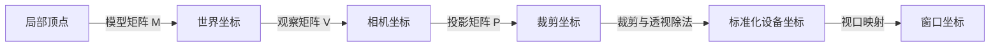

# Android OpenGL 矩阵 API 使用指南

本文介绍 `android.opengl.Matrix` 的数据约定、公共 API、变换顺序，以及在 OpenGL ES 渲染器中的实际用法。示例使用 Kotlin 和 OpenGL ES 2.0，适用于本项目中矩形、纹理、曲线等图形的变换。

本文只提供说明和示例，不修改项目中的 Activity 或 Renderer。

API 签名与实现细节依据本机 Android SDK API 35 源码核对，并对照 API 版本索引确认新增与弃用时间。矩阵计算本身在 CPU 上进行，不依赖当前是否存在 EGL 上下文；把矩阵传给 Shader 的 `glUniformMatrix4fv()` 才是 OpenGL 调用。

## 目录

1. [这个类负责什么](#1-这个类负责什么)
2. [矩阵数组、列主序和齐次坐标](#2-矩阵数组列主序和齐次坐标)
3. [公共 API 速查](#3-公共-api-速查)
4. [单位矩阵](#4-单位矩阵)
5. [缩放](#5-缩放)
6. [平移](#6-平移)
7. [旋转和指定中心变换](#7-旋转和指定中心变换)
8. [矩阵乘法与执行顺序](#8-矩阵乘法与执行顺序)
9. [用矩阵计算一个点](#9-用矩阵计算一个点)
10. [正交投影与宽高比](#10-正交投影与宽高比)
11. [透视投影](#11-透视投影)
12. [相机矩阵](#12-相机矩阵)
13. [模型、相机、投影矩阵的组合](#13-模型相机投影矩阵的组合)
14. [逆矩阵、转置和向量长度](#14-逆矩阵转置和向量长度)
15. [欧拉角 API 与版本限制](#15-欧拉角-api-与版本限制)
16. [输入输出数组和重叠限制](#16-输入输出数组和重叠限制)
17. [接入当前矩形渲染器](#17-接入当前矩形渲染器)
18. [完整的矩形变换示例](#18-完整的矩形变换示例)
19. [纹理矩阵与上下翻转](#19-纹理矩阵与上下翻转)
20. [常见问题与使用建议](#20-常见问题与使用建议)
21. [参考资料](#21-参考资料)

## 1. 这个类负责什么

使用时导入：

```kotlin
import android.opengl.Matrix
```

它提供 4 × 4 浮点矩阵和四维向量的计算方法，可以描述缩放、旋转、平移、相机观察以及投影。

| 类或 API | 主要职责 |
|---|---|
| `android.opengl.Matrix` | 在 CPU 上计算 4 × 4 矩阵 |
| `android.graphics.Matrix` | 常用于 Canvas、Bitmap、View 相关的二维 3 × 3 变换 |
| `GLES20.glUniformMatrix4fv()` | 把计算好的矩阵上传给当前 Shader 程序 |
| 顶点着色器中的 `矩阵 * 顶点` | 在 GPU 上逐顶点执行变换 |

`Matrix` 的方法都是静态方法，直接通过类名调用即可，不需要 `Matrix()` 实例。它也不会自动修改 VBO、顶点数组、View 的位置或 Android 布局。

## 2. 矩阵数组、列主序和齐次坐标

### 2.1 为什么使用 `FloatArray(16)`

一个 4 × 4 矩阵包含 16 个浮点数：

```kotlin
val modelMatrix = FloatArray(16)
```

新创建的数组全部为 `0f`，它还不是单位矩阵。如果直接用全零矩阵乘以顶点，会得到 `(0, 0, 0, 0)`，无法正常显示。

### 2.2 列主序如何对应数组下标

Android 的 OpenGL 矩阵使用列主序存储。以下是数学上按行显示的矩阵与数组下标的对应关系：

```text
┌                                    ┐
│ m[0]   m[4]   m[8]    m[12]         │
│ m[1]   m[5]   m[9]    m[13]         │
│ m[2]   m[6]   m[10]   m[14]         │
│ m[3]   m[7]   m[11]   m[15]         │
└                                    ┘
```

第 `row` 行、第 `column` 列对应：

```kotlin
val index = offset + column * 4 + row
```

行和列都从 `0` 开始。不要把文档中按行展示的 16 个数字，直接按行抄进数组；数组需要先存第一列，再存第二列。

对于常见的仿射矩阵：

- `m[0]`、`m[5]`、`m[10]` 在纯缩放矩阵中分别是 X、Y、Z 的缩放系数。
- `m[12]`、`m[13]`、`m[14]` 是平移分量。
- 只有在明确矩阵结构时才能直接读取这些含义。组合了旋转后，不能把对角线直接当成三个缩放系数。

### 2.3 `offset` 的单位是元素，不是字节

```kotlin
Matrix.setIdentityM(modelMatrix, 0)
```

这里的 `0` 表示从数组下标 0 开始写入 16 个元素。

一个数组也可以保存多个矩阵：

```kotlin
val matrices = FloatArray(32)

Matrix.setIdentityM(matrices, 0)
Matrix.setIdentityM(matrices, 16)
```

第二个矩阵从第 16 号元素开始，不是从第 16 个字节开始。输入输出矩阵各自至少需要从对应偏移开始保留 16 个元素；四维向量需要 4 个元素。

### 2.4 顶点为什么有第四个分量 `w`

GLSL 中通常把顶点写成列向量：

```text
v = [x, y, z, w]ᵀ
v' = M × v
```

常见用法是：

| 数据 | 常用表示 | 平移是否影响它 |
|---|---|---|
| 一个位置点 | `(x, y, z, 1)` | 是 |
| 一个方向向量 | `(x, y, z, 0)` | 对仿射变换而言，不受平移影响 |

如果着色器声明 `attribute vec4 aPosition`，而 `glVertexAttribPointer()` 只提供 3 个分量，缺失的第四分量默认是 `1`，所以本项目的位置属性可以直接参与 4 × 4 变换。

透视投影后的 `gl_Position` 是裁剪坐标，不应直接当作屏幕坐标。GPU 在裁剪后进行透视除法：

```text
xNdc = xClip / wClip
yNdc = yClip / wClip
zNdc = zClip / wClip
```

OpenGL ES 的标准裁剪条件是 `-w ≤ x、y、z ≤ w`；透视除法后的可见 NDC 范围是 `[-1, 1]`。只有 `w = 1` 时，才可以直接用 X、Y 是否在 `[-1, 1]` 内作简单判断。

## 3. 公共 API 速查

下面覆盖本机 API 35 中该类的公共静态计算方法。同名的原地与输出数组重载放在同一行。

| 方法 | 作用 | Android API |
|---|---|---|
| `setIdentityM()` | 写入单位矩阵 | 1 起 |
| `scaleM()` | 将缩放矩阵右乘到已有矩阵 | 1 起 |
| `translateM()` | 将平移矩阵右乘到已有矩阵 | 1 起 |
| `rotateM()` | 将轴角旋转矩阵右乘到已有矩阵 | 1 起 |
| `setRotateM()` | 覆盖写入轴角旋转矩阵 | 1 起 |
| `multiplyMM()` | 两个 4 × 4 矩阵相乘 | 1 起 |
| `multiplyMV()` | 4 × 4 矩阵乘四维向量 | 1 起 |
| `orthoM()` | 创建正交投影矩阵 | 1 起 |
| `frustumM()` | 通过近平面边界创建透视投影矩阵 | 1 起 |
| `perspectiveM()` | 通过视野角和宽高比创建透视投影矩阵 | 14 起 |
| `setLookAtM()` | 创建相机观察矩阵 | 8 起 |
| `invertM()` | 求逆矩阵，返回是否成功 | 1 起 |
| `transposeM()` | 求转置矩阵 | 1 起 |
| `length()` | 计算三维向量长度 | 1 起 |
| `setRotateEulerM()` | 旧欧拉角方法，Y 轴实现存在错误 | 1 起，34 弃用 |
| `setRotateEulerM2()` | 修正后的欧拉角方法 | 34 起 |

本项目 `minSdk = 24`，可以直接使用 `perspectiveM()`、`setLookAtM()` 等常用方法；调用 `setRotateEulerM2()` 仍需要考虑运行设备是否达到 API 34。

## 4. 单位矩阵

```kotlin
Matrix.setIdentityM(matrix, offset)
```

它会覆盖指定区域，得到：

```text
I =
┌             ┐
│ 1  0  0  0  │
│ 0  1  0  0  │
│ 0  0  1  0  │
│ 0  0  0  1  │
└             ┘
```

单位矩阵乘以顶点不会改变位置：`I × v = v`。

```kotlin
val modelMatrix = FloatArray(16)
Matrix.setIdentityM(modelMatrix, 0)
```

如果每一帧都根据当前缩放、角度和位置重新构建模型矩阵，先重置为单位矩阵，再追加变换。否则每帧调用 `scaleM(..., 0.9f, ...)` 会不断累乘，图形会越来越小。

这不是要求所有矩阵每帧都重置：投影矩阵通常在窗口尺寸变化时重建，相机矩阵在相机参数变化时重建。

## 5. 缩放

### 5.1 原地缩放

```kotlin
Matrix.scaleM(matrix, offset, scaleX, scaleY, scaleZ)
```

执行的是：`matrix = matrix × S`。

```kotlin
Matrix.setIdentityM(modelMatrix, 0)
Matrix.scaleM(modelMatrix, 0, 0.5f, 0.5f, 1f)
```

缩放矩阵为：

```text
S =
┌                 ┐
│ sx  0   0   0   │
│ 0   sy  0   0   │
│ 0   0   sz  0   │
│ 0   0   0   1   │
└                 ┘
```

原点附近的二维顶点 `(0.3, 0.3, 0, 1)` 经过以上变换，变成 `(0.15, 0.15, 0, 1)`。

| 参数 | 效果 |
|---|---|
| `(1, 1, 1)` | 保持原大小 |
| `(2, 2, 1)` | 二维宽、高分别放大到两倍 |
| `(0.5, 1, 1)` | 宽度变为一半，高度不变 |
| `(-1, 1, 1)` | 围绕原点左右镜像 |
| `(1, -1, 1)` | 围绕原点上下镜像 |

二维场景通常让 Z 的缩放保持为 `1`。把某个轴缩放为 `0` 会让整个矩阵不可逆；负缩放还可能改变三角形绕向，如果启用了面剔除，需要一并考虑。

### 5.2 输出到另一个数组

```kotlin
Matrix.scaleM(
    resultMatrix, 0,
    sourceMatrix, 0,
    0.5f, 0.5f, 1f
)
```

结果是 `resultMatrix = sourceMatrix × S`，源矩阵保持不变。此重载要求源与目标的有效区域不重叠；希望原地修改时使用上一节的原地重载。

## 6. 平移

### 6.1 原地平移

```kotlin
Matrix.translateM(matrix, offset, x, y, z)
```

执行的是：`matrix = matrix × T`。

```kotlin
Matrix.setIdentityM(modelMatrix, 0)
Matrix.translateM(modelMatrix, 0, 0.4f, -0.2f, 0f)
```

平移矩阵为：

```text
T =
┌                 ┐
│ 1  0  0   tx    │
│ 0  1  0   ty    │
│ 0  0  1   tz    │
│ 0  0  0   1     │
└                 ┘
```

对 `w = 1` 的点：

```text
x' = x + tx
y' = y + ty
z' = z + tz
```

位移单位取决于坐标系，不一定是像素。未使用投影时，`0.4f` 是裁剪空间中的位置变化；采用以世界单位建立的模型和投影后，它表示相应世界坐标中的位移。

### 6.2 输出到另一个数组

```kotlin
Matrix.translateM(
    resultMatrix, 0,
    sourceMatrix, 0,
    0.4f, -0.2f, 0f
)
```

结果是 `resultMatrix = sourceMatrix × T`，源与目标的有效区域不能重叠。

### 6.3 为什么平移量有时也被缩放或旋转了

因为 `translateM()` 会右乘到已有矩阵。如果已有矩阵是缩放矩阵，结果就是 `S × T`，顶点先平移，再缩放，平移效果也会被缩放。

```kotlin
Matrix.setIdentityM(modelMatrix, 0)
Matrix.scaleM(modelMatrix, 0, 2f, 2f, 1f)
Matrix.translateM(modelMatrix, 0, 0.3f, 0f, 0f)
```

这里原点最后会移动到 X = `0.6`，并不是 `0.3`。同理，在已有旋转矩阵后右乘平移，位移方向也会随已有旋转改变。

## 7. 旋转和指定中心变换

### 7.1 `setRotateM()`：创建一个旋转矩阵

```kotlin
Matrix.setRotateM(matrix, offset, angleDegrees, axisX, axisY, axisZ)
```

它会覆盖矩阵，而不是在原矩阵后追加旋转。

```kotlin
// 绕 Z 轴旋转 45 度
Matrix.setRotateM(modelMatrix, 0, 45f, 0f, 0f, 1f)
```

| 旋转轴 | 参数 |
|---|---|
| X 轴 | `(1f, 0f, 0f)` |
| Y 轴 | `(0f, 1f, 0f)` |
| Z 轴 | `(0f, 0f, 1f)` |
| 自定义轴 | 非零方向，例如 `(1f, 1f, 0f)` |

角度单位是度，不是弧度。该方法会对一般的非单位旋转轴进行归一化，但不能传 `(0, 0, 0)`。

旋转遵循右手规则。在 X 向右、Y 向上、没有额外坐标翻转的二维观察下，绕正 Z 轴旋转 `90°` 会把 `(1, 0)` 变成 `(0, 1)`，视觉上是逆时针。若投影把 Y 改成向下，视觉方向也会改变。

### 7.2 `rotateM()`：追加旋转

```kotlin
Matrix.rotateM(matrix, offset, angleDegrees, axisX, axisY, axisZ)
```

执行的是：`matrix = matrix × R`。

```kotlin
Matrix.setIdentityM(modelMatrix, 0)
Matrix.translateM(modelMatrix, 0, 0.5f, 0f, 0f)
Matrix.rotateM(modelMatrix, 0, 45f, 0f, 0f, 1f)
```

结果为 `T × R`，对于顶点而言，先绕原点旋转，再整体平移。

它也有独立输出重载：

```kotlin
Matrix.rotateM(
    resultMatrix, 0,
    sourceMatrix, 0,
    45f, 0f, 0f, 1f
)
```

结果是 `sourceMatrix × R`。独立输出重载按文档要求使用不重叠的区域；原地修改使用原地重载。

### 7.3 围绕指定点旋转或缩放

默认变换中心是局部坐标原点。如果要围绕 `(pivotX, pivotY)` 旋转，构造：

```text
M = T(pivot) × R × T(-pivot)
```

```kotlin
val pivotX = 0.3f
val pivotY = 0.2f

Matrix.setIdentityM(modelMatrix, 0)
Matrix.translateM(modelMatrix, 0, pivotX, pivotY, 0f)
Matrix.rotateM(modelMatrix, 0, 45f, 0f, 0f, 1f)
Matrix.translateM(modelMatrix, 0, -pivotX, -pivotY, 0f)
```

顶点实际经历：先把中心移到原点，再旋转，最后移回原位置。把中间的 `rotateM()` 换成 `scaleM()`，就可以围绕指定点缩放。

矩形顶点本来就以原点为中心时，不需要额外移动中心。

## 8. 矩阵乘法与执行顺序

### 8.1 `multiplyMM()`

```kotlin
Matrix.multiplyMM(
    resultMatrix, resultOffset,
    leftMatrix, leftOffset,
    rightMatrix, rightOffset
)
```

计算结果是：

```text
result = left × right
result × vertex = left × (right × vertex)
```

所以对顶点来说，右边的矩阵先执行。矩阵乘法通常不满足交换律：`T × S ≠ S × T`。

### 8.2 常见的模型变换组合

```kotlin
Matrix.setIdentityM(modelMatrix, 0)
Matrix.translateM(modelMatrix, 0, translateX, translateY, 0f)
Matrix.rotateM(modelMatrix, 0, angle, 0f, 0f, 1f)
Matrix.scaleM(modelMatrix, 0, scaleX, scaleY, 1f)
```

代码从上到下构建：

```text
M = T × R × S
```

顶点实际从右往左经历：

```text
局部顶点 → 缩放 → 旋转 → 平移 → 世界坐标
```

这样通常可以实现“图形在自身原点附近缩放旋转，然后放到目标位置”。

### 8.3 用数字验证顺序

让点 `(1, 0, 0, 1)` 沿 X 放大两倍，再沿 X 平移 3：

```text
T × S：1 × 2 + 3 = 5
S × T：(1 + 3) × 2 = 8
```

```kotlin
val translation = FloatArray(16)
val scaling = FloatArray(16)
val resultMatrix = FloatArray(16)
val resultPoint = FloatArray(4)
val point = floatArrayOf(1f, 0f, 0f, 1f)

Matrix.setIdentityM(translation, 0)
Matrix.translateM(translation, 0, 3f, 0f, 0f)

Matrix.setIdentityM(scaling, 0)
Matrix.scaleM(scaling, 0, 2f, 1f, 1f)

Matrix.multiplyMM(resultMatrix, 0, translation, 0, scaling, 0)
Matrix.multiplyMV(resultPoint, 0, resultMatrix, 0, point, 0)
// resultPoint 约为 [5, 0, 0, 1]

Matrix.multiplyMM(resultMatrix, 0, scaling, 0, translation, 0)
Matrix.multiplyMV(resultPoint, 0, resultMatrix, 0, point, 0)
// resultPoint 约为 [8, 0, 0, 1]
```

浮点计算存在误差，验证时应使用容差，不应要求所有结果逐位相等。

## 9. 用矩阵计算一个点

### 9.1 `multiplyMV()`

```kotlin
Matrix.multiplyMV(
    resultVector, resultOffset,
    matrix, matrixOffset,
    vector, vectorOffset
)
```

它在 CPU 上计算 `resultVector = matrix × vector`。向量必须包含四个元素。

```kotlin
val point = floatArrayOf(0.3f, 0.3f, 0f, 1f)
val result = FloatArray(4)

Matrix.multiplyMV(result, 0, modelMatrix, 0, point, 0)
```

它适合验证变换结果、转换少量坐标。绘制大量顶点时，通常把矩阵上传给顶点着色器，由 GPU 处理所有顶点，无须每帧在 CPU 上改写整个顶点数组。

### 9.2 透视投影后仍需处理 `w`

`multiplyMV()` 只做乘法，不会自动进行透视除法或视口映射：

```kotlin
val clip = FloatArray(4)
Matrix.multiplyMV(clip, 0, mvpMatrix, 0, point, 0)

// 这里只演示除法；实际还要根据用途检查裁剪范围和点是否位于相机前方
if (kotlin.math.abs(clip[3]) > 1e-6f) {
    val xNdc = clip[0] / clip[3]
    val yNdc = clip[1] / clip[3]

    // 假设视口覆盖整个 View，转换为左上角原点的 View 像素坐标
    val screenX = (xNdc + 1f) * 0.5f * width
    val screenY = (1f - yNdc) * 0.5f * height
}
```

`width`、`height` 是实际视口的像素尺寸。若视口只占 View 的一部分，还需要计入视口偏移。屏幕点反推三维位置时只有 X、Y 不够，通常还需要深度，或用近、远平面两点建立拾取射线。

## 10. 正交投影与宽高比

### 10.1 `orthoM()`

```kotlin
Matrix.orthoM(
    projectionMatrix, 0,
    left, right,
    bottom, top,
    near, far
)
```

它会覆盖输出矩阵。正交投影不会产生近大远小效果，适合二维图形、UI 和函数曲线。

| 参数 | 含义 |
|---|---|
| `left`、`right` | 可视区域左右边界 |
| `bottom`、`top` | 可视区域下、上边界 |
| `near`、`far` | 按 OpenGL 约定描述 Z 裁剪平面；对应观察空间的 `z = -near`、`z = -far` |

必须保证 `left != right`、`bottom != top`、`near != far`。正交投影允许使用跨越零点的 near/far；这和要求正距离的透视投影不同。

### 10.2 为什么不处理宽高比会拉伸

假设视口是 1080 × 1920，X、Y 都使用 `[-1, 1]`。同样长度的 X、Y 坐标分别映射到不同数量的像素，数学上的正方形看起来会变成长方形。

常见处理方式是在 `onSurfaceChanged()` 中调整可视范围：

```kotlin
override fun onSurfaceChanged(gl: GL10?, width: Int, height: Int) {
    GLES20.glViewport(0, 0, width, height)
    if (width <= 0 || height <= 0) return

    val aspect = width.toFloat() / height.toFloat()

    if (aspect >= 1f) {
        // 横屏：Y 范围不变，扩大 X 方向的可视范围
        Matrix.orthoM(
            projectionMatrix, 0,
            -aspect, aspect,
            -1f, 1f,
            -1f, 1f
        )
    } else {
        // 竖屏：X 范围不变，扩大 Y 方向的可视范围
        Matrix.orthoM(
            projectionMatrix, 0,
            -1f, 1f,
            -1f / aspect, 1f / aspect,
            -1f, 1f
        )
    }
}
```

在相机矩阵为单位矩阵、模型没有非等比缩放的前提下，这样 X、Y 的一个世界单位会对应相同数量的像素。不要再重复对模型额外乘一次同样的宽高比修正。

### 10.3 建立类似 Android View 的像素坐标系

```kotlin
Matrix.orthoM(
    projectionMatrix, 0,
    0f, width.toFloat(),
    height.toFloat(), 0f,
    -1f, 1f
)
```

这里特意把 `bottom` 设为 `height`、`top` 设为 `0`，得到左上角为原点、X 向右、Y 向下的坐标约定。此时顶点和平移量可以用视口像素单位表达，旋转的视觉方向也会随 Y 轴翻转而改变。

## 11. 透视投影

### 11.1 `perspectiveM()`

```kotlin
Matrix.perspectiveM(
    projectionMatrix, 0,
    fieldOfViewY,
    aspect,
    near,
    far
)
```

| 参数 | 含义 |
|---|---|
| `fieldOfViewY` | 垂直视野角，单位为度 |
| `aspect` | 视口宽度 / 高度，必须使用浮点除法 |
| `near` | 近平面距离，必须大于 0 |
| `far` | 远平面距离，正常使用要求大于 near |

```kotlin
val aspect = width.toFloat() / height.toFloat()

Matrix.perspectiveM(
    projectionMatrix, 0,
    45f,
    aspect,
    0.1f,
    100f
)
```

正常参数要求是 `0 < fieldOfViewY < 180`、`aspect > 0`、`0 < near < far`。不要假设每种无效参数都会被该方法主动检查并抛异常。

标准观察空间中，相机看向负 Z 方向。需要让物体位于相机前方，例如使用观察矩阵把位于原点的物体变换到 `z = -3`。

如果只加透视矩阵，而物体仍处于观察空间 `z = 0`，可能得到 `wClip = 0`，无法正常显示。透视投影不是把原来二维代码中的单位矩阵随意替换一下就能完成的，还要安排相机或物体的 Z 位置。

近平面过度接近 0、远近平面跨度过大，会降低深度区分能力。绘制真正互相遮挡的三维物体，还需要深度缓冲、启用深度测试，并清理深度缓冲；仅创建透视矩阵不会自动完成遮挡处理。

### 11.2 `frustumM()`

```kotlin
Matrix.frustumM(
    projectionMatrix, 0,
    left, right,
    bottom, top,
    near, far
)
```

它根据近平面上的左右、上下边界构建透视投影，适合需要非对称视锥等场景。这里的边界是近平面上的位置，不是所有深度共享的固定可视范围。

对于对称视锥：

```text
top = near × tan(fovy / 2)
bottom = -top
right = top × aspect
left = -right
```

```kotlin
val fovy = 45f
val near = 0.1f
val far = 100f
val aspect = width.toFloat() / height.toFloat()
val halfAngle = Math.toRadians(fovy.toDouble() / 2.0)
val top = (near * kotlin.math.tan(halfAngle)).toFloat()
val right = top * aspect

Matrix.frustumM(
    projectionMatrix, 0,
    -right, right,
    -top, top,
    near, far
)
```

以上对称视锥与相同参数的 `perspectiveM()` 对应。注意 `tan()` 接收弧度，而 `perspectiveM()` 接收角度。

## 12. 相机矩阵

### 12.1 `setLookAtM()`

```kotlin
Matrix.setLookAtM(
    viewMatrix, 0,
    eyeX, eyeY, eyeZ,
    centerX, centerY, centerZ,
    upX, upY, upZ
)
```

| 参数组 | 含义 |
|---|---|
| `eye` | 相机在世界坐标中的位置 |
| `center` | 相机看向的目标位置，不是方向向量 |
| `up` | 用来确定相机上方的参考方向，不是一个位置点 |

例如相机位于 `(0, 0, 3)`，看向原点，Y 轴朝上：

```kotlin
Matrix.setLookAtM(
    viewMatrix, 0,
    0f, 0f, 3f,
    0f, 0f, 0f,
    0f, 1f, 0f
)
```

原点经过这个观察矩阵后会变成 `(0, 0, -3)`，可以配合透视投影使用。

观察矩阵描述的是把世界变换到相机坐标系，包含相机姿态的逆变换。不能简单把 `eye` 当成物体平移量直接写入模型矩阵。

### 12.2 避免无效相机参数

- `eye` 不能与 `center` 重合，否则没有观察方向。
- `up` 不能是零向量。
- `up` 不能与观察方向平行或反平行，否则无法建立相机的右方向。

无效参数可能产生非有限值，不应依赖该方法自动报错。

## 13. 模型、相机、投影矩阵的组合

### 13.1 三种矩阵的职责

| 矩阵 | 常用变量 | 作用 |
|---|---|---|
| Model | `modelMatrix` | 局部坐标变换到世界坐标，描述物体自身位置、旋转和大小 |
| View | `viewMatrix` | 世界坐标变换到相机坐标，描述从哪里观察 |
| Projection | `projectionMatrix` | 相机坐标变换到裁剪坐标，描述投影方式和可视范围 |



组合公式为：

```text
gl_Position = P × V × M × aPosition
MVP = P × V × M
```

### 13.2 用 `multiplyMM()` 组合

```kotlin
val viewModelMatrix = FloatArray(16)
val mvpMatrix = FloatArray(16)

// 先计算 V × M
Matrix.multiplyMM(
    viewModelMatrix, 0,
    viewMatrix, 0,
    modelMatrix, 0
)

// 再计算 P × (V × M)
Matrix.multiplyMM(
    mvpMatrix, 0,
    projectionMatrix, 0,
    viewModelMatrix, 0
)
```

不要把顺序写成 `M × V × P`。本例复用中间数组，每帧只更新数值，不需要每帧重新分配数组。

### 13.3 在着色器中使用

```glsl
attribute vec4 aPosition;
uniform mat4 uMvpMatrix;

void main() {
    gl_Position = uMvpMatrix * aPosition;
}
```

程序成功链接后，获取位置：

```kotlin
val uMvpMatrixLocation =
    GLES20.glGetUniformLocation(program, "uMvpMatrix")
```

绘制前，在对应程序已经被 `glUseProgram()` 选中后上传：

```kotlin
GLES20.glUseProgram(program)
GLES20.glUniformMatrix4fv(
    uMvpMatrixLocation,
    1,
    false,
    mvpMatrix,
    0
)
```

| 参数 | 含义 |
|---|---|
| 第 1 个 | uniform 的位置，不是 program 编号 |
| `1` | 上传一个 4 × 4 矩阵，不是 16 |
| `false` | 不转置；OpenGL ES 中必须为 false |
| `mvpMatrix` | 按列主序存放矩阵的数组 |
| `0` | 从数组的第 0 个元素读取 |

矩阵 uniform 在程序成功链接后默认为零矩阵，必须在第一次绘制前赋予有效矩阵。程序重新创建或重新链接后，也需要重新获取位置并上传数据。

## 14. 逆矩阵、转置和向量长度

### 14.1 `invertM()`：求逆矩阵

```kotlin
val success = Matrix.invertM(
    inverseMatrix, 0,
    sourceMatrix, 0
)
```

逆矩阵满足：

```text
M⁻¹ × M = I
```

例如可以把世界坐标还原为模型局部坐标：

```kotlin
val inverseModel = FloatArray(16)
val localPoint = FloatArray(4)
val worldPoint = floatArrayOf(0.5f, 0.2f, 0f, 1f)

if (Matrix.invertM(inverseModel, 0, modelMatrix, 0)) {
    Matrix.multiplyMV(localPoint, 0, inverseModel, 0, worldPoint, 0)
} else {
    // 当前矩阵不可逆，不使用输出数组中的结果
}
```

某个轴缩放为 0 时矩阵不可逆，方法返回 `false`。即使返回 `true`，接近奇异的矩阵仍可能产生较大的数值误差。

输入和输出有效区域不能重叠。对包含投影的逆变换，还需要正确处理齐次坐标和透视除法。

### 14.2 `transposeM()`：转置

```kotlin
Matrix.transposeM(
    transposedMatrix, 0,
    sourceMatrix, 0
)
```

转置交换矩阵的行和列：`result[row, column] = source[column, row]`。

它不是把物体旋转 90 度，也不是修复纹理上下颠倒的通用方法，更不是从 Android 数组上传到 GLSL 前必做的操作。

输入输出有效区域不能重叠，不要直接对同一段数组原地转置。

### 14.3 法线为什么可能需要逆转置

有非等比缩放时，不能直接把模型矩阵当成法线变换矩阵。常用法线矩阵是相关线性变换的逆转置：

```text
N = transpose(inverse(M))
```

如果在观察空间做光照，则应以模型观察矩阵 `V × M` 为基础计算。使用其左上角 3 × 3 部分处理法线，并重新归一化。

```kotlin
val inverse = FloatArray(16)
val inverseTranspose = FloatArray(16)

if (Matrix.invertM(inverse, 0, modelMatrix, 0)) {
    Matrix.transposeM(inverseTranspose, 0, inverse, 0)
}
```

二维无光照的矩形和普通纹理显示通常不需要这一步。

### 14.4 `length()`：向量长度

```kotlin
val length = Matrix.length(3f, 4f, 0f)
// length = 5f
```

计算 `sqrt(x² + y² + z²)`，不是矩阵元素数量，也不是两点距离。计算两点距离时，先对坐标作差；手动归一化时，先确认长度不为 0，再分别除以长度。

## 15. 欧拉角 API 与版本限制

### 15.1 避免使用 `setRotateEulerM()`

```kotlin
// 旧 API，避免在新代码中使用
Matrix.setRotateEulerM(matrix, 0, angleX, angleY, angleZ)
```

官方源码明确说明该方法绕 Y 轴的实现存在错误，它在 API 34 被弃用。不要为了兼容旧系统，直接把这个有问题的方法作为新方法的替代方案。

### 15.2 `setRotateEulerM2()`

```kotlin
// 要求运行设备为 API 34 或以上
Matrix.setRotateEulerM2(matrix, 0, angleX, angleY, angleZ)
```

三个角度均以度为单位。此方法覆盖输出矩阵，需要足够的数组容量和合法偏移。

欧拉角还涉及旋转顺序和正负方向约定，不应默认它等价于任意三个正角度的 `rotateM()` 调用。在本次核对的 API 35 实现中，`setRotateEulerM2(..., 0, 0, 90)` 与轴角方法 `setRotateM(..., -90, 0, 0, 1)` 得到相同的 Z 轴旋转效果。选择该 API 前，先确认其约定符合你的数据来源。

对当前二维图形，使用 `setRotateM()` 或 `rotateM()` 绕 Z 轴旋转更直接。三维场景需要明确的顺序时，也可以显式组合：

```kotlin
Matrix.setIdentityM(modelMatrix, 0)
Matrix.rotateM(modelMatrix, 0, angleZ, 0f, 0f, 1f)
Matrix.rotateM(modelMatrix, 0, angleY, 0f, 1f, 0f)
Matrix.rotateM(modelMatrix, 0, angleX, 1f, 0f, 0f)
```

这里构建的是 `Rz × Ry × Rx`，顶点先绕 X，再绕 Y，最后绕 Z。它是一套明确的轴角组合约定，不是在声称与 `setRotateEulerM2()` 等价。

## 16. 输入输出数组和重叠限制

同一个数组能不能同时作为输入和输出，不能一概而论。

| 方法或重载 | 建议与约定 |
|---|---|
| 原地 `scaleM()`、`translateM()`、`rotateM()` | 专门用于修改当前矩阵 |
| 独立输出的 `scaleM()`、`translateM()`、`rotateM()` | 按方法文档要求，输入输出有效区域不重叠 |
| `transposeM()`、`invertM()` | 输入输出有效区域不能重叠 |
| `multiplyMM()`、`multiplyMV()` | 本次核对的 API 35 文档与实现支持输入输出重叠；本文仍使用独立结果数组，避免依赖不同旧系统实现的细节 |

“不重叠”针对的是实际使用的数组区域：一个大数组里相隔 16 个元素存放的两个矩阵可以互不重叠。

初学时采用下面的写法最容易检查顺序：

```kotlin
Matrix.multiplyMM(result, 0, left, 0, right, 0)
```

其中三个数组相互独立。不要因为某个 API 在某个系统上恰好允许重叠，就把同样的使用方式套用到所有矩阵方法。

## 17. 接入当前矩形渲染器

当前矩形渲染器通过 `uniform vec2 uScale` 缩放顶点。改成矩阵后，可以同时控制平移、旋转和缩放，并继续使用原来的交错顶点颜色数据。

### 17.1 顶点着色器

将 `uScale` 替换为 `uMvpMatrix`，删除原来的 `position.xy *= uScale`，避免重复缩放：

```kotlin
private val vertexShaderCode = """
    attribute vec4 aPosition;
    attribute vec4 aColor;
    uniform mat4 uMvpMatrix;

    varying mediump vec4 vColor;

    void main() {
        gl_Position = uMvpMatrix * aPosition;
        vColor = aColor;
    }
""".trimIndent()
```

片元着色器和原来每个顶点的 `x、y、z、r、g、b、a` 格式保持不变。

### 17.2 成员变量

```kotlin
private val modelMatrix = FloatArray(16)
private val viewMatrix = FloatArray(16)
private val projectionMatrix = FloatArray(16)
private val viewModelMatrix = FloatArray(16)
private val mvpMatrix = FloatArray(16)

private var uMvpMatrixLocation = -1
private var angle = 0f
private var translateX = 0f
private var translateY = 0f
```

原来的 `scaleX`、`scaleY` 和 `setScale()` 可以继续保留，删除不再使用的 `uScaleLocation`。

### 17.3 初始化

在 `onSurfaceCreated()` 中，程序成功链接后获取 uniform 位置，并初始化观察和投影矩阵：

```kotlin
uMvpMatrixLocation =
    GLES20.glGetUniformLocation(program, "uMvpMatrix")

Matrix.setIdentityM(viewMatrix, 0)
Matrix.setIdentityM(projectionMatrix, 0)
```

在 `onSurfaceChanged()` 中按第 10 节的示例更新正交投影矩阵。

### 17.4 绘制前更新矩阵

在 `onDrawFrame()` 的 `glUseProgram(program)` 后添加以下代码，并删除原来的 `glUniform2f(uScaleLocation, ...)`：

```kotlin
Matrix.setIdentityM(modelMatrix, 0)
Matrix.translateM(modelMatrix, 0, translateX, translateY, 0f)
Matrix.rotateM(modelMatrix, 0, angle, 0f, 0f, 1f)
Matrix.scaleM(modelMatrix, 0, scaleX, scaleY, 1f)

Matrix.multiplyMM(viewModelMatrix, 0, viewMatrix, 0, modelMatrix, 0)
Matrix.multiplyMM(mvpMatrix, 0, projectionMatrix, 0, viewModelMatrix, 0)

GLES20.glUniformMatrix4fv(uMvpMatrixLocation, 1, false, mvpMatrix, 0)
```

后续顶点属性、颜色属性和绘制调用保持原来的逻辑。模型矩阵是在 CPU 上计算的；只有上传 uniform 和实际绘制需要在当前 GL 上下文的线程中进行。

### 17.5 页面更新缩放状态

```kotlin
glSurfaceView.queueEvent {
    renderer.setScale(0.5f, 0.5f)
}
glSurfaceView.requestRender()
```

数学方法本身不要求 GL 线程；这里通过 `queueEvent()` 更新状态，是为了让修改和绘制都发生在同一线程，避免 UI 线程与 GL 线程同时访问共享状态。

## 18. 完整的矩形变换示例

以下是独立教学示例：四个带颜色的顶点组成矩形，使用正交投影保持宽高比，并通过模型矩阵控制平移、旋转和缩放。采用 OpenGL ES 2.0，不依赖 VAO 或 ES 3.0。

```kotlin
import android.opengl.GLES20
import android.opengl.GLSurfaceView
import android.opengl.Matrix
import java.nio.ByteBuffer
import java.nio.ByteOrder
import javax.microedition.khronos.egl.EGLConfig
import javax.microedition.khronos.opengles.GL10

class MatrixDemoRenderer : GLSurfaceView.Renderer {

    private val vertexShaderSource = """
        attribute vec4 aPosition;
        attribute vec4 aColor;
        uniform mat4 uMvpMatrix;
        varying mediump vec4 vColor;

        void main() {
            gl_Position = uMvpMatrix * aPosition;
            vColor = aColor;
        }
    """.trimIndent()

    private val fragmentShaderSource = """
        precision mediump float;
        varying mediump vec4 vColor;

        void main() {
            gl_FragColor = vColor;
        }
    """.trimIndent()

    // 每个顶点包含位置 XYZ 和颜色 RGBA
    private val vertices = floatArrayOf(
        -0.5f,  0.5f, 0f, 1f, 0f, 0f, 1f,
        -0.5f, -0.5f, 0f, 0f, 1f, 0f, 1f,
         0.5f,  0.5f, 0f, 0f, 0f, 1f, 1f,
         0.5f, -0.5f, 0f, 1f, 1f, 0f, 1f
    )

    private val vertexBuffer = ByteBuffer
        .allocateDirect(vertices.size * 4)
        .order(ByteOrder.nativeOrder())
        .asFloatBuffer()
        .apply {
            put(vertices)
            position(0)
        }

    private val modelMatrix = FloatArray(16)
    private val viewMatrix = FloatArray(16)
    private val projectionMatrix = FloatArray(16)
    private val viewModelMatrix = FloatArray(16)
    private val mvpMatrix = FloatArray(16)

    private var program = 0
    private var positionLocation = -1
    private var colorLocation = -1
    private var matrixLocation = -1

    private var scaleX = 1f
    private var scaleY = 1f
    private var angle = 0f
    private var translateX = 0f
    private var translateY = 0f

    override fun onSurfaceCreated(gl: GL10?, config: EGLConfig?) {
        GLES20.glClearColor(0.08f, 0.08f, 0.08f, 1f)

        // 上下文重建后，需要重新创建程序并获取 uniform、attribute 位置
        program = createProgram(vertexShaderSource, fragmentShaderSource)
        positionLocation = GLES20.glGetAttribLocation(program, "aPosition")
        colorLocation = GLES20.glGetAttribLocation(program, "aColor")
        matrixLocation = GLES20.glGetUniformLocation(program, "uMvpMatrix")

        Matrix.setIdentityM(viewMatrix, 0)
        Matrix.setIdentityM(projectionMatrix, 0)
    }

    override fun onSurfaceChanged(gl: GL10?, width: Int, height: Int) {
        GLES20.glViewport(0, 0, width, height)
        if (width <= 0 || height <= 0) return

        val aspect = width.toFloat() / height.toFloat()
        if (aspect >= 1f) {
            Matrix.orthoM(
                projectionMatrix, 0,
                -aspect, aspect, -1f, 1f, -1f, 1f
            )
        } else {
            Matrix.orthoM(
                projectionMatrix, 0,
                -1f, 1f, -1f / aspect, 1f / aspect, -1f, 1f
            )
        }
    }

    override fun onDrawFrame(gl: GL10?) {
        GLES20.glClear(GLES20.GL_COLOR_BUFFER_BIT)
        GLES20.glUseProgram(program)

        // 构建 T × R × S，顶点实际先缩放，再旋转，最后平移
        Matrix.setIdentityM(modelMatrix, 0)
        Matrix.translateM(modelMatrix, 0, translateX, translateY, 0f)
        Matrix.rotateM(modelMatrix, 0, angle, 0f, 0f, 1f)
        Matrix.scaleM(modelMatrix, 0, scaleX, scaleY, 1f)

        Matrix.multiplyMM(viewModelMatrix, 0, viewMatrix, 0, modelMatrix, 0)
        Matrix.multiplyMM(mvpMatrix, 0, projectionMatrix, 0, viewModelMatrix, 0)
        GLES20.glUniformMatrix4fv(matrixLocation, 1, false, mvpMatrix, 0)

        // 本示例使用客户端缓冲区，确保没有绑定顶点 VBO
        GLES20.glBindBuffer(GLES20.GL_ARRAY_BUFFER, 0)

        vertexBuffer.position(0)
        GLES20.glVertexAttribPointer(
            positionLocation, 3, GLES20.GL_FLOAT, false, 7 * 4, vertexBuffer
        )
        GLES20.glEnableVertexAttribArray(positionLocation)

        vertexBuffer.position(3)
        GLES20.glVertexAttribPointer(
            colorLocation, 4, GLES20.GL_FLOAT, false, 7 * 4, vertexBuffer
        )
        GLES20.glEnableVertexAttribArray(colorLocation)

        GLES20.glDrawArrays(GLES20.GL_TRIANGLE_STRIP, 0, 4)

        GLES20.glDisableVertexAttribArray(positionLocation)
        GLES20.glDisableVertexAttribArray(colorLocation)
    }

    // 通过 GLSurfaceView.queueEvent() 在 GL 线程调用
    fun setTransform(
        sx: Float,
        sy: Float,
        angleDegrees: Float,
        tx: Float,
        ty: Float
    ) {
        scaleX = sx
        scaleY = sy
        angle = angleDegrees
        translateX = tx
        translateY = ty
    }

    private fun compileShader(type: Int, source: String): Int {
        val shader = GLES20.glCreateShader(type)
        check(shader != 0) { "无法创建着色器" }
        GLES20.glShaderSource(shader, source)
        GLES20.glCompileShader(shader)

        val status = IntArray(1)
        GLES20.glGetShaderiv(shader, GLES20.GL_COMPILE_STATUS, status, 0)
        if (status[0] == 0) {
            val message = GLES20.glGetShaderInfoLog(shader)
            GLES20.glDeleteShader(shader)
            error("着色器编译失败：$message")
        }
        return shader
    }

    private fun createProgram(vertexSource: String, fragmentSource: String): Int {
        val vertexShader = compileShader(GLES20.GL_VERTEX_SHADER, vertexSource)
        try {
            val fragmentShader = compileShader(
                GLES20.GL_FRAGMENT_SHADER, fragmentSource
            )
            try {
                val linkedProgram = GLES20.glCreateProgram()
                check(linkedProgram != 0) { "无法创建着色器程序" }
                GLES20.glAttachShader(linkedProgram, vertexShader)
                GLES20.glAttachShader(linkedProgram, fragmentShader)
                GLES20.glLinkProgram(linkedProgram)

                val status = IntArray(1)
                GLES20.glGetProgramiv(
                    linkedProgram, GLES20.GL_LINK_STATUS, status, 0
                )
                if (status[0] == 0) {
                    val message = GLES20.glGetProgramInfoLog(linkedProgram)
                    GLES20.glDeleteProgram(linkedProgram)
                    error("着色器程序链接失败：$message")
                }
                return linkedProgram
            } finally {
                GLES20.glDeleteShader(fragmentShader)
            }
        } finally {
            GLES20.glDeleteShader(vertexShader)
        }
    }
}
```

页面中的核心接入方式：

```kotlin
val renderer = MatrixDemoRenderer()
val glSurfaceView = GLSurfaceView(this).apply {
    setEGLContextClientVersion(2)
    setRenderer(renderer)
    renderMode = GLSurfaceView.RENDERMODE_WHEN_DIRTY
}
setContentView(glSurfaceView)

glSurfaceView.queueEvent {
    renderer.setTransform(
        sx = 0.8f,
        sy = 0.8f,
        angleDegrees = 30f,
        tx = 0.2f,
        ty = 0f
    )
}
glSurfaceView.requestRender()
```

Activity 仍需像项目现有代码一样，在生命周期中调用 `glSurfaceView.onResume()`、`glSurfaceView.onPause()`。用于生命周期回调的 View 应保存为成员变量。

以上示例通过客户端 `FloatBuffer` 提供顶点。如果以后改用 VBO 或 VAO，矩阵的构建、MVP 顺序与 uniform 上传方式仍然相同。

## 19. 纹理矩阵与上下翻转

位置矩阵变换的是物体顶点，纹理矩阵变换的是采样坐标，二者可以分别控制。

### 19.1 用矩阵实现 `v = 1 - v`

对覆盖整个纹理的标准 UV 坐标，可以构造：

```text
u' = u
v' = 1 - v

F = T(0, 1, 0) × S(1, -1, 1)
```

```kotlin
val textureMatrix = FloatArray(16)
Matrix.setIdentityM(textureMatrix, 0)
Matrix.translateM(textureMatrix, 0, 0f, 1f, 0f)
Matrix.scaleM(textureMatrix, 0, 1f, -1f, 1f)
```

顶点着色器中分别处理位置和纹理坐标：

```glsl
attribute vec4 aPosition;
attribute vec2 aTexCoord;
uniform mat4 uMvpMatrix;
uniform mat4 uTexMatrix;
varying vec2 vTexCoord;

void main() {
    gl_Position = uMvpMatrix * aPosition;
    vTexCoord = (uTexMatrix * vec4(aTexCoord, 0.0, 1.0)).xy;
}
```

纹理矩阵也需要单独获取 uniform 位置，并通过 `glUniformMatrix4fv()` 上传。这里没有移动矩形本身，只改变它从图片的什么位置取样。

如果只做一次简单翻转，直接写 `vec2(u, 1.0 - v)` 就足够；需要组合裁剪、旋转、镜像时，矩阵更方便。只使用图集中的局部区域 `[vMin, vMax]` 时，应围绕该区域翻转，即 `v' = vMin + vMax - v`，不能直接套用整个纹理的 `1 - v`。

### 19.2 相机和视频纹理

对于 `SurfaceTexture`，在 GL 线程更新图像后取得系统提供的纹理矩阵：

```kotlin
surfaceTexture.updateTexImage()
surfaceTexture.getTransformMatrix(surfaceTextureMatrix)
```

这个矩阵可能包含生产者坐标修正和裁剪等变换，不应无条件用一个自定义翻转矩阵替代。若还要增加自定义 UV 变换，先明确希望在哪个坐标系应用：

```text
最终纹理矩阵 = 系统纹理矩阵 × 自定义纹理矩阵
```

此顺序表示先在输入 UV 上执行自定义变换，再映射到生产者的纹理区域；把乘法顺序交换会得到不同结果。

## 20. 常见问题与使用建议

| 现象 | 常见原因与处理 |
|---|---|
| 加了矩阵后图形消失 | 新数组或 uniform 仍为全零，检查单位矩阵初始化和首次上传 |
| 每帧越来越小或越来越大 | 在旧矩阵上反复累乘缩放；若要表达绝对状态，每帧从单位矩阵重建 |
| 平移距离也被放大 | 构建成了 `S × T`，确认是否应该使用 `T × S` |
| 物体绕远处转圈 | 缩放旋转中心或矩阵顺序不符合预期，检查局部原点与 pivot |
| 正方形看起来被拉长 | 视口宽高比未通过投影或其他一致策略处理 |
| 使用投影后缩放效果翻倍 | 旧 `uScale` 逻辑与模型矩阵缩放同时生效 |
| 透视投影后看不到物体 | 检查观察空间 Z、near/far、相机方向和 `wClip` |
| 某些角度或缩放下物体消失 | 检查裁剪范围、面剔除及负缩放导致的绕向变化 |
| 上传矩阵没有效果 | 检查程序是否正确、uniform 名称是否匹配、是否被优化掉；位置为 `-1` 时上传会被忽略 |
| 坐标计算结果不像屏幕位置 | `multiplyMV()` 不执行透视除法和视口映射 |
| 逆矩阵计算失败 | 某个轴被缩放为 0，或其他情况导致矩阵奇异；检查返回值 |
| 数值出现 NaN 或无穷大 | 检查零旋转轴、无效相机参数、零视口高度和非法投影参数 |
| UI 更新后没有重绘 | 按需渲染模式需要 `requestRender()`；通过 `queueEvent()` 安全更新渲染状态 |
| 恢复页面后 uniform 失效 | EGL 上下文或程序重建后，重新获取位置并上传矩阵 |

实际使用时遵循以下顺序比较容易定位问题：

1. 先让所有矩阵为单位矩阵，确认顶点和 Shader 可以正常绘制。
2. 单独加入缩放、旋转、平移，必要时用 `multiplyMV()` 验证一个已知点。
3. 再加入正交或透视投影，并确认相机位置。
4. 最后组合动画、纹理变换和交互。

矩阵数组通常作为成员变量复用，避免在 `onDrawFrame()` 中反复创建。固定不变的投影、相机参数不必每帧重算；模型需要每帧重建还是只在状态变化时重建，由场景决定。

## 21. 参考资料

- [Android 官方：矩阵工具类 API](https://developer.android.com/reference/android/opengl/Matrix)
- [Android 官方：应用投影和相机变换](https://developer.android.com/develop/ui/views/graphics/opengl/projection)
- [Android 官方：上传四阶矩阵 uniform](https://developer.android.com/reference/android/opengl/GLES20#glUniformMatrix4fv(int,%20int,%20boolean,%20float[],%20int))
- [Android 官方：视频纹理变换矩阵](https://developer.android.com/reference/android/graphics/SurfaceTexture#getTransformMatrix(float[]))
- [AOSP：矩阵工具类源码](https://android.googlesource.com/platform/frameworks/base/+/refs/heads/android15-release/opengl/java/android/opengl/Matrix.java)

版本说明：常用基础方法大部分从 API 1 即可用，`setLookAtM()` 从 API 8、`perspectiveM()` 从 API 14、`setRotateEulerM2()` 从 API 34 可用。文中的数组重叠和欧拉角实现说明以核对的 API 35 源码为依据，运行时行为仍由设备系统提供的实现决定。
