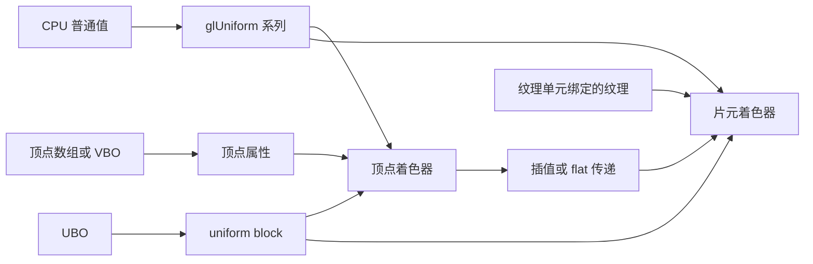

# GLES20 与 GLES30 着色器参数传递指南

本文介绍 Android 的 `android.opengl.GLES20`、`android.opengl.GLES30` 中，用来向着色器程序提供数据的主要接口。内容包括顶点属性、普通 uniform、矩阵、纹理采样器，以及 OpenGL ES 3.0 的整数属性、无符号 uniform、非方阵、UBO 和实例化属性。

示例使用 Kotlin，接口签名以本机 Android SDK API 35 源码为依据。本文只新增说明文档，不修改项目中的 Activity 或 Renderer，也不需要编译 APK。

## 目录

1. [先区分数据通道](#1-先区分数据通道)
2. [正确的调用时序与版本](#2-正确的调用时序与版本)
3. [位置查询和绑定](#3-位置查询和绑定)
4. [顶点属性数组](#4-顶点属性数组)
5. [顶点属性常量](#5-顶点属性常量)
6. [浮点、整数和布尔 uniform](#6-浮点整数和布尔-uniform)
7. [uniform 数组与结构体](#7-uniform-数组与结构体)
8. [矩阵 uniform](#8-矩阵-uniform)
9. [纹理采样器](#9-纹理采样器)
10. [GLES30 的整数顶点属性](#10-gles30-的整数顶点属性)
11. [GLES30 的无符号 uniform](#11-gles30-的无符号-uniform)
12. [GLES30 的非方阵 uniform](#12-gles30-的非方阵-uniform)
13. [GLES30 的 UBO](#13-gles30-的-ubo)
14. [std140 内存布局](#14-std140-内存布局)
15. [GLES30 的实例化和矩阵属性](#15-gles30-的实例化和矩阵属性)
16. [活动变量查询与读取](#16-活动变量查询与读取)
17. [GLES20 组合示例](#17-gles20-组合示例)
18. [GLES30 组合示例](#18-gles30-组合示例)
19. [状态归属、生命周期和线程](#19-状态归属生命周期和线程)
20. [常见错误和选型](#20-常见错误和选型)
21. [参考资料](#21-参考资料)

## 1. 先区分数据通道

| 数据通道 | Shader 声明 | CPU 侧主要方法 | 适合的数据 |
|---|---|---|---|
| 顶点属性 | ES 2.0 的 `attribute`；ES 3.0 顶点着色器的 `in` | `glVertexAttribPointer()`、`glVertexAttribIPointer()` | 每个顶点的位置、颜色、UV、法线、骨骼索引 |
| 顶点属性常量 | 与上面相同 | `glVertexAttrib*f()`、`glVertexAttribI4i()` 等 | 所有顶点共用的属性值 |
| 普通 uniform | block 外的 `uniform` | `glUniform*()` | 整体颜色、缩放、时间、矩阵、阈值 |
| 纹理采样器 | `uniform sampler2D` 等 | 纹理绑定 + `glUniform1i()` | 通过采样读取图像或其他数据 |
| uniform block（ES 3.0） | `uniform BlockName { ... };` | UBO + `glUniformBlockBinding()` | 多个程序共享的一组相机、场景或材质参数 |
| 实例化属性（ES 3.0） | 顶点 `in` | 顶点属性配置 + `glVertexAttribDivisor()` | 每个实例不同的颜色、位置、变换矩阵 |

`uniform` 表示在一次绘制中，各顶点或片元读取同一份值。它不是“永远不能修改”：下一次绘制前可以重新赋值。

顶点到片元的 `varying`（ES 2.0），或顶点 `out` / 片元 `in`（ES 3.0），不是 CPU 直接设置的参数。通常由顶点着色器写入，再由光栅化阶段插值或按 `flat` 规则传递。



以下数值即使都是 Kotlin `Int`，含义也完全不同：

| 数值 | 作用 |
|---|---|
| `program` | 着色器程序对象的名称/句柄 |
| attribute location | 顶点属性槽位索引 |
| uniform location | 某个 Program 中普通 uniform 的位置 |
| `textureId` | 纹理对象的名称/句柄 |
| texture unit index | 纹理单元索引，例如 `0`、`1` |
| `vbo` / `ubo` | Buffer 对象的名称/句柄 |
| uniform block index | 某个 Program 中 uniform block 的索引 |
| UBO binding point | GL 上下文中的 uniform buffer 绑定点编号 |

## 2. 正确的调用时序与版本

### 2.1 常见时序

```text
编译 Shader → attach → link Program → 检查链接状态
                                      ↓
                          获取属性和 uniform 的位置
                                      ↓
                             glUseProgram(program)
                                      ↓
               设置 uniform、绑定纹理、准备顶点属性
                                      ↓
                         glDrawArrays / glDrawElements
```

`glGetUniformLocation()` 和 `glGetAttribLocation()` 必须针对已经成功链接的 Program。查询位置不要求该 Program 已经是 current；而 `glUniform*()` 没有 program 参数，修改的是 `glUseProgram()` 选中的当前程序。

`glBindAttribLocation()` 是一个例外：它用于指定下一次链接时的属性位置，应在 `glLinkProgram()` 之前调用。

### 2.2 GLES20 与 GLES30

| 项目 | GLES20 | GLES30 |
|---|---|---|
| Android Java 类开始提供的 API | 8 | 18 |
| 主要 Shader 语言 | GLSL ES 1.00 | GLSL ES 3.00 |
| 顶点属性关键字 | `attribute` | 顶点着色器 `in` |
| 阶段间变量 | `varying` | 顶点 `out`、片元 `in` |
| 片元输出 | `gl_FragColor` | 自定义 `out` |
| 普通 float/int/bool uniform | 支持 | 继续支持 |
| 整数顶点属性、uint uniform、UBO | 没有这些核心接口 | 支持 |
| 非方阵 uniform、VAO、实例化属性 | 没有这些核心接口 | 支持 |

GLES30 的 Java 类继承 `GLES20`，公共的 `glUniform1f()` 等接口可以继续使用。**调用哪个 Java 类，不会自动改变 EGL 上下文版本。**

```kotlin
// 使用 OpenGL ES 3.0 前，先创建对应上下文
// 此调用必须在 setRenderer() 之前
glSurfaceView.setEGLContextClientVersion(3)
```

ES 3.0 上下文保留了对 GLSL ES 1.00 着色器的兼容支持，不能笼统地说“ES 3.0 中不能出现 attribute”。但本文所有 GLES30 专用功能示例都明确使用 `#version 300 es`。同一个 Program 的顶点和片元着色器应使用匹配的语言版本，不要把一个阶段写成 1.00、另一个阶段写成 3.00。

设备 Android 版本达到 18，不等于 GPU 一定支持 ES 3.0；还要检查设备能力和上下文创建结果。

## 3. 位置查询和绑定

### 3.1 顶点属性位置

```glsl
attribute vec4 aPosition;
attribute vec4 aColor;
```

```kotlin
val positionLocation = GLES20.glGetAttribLocation(program, "aPosition")
val colorLocation = GLES20.glGetAttribLocation(program, "aColor")
```

返回值是属性索引。`-1` 表示找不到活动属性，例如拼写错误、变量被优化掉，或查询了错误程序。不要把 `-1` 传给 `glEnableVertexAttribArray()`、`glVertexAttribPointer()`。

### 3.2 普通 uniform 位置

```glsl
uniform float uProgress;
uniform mat4 uMvpMatrix;
```

```kotlin
val progressLocation = GLES20.glGetUniformLocation(program, "uProgress")
val matrixLocation = GLES20.glGetUniformLocation(program, "uMvpMatrix")
```

uniform location 不是程序对象编号。向 `location = -1` 调用 `glUniform*()` 会被忽略，但它可能暴露变量名、优化或接口设计问题。

location 属于特定程序的一次链接结果，程序重新创建或重新链接后需要重新查询。不要在两个 Program 之间复用 location，即使 Shader 变量名称相同。

### 3.3 链接前固定属性位置

```kotlin
GLES20.glBindAttribLocation(program, 0, "aPosition")
GLES20.glBindAttribLocation(program, 1, "aColor")
GLES20.glLinkProgram(program)
```

这只是指定属性槽位，不会上传顶点，也不会启用属性数组。ES 3.0 可以直接在 Shader 中指定：

```glsl
#version 300 es
layout(location = 0) in vec3 aPosition;
layout(location = 1) in vec4 aColor;
```

`layout(location=...)` 的这项 ES 3.0 功能适用于顶点输入等接口；不要据此认为 ES 3.0 核心语言也允许任意普通 uniform 位置声明。普通 uniform 仍通过 `glGetUniformLocation()` 查询。

## 4. 顶点属性数组

### 4.1 `glVertexAttribPointer()` 的意义

它描述“绘制时如何从数据源取出某个顶点属性”，并不负责上传数据，也不负责绘制。

```kotlin
GLES20.glVertexAttribPointer(
    index,       // 顶点属性 location
    size,        // 每个顶点的分量数，通常为 1～4
    type,        // 底层数据类型
    normalized,  // 整数源数据是否按规则归一化为浮点范围
    stride,      // 相邻顶点这一属性起点之间的字节距离
    pointer      // 客户端 Buffer，或 VBO 中的字节偏移
)
```

| 参数 | 常见值和含义 |
|---|---|
| `index` | `glGetAttribLocation()` 的结果或显式绑定的槽位 |
| `size` | 位置 XYZ 是 3，颜色 RGBA 是 4，UV 是 2 |
| `type` | `GL_FLOAT`、`GL_UNSIGNED_BYTE` 等；合法集合取决于 ES 版本 |
| `normalized` | 对整数源数据有意义，例如把无符号字节 255 转换为浮点 1.0 |
| `stride` | 字节单位；0 表示该属性的分量紧密排列 |
| `pointer` | `Buffer` 重载看 Buffer 当前 position；整数重载表示 VBO 字节偏移 |

当 Shader 输入是 `vec4`、数据只提供 XYZ 三个分量时，缺少的 W 默认是 1。未提供的 Y/Z 分量默认是 0。

### 4.2 客户端 FloatBuffer 示例

这是与当前 GLES20 示例相同的交错格式：每个顶点保存 `x、y、z、r、g、b、a`。

```kotlin
val vertices = floatArrayOf(
     0f,    0.5f, 0f, 1f, 0f, 0f, 1f,
    -0.5f, -0.5f, 0f, 0f, 1f, 0f, 1f,
     0.5f, -0.5f, 0f, 0f, 0f, 1f, 1f
)

val vertexBuffer = ByteBuffer
    .allocateDirect(vertices.size * 4)
    .order(ByteOrder.nativeOrder())
    .asFloatBuffer()
    .apply {
        put(vertices)
        position(0)
    }

// 本段使用客户端数据，确保 GL_ARRAY_BUFFER 没有绑定 VBO
GLES20.glBindBuffer(GLES20.GL_ARRAY_BUFFER, 0)

vertexBuffer.position(0)
GLES20.glVertexAttribPointer(
    positionLocation, 3, GLES20.GL_FLOAT, false, 7 * 4, vertexBuffer
)
GLES20.glEnableVertexAttribArray(positionLocation)

vertexBuffer.position(3)
GLES20.glVertexAttribPointer(
    colorLocation, 4, GLES20.GL_FLOAT, false, 7 * 4, vertexBuffer
)
GLES20.glEnableVertexAttribArray(colorLocation)
```

这里有三种不同单位：

- `vertices.size`：Float 的数量。
- `vertexBuffer.position(3)`：跳过 3 个 Float。
- `stride = 7 * 4`：一个顶点占 28 字节。

客户端数组需要让直接 Buffer 在绘制期间保持有效。`glVertexAttribPointer()` 不会像 `glBufferData()` 一样把整份顶点复制进 VBO。

### 4.3 VBO 示例

VBO 的建立与上传：

```kotlin
val ids = IntArray(1)
GLES20.glGenBuffers(1, ids, 0)
val vbo = ids[0]

vertexBuffer.position(0)
GLES20.glBindBuffer(GLES20.GL_ARRAY_BUFFER, vbo)
GLES20.glBufferData(
    GLES20.GL_ARRAY_BUFFER,
    vertices.size * 4,
    vertexBuffer,
    GLES20.GL_STATIC_DRAW
)
```

之后使用整数偏移重载：

```kotlin
GLES20.glVertexAttribPointer(
    positionLocation, 3, GLES20.GL_FLOAT, false, 7 * 4, 0
)
GLES20.glEnableVertexAttribArray(positionLocation)

GLES20.glVertexAttribPointer(
    colorLocation, 4, GLES20.GL_FLOAT, false, 7 * 4, 3 * 4
)
GLES20.glEnableVertexAttribArray(colorLocation)
```

最后一个 `0` 和 `3 * 4` 是 VBO 内的字节偏移。这里不能把颜色偏移写成 `3`。

设置属性指针时，GL 会记录当前 `GL_ARRAY_BUFFER` 对象与该属性的关联。之后仅仅绑定另一个 `GL_ARRAY_BUFFER`，不会自动修改已经配置好的属性来源。

GLES30 示例推荐使用 VBO + VAO + 偏移重载，避免将客户端 Buffer 与非零 VAO 的状态约束混用。Java 方法重载存在，不代表它在所有 GL 状态组合下都合法。

### 4.4 启用与禁用

```kotlin
GLES20.glEnableVertexAttribArray(positionLocation)
GLES20.glDrawArrays(GLES20.GL_TRIANGLES, 0, 3)
GLES20.glDisableVertexAttribArray(positionLocation)
```

属性数组未启用时，使用的是该槽位的当前常量值。是否在每次绘制后禁用，要由渲染器的状态管理策略决定；使用 VAO 时通常把启用状态保存在 VAO 中，绘制时直接切换 VAO。

### 4.5 `normalized` 不是法线归一化

```kotlin
GLES20.glVertexAttribPointer(
    colorLocation, 4, GLES20.GL_UNSIGNED_BYTE, true, 4, colorByteBuffer
)
```

上面的 `true` 表示无符号字节颜色从 `0～255` 转成 `0～1`，并不表示把向量长度归一化到 1。

| 底层源数据 | `normalized=false` | `normalized=true` |
|---|---|---|
| 无符号整数 | 按其数值转换成 float，例如 255 → 255.0 | 映射到 `[0, 1]` |
| 有符号整数 | 按其数值转换成 float | 按对应 ES 规则映射到约 `[-1, 1]` |
| `GL_FLOAT` | 使用原浮点值 | 不会替你归一化向量，也不会把任意 float 压到 `[0, 1]` |

法线等向量要归一化，应在 CPU 上计算，或在 Shader 中使用 `normalize()`。

## 5. 顶点属性常量

禁用某个属性数组后，可以给所有顶点设置同一个属性值：

```kotlin
GLES20.glDisableVertexAttribArray(colorLocation)
GLES20.glVertexAttrib4f(colorLocation, 1f, 0f, 0f, 1f)
```

完整的浮点常量系列：

| 传入分量 | 直接参数 | 数组或 FloatBuffer |
|---|---|---|
| 1 | `glVertexAttrib1f()` | `glVertexAttrib1fv()` |
| 2 | `glVertexAttrib2f()` | `glVertexAttrib2fv()` |
| 3 | `glVertexAttrib3f()` | `glVertexAttrib3fv()` |
| 4 | `glVertexAttrib4f()` | `glVertexAttrib4fv()` |

例如：

```kotlin
val color = floatArrayOf(1f, 0.5f, 0.2f, 1f)
GLES20.glVertexAttrib4fv(colorLocation, color, 0)
```

这里的 `fv` 没有 uniform 数组的 `count` 参数：它只给一个属性槽设置一组分量，不是批量给多个顶点传值。

当前属性常量初始值为 `(0, 0, 0, 1)`。为了避免其他绘制修改状态，使用常量时应显式设置。通过启用的属性数组绘制后，也不要依赖该槽位留下的当前值。

如果它在语义上是“整个物体统一的颜色”，也可以直接设计成 `uniform vec4 uColor`。常量属性只是另一种数据通道。

## 6. 浮点、整数和布尔 uniform

### 6.1 函数命名规律

以 `glUniform3fv()` 为例：

```text
Uniform：更新普通 uniform
3：每个值包含 3 个分量
f：分量类型为 float
v 后缀：数据来自数组或 Buffer
```

其中 `v` 表示向量形式的内存数据，不表示变量必须声明为 GLSL 数组：给一个 `vec3` 上传时也可使用 `glUniform3fv(location, 1, ...)`。

### 6.2 GLES20/GLES30 共用系列

| GLSL 类型 | 直接传参 | 数组/Buffer 传参 |
|---|---|---|
| `float` | `glUniform1f()` | `glUniform1fv()` |
| `vec2` | `glUniform2f()` | `glUniform2fv()` |
| `vec3` | `glUniform3f()` | `glUniform3fv()` |
| `vec4` | `glUniform4f()` | `glUniform4fv()` |
| `int` | `glUniform1i()` | `glUniform1iv()` |
| `ivec2` | `glUniform2i()` | `glUniform2iv()` |
| `ivec3` | `glUniform3i()` | `glUniform3iv()` |
| `ivec4` | `glUniform4i()` | `glUniform4iv()` |
| `bool`、`bvec*` | 推荐对应分量数的整数接口 | 推荐对应整数数组接口 |
| sampler 类型 | `glUniform1i()` | `glUniform1iv()` |

`bool` 是一个类型匹配规则上的特例，规范允许相应数值接口按零/非零转成布尔值；教学代码统一使用整数 `0/1`，更清楚。普通 `int` 和 `float` 则不能随意混用 setter。

### 6.3 标量和向量

```glsl
uniform float uProgress;
uniform vec2 uScale;
uniform vec3 uLightDirection;
uniform vec4 uTint;
uniform int uMode;
uniform bool uFlipY;
```

```kotlin
GLES20.glUseProgram(program)
GLES20.glUniform1f(progressLocation, 0.5f)
GLES20.glUniform2f(scaleLocation, 0.8f, 0.8f)
GLES20.glUniform3f(lightLocation, 0f, 0f, -1f)
GLES20.glUniform4f(tintLocation, 1f, 0.5f, 0.2f, 1f)
GLES20.glUniform1i(modeLocation, 2)
GLES20.glUniform1i(flipLocation, if (flipY) 1 else 0)
```

例如当前缩放 uniform：

```glsl
uniform vec2 uScale;
```

```kotlin
GLES20.glUniform2f(scaleLocation, scaleX, scaleY)
```

传入两个 Float 就对应 Shader 中的 `uScale.x` 和 `uScale.y`。

如果顶点和片元着色器都声明并使用同名普通 uniform，它们描述的是链接后 Program 中同一个值，声明必须符合链接匹配规则，包括类型、数组长度和精度等要求。通常只需获取一个 location 并设置一次，不需要按 Shader 阶段分别上传。同名但类型不一致会导致链接失败。

### 6.4 初始化与保持

对没有初始值的普通 uniform，程序成功链接后的初始数值为零；sampler 初始指向单元 0，矩阵初始为零矩阵。实践中应在第一次绘制前显式设置需要的默认值，例如缩放 `(1, 1)`、单位矩阵、颜色和纹理单元。

设置的值保存在 Program 中，直到再次修改、重新链接或程序被销毁。单纯切换到另一个 Program 再切换回来，不会清零原程序的 uniform。

`glUniform*()` 在调用时从 CPU 数组或 Buffer 读取数据。之后再修改这个 Kotlin 数组，不会自动同步到 Shader，仍需再次调用上传方法。

## 7. uniform 数组与结构体

### 7.1 `count` 是值的个数

```glsl
uniform vec3 uLights[2];
```

```kotlin
val lights = floatArrayOf(
    1f, 2f, 3f,
    4f, 5f, 6f
)
val location = GLES20.glGetUniformLocation(program, "uLights[0]")

GLES20.glUniform3fv(location, 2, lights, 0)
```

`count = 2` 表示两个 `vec3`，不是六个 float。

| 类型 | 一个值的标量数 | 上传 4 个值所需标量数 | count |
|---|---:|---:|---:|
| `float` | 1 | 4 | 4 |
| `vec2` | 2 | 8 | 4 |
| `vec3` | 3 | 12 | 4 |
| `vec4` | 4 | 16 | 4 |
| `mat4` | 16 | 64 | 4 |

对非数组 uniform 上传时使用 `count=1`，不要试图用一次 `glUniform3fv()` 跨越多个不同名称的 `vec3` uniform。

### 7.2 数组偏移与 Buffer 位置

数组重载：

```kotlin
// 跳过前 3 个 float，只上传第二个 vec3
GLES20.glUniform3fv(location, 1, lights, 3)
```

这里 location 决定写入哪个 Shader 变量，offset 只决定从 CPU 数组哪里读取。

FloatBuffer 重载：

```kotlin
val buffer = ByteBuffer.allocateDirect(lights.size * 4)
    .order(ByteOrder.nativeOrder())
    .asFloatBuffer()
    .apply {
        put(lights)
        position(0)
    }

GLES20.glUniform3fv(location, 2, buffer)
```

Buffer 重载没有单独 offset，以当前 `position` 作为起点。不要依赖一次 GL 调用替你修改或重置 position，明确设置起点并保证 `remaining()` 足够。

普通 uniform 向量数组紧密存放，例如 `vec3[2]` 需要 6 个 float。它和后面 UBO 的 `std140` 数组布局是两套规则。

### 7.3 修改特定数组元素

```kotlin
val secondLight = GLES20.glGetUniformLocation(program, "uLights[1]")
GLES20.glUniform3f(secondLight, 7f, 8f, 9f)
```

通用代码可以缓存每个需要的元素位置，不必对不同结构的 uniform location 做未经确认的加减。

### 7.4 结构体成员

```glsl
struct Material {
    vec4 color;
    float roughness;
};
uniform Material uMaterial;
```

```kotlin
val colorLocation = GLES20.glGetUniformLocation(program, "uMaterial.color")
val roughnessLocation =
    GLES20.glGetUniformLocation(program, "uMaterial.roughness")

GLES20.glUniform4f(colorLocation, 1f, 0.5f, 0.2f, 1f)
GLES20.glUniform1f(roughnessLocation, 0.6f)
```

不能直接把 Kotlin 对象地址传给一个叫 `glUniformMaterial()` 的方法；没有这种接口。普通结构体按活动成员设置，或者在 GLES30 中设计 UBO 并处理内存布局。

未被使用的成员可能被优化掉。声明的数组长度也不代表所有元素都成为活动资源，使用时要结合 Shader 和链接结果。

## 8. 矩阵 uniform

### 8.1 方阵接口

| GLSL 类型 | 方法 | 每个矩阵包含的 Float |
|---|---|---:|
| `mat2` | `glUniformMatrix2fv()` | 4 |
| `mat3` | `glUniformMatrix3fv()` | 9 |
| `mat4` | `glUniformMatrix4fv()` | 16 |

```glsl
attribute vec4 aPosition;
uniform mat4 uMvpMatrix;

void main() {
    gl_Position = uMvpMatrix * aPosition;
}
```

```kotlin
val matrixLocation = GLES20.glGetUniformLocation(program, "uMvpMatrix")

GLES20.glUseProgram(program)
GLES20.glUniformMatrix4fv(
    matrixLocation,  // 普通 uniform 的位置
    1,               // 上传一个矩阵，不是 16
    false,           // ES 中必须为 false
    mvpMatrix,       // 16 个 float，按列主序
    0                // 从数组第 0 个元素读取
)
```

数组和 FloatBuffer 重载均可用，矩阵数组例如 `mat4 uBones[2]` 使用 count=2，并准备 32 个 float。

### 8.2 列主序和转置

`android.opengl.Matrix` 生成 OpenGL 列主序数组，可以直接上传。

```text
数组下标对应的数学矩阵：

m[0]  m[4]  m[8]   m[12]
m[1]  m[5]  m[9]   m[13]
m[2]  m[6]  m[10]  m[14]
m[3]  m[7]  m[11]  m[15]
```

GLES20 和 GLES30 的矩阵 uniform 上传都要求 `transpose=false`。如果输入库使用行主序，应先在 CPU 上转换存储，不能通过传 true 来处理。

普通 uniform 的 `mat3` 直接用 9 个 float 紧密存放；UBO 的默认列主序 `mat3` 通常占 48 字节，不要混用两种布局。

## 9. 纹理采样器

### 9.1 三个步骤缺一不可

```glsl
uniform sampler2D uTexture;
```

```kotlin
GLES20.glUseProgram(program)

// 1. 选择第 0 号纹理单元
GLES20.glActiveTexture(GLES20.GL_TEXTURE0)

// 2. 把具体纹理绑定到该单元的二维纹理绑定点
GLES20.glBindTexture(GLES20.GL_TEXTURE_2D, textureId)

// 3. 告诉 sampler 使用第 0 号单元
GLES20.glUniform1i(textureLocation, 0)
```

对应关系：

```text
uTexture 的 uniform 值：0
           ↓
纹理单元 0 的 GL_TEXTURE_2D 绑定
           ↓
textureId 对应的纹理对象及像素数据
```

`glUniform1i(textureLocation, 0)` 的 0 确实指向 `GL_TEXTURE0` 对应的单元，但它是单元索引，不是常量 `GL_TEXTURE0` 的数值。`GL_TEXTURE0` 实际为 `0x84C0`，不能把该常量直接传入 sampler。

| 选择绑定目标时 | sampler 的整数值 |
|---|---:|
| `glActiveTexture(GL_TEXTURE0)` | 0 |
| `glActiveTexture(GL_TEXTURE1)` | 1 |
| `glActiveTexture(GL_TEXTURE0 + unit)` | unit |

sampler 始终使用 `glUniform1i()` / `glUniform1iv()`。即便是 GLES30 的 `usampler2D`，它描述的是纹理采样结果为无符号整数，sampler 自身的单元索引仍用有符号整数 setter，不用 `glUniform1ui()`。

### 9.2 双纹理与混合参数

```glsl
precision mediump float;
varying vec2 vUv;
uniform sampler2D uTextureA;
uniform sampler2D uTextureB;
uniform float uProgress;

void main() {
    vec4 a = texture2D(uTextureA, vUv);
    vec4 b = texture2D(uTextureB, vUv);
    gl_FragColor = mix(a, b, uProgress);
}
```

```kotlin
GLES20.glUseProgram(program)
GLES20.glActiveTexture(GLES20.GL_TEXTURE0)
GLES20.glBindTexture(GLES20.GL_TEXTURE_2D, textureA)
GLES20.glUniform1i(textureALocation, 0)

GLES20.glActiveTexture(GLES20.GL_TEXTURE1)
GLES20.glBindTexture(GLES20.GL_TEXTURE_2D, textureB)
GLES20.glUniform1i(textureBLocation, 1)

GLES20.glUniform1f(progressLocation, progress)
```

纹理的上传如 `GLUtils.texImage2D()`、`glTexImage2D()`，负责定义纹理像素；`glUniform1i()` 负责让 Shader 找到相应纹理单元。前者不是后者的替代。

### 9.3 sampler 数组

```glsl
uniform sampler2D uTextures[2];
```

```kotlin
val units = intArrayOf(0, 1)
val location = GLES20.glGetUniformLocation(program, "uTextures[0]")
GLES20.glUniform1iv(location, 2, units, 0)
```

ES 2.0 / ES 3.0 对 sampler 数组索引有严格的常量表达式约束。不要因为 CPU 可以批量设置数组，就假定 Shader 能用任意动态 int 索引采样器；简单示例可分别访问 `uTextures[0]` 和 `uTextures[1]`。

### 9.4 目标类型与采样器匹配

| Shader sampler | 绑定目标/数据 |
|---|---|
| `sampler2D` | `GL_TEXTURE_2D`，通常读取浮点或归一化颜色 |
| `samplerCube` | `GL_TEXTURE_CUBE_MAP` |
| `sampler3D`（ES 3.0） | `GL_TEXTURE_3D` |
| `sampler2DArray`（ES 3.0） | `GL_TEXTURE_2D_ARRAY` |
| `isampler2D` / `usampler2D`（ES 3.0） | `GL_TEXTURE_2D` 中匹配的整数纹理格式 |
| `samplerExternalOES` | 扩展的 `GL_TEXTURE_EXTERNAL_OES`，例如相机和视频 |

外部纹理需要设备扩展支持和对应的扩展 Shader 声明；ES 3.00 外部纹理语法还需要匹配的 ESSL3 扩展，不能原样照搬 ES 1.00 的扩展头。

sampler 绑定正确后，纹理仍需满足尺寸、格式、过滤与 mipmap 等完整性要求。没有生成 mipmap 却使用需要 mipmap 的 min filter，是纹理显示异常的常见原因。

## 10. GLES30 的整数顶点属性

### 10.1 `glVertexAttribIPointer()`

```glsl
#version 300 es
layout(location = 0) in vec3 aPosition;
layout(location = 1) in ivec4 aBoneIds;
```

浮点位置走普通属性路径；整数 ID 需要保持整数值：

```kotlin
GLES30.glBindBuffer(GLES30.GL_ARRAY_BUFFER, boneIdVbo)
GLES30.glVertexAttribIPointer(
    1,                 // 属性槽位
    4,                 // 每顶点 4 个索引
    GLES30.GL_INT,     // 有符号 32 位整数
    4 * 4,             // 16 字节一个顶点
    0                  // VBO 内字节偏移
)
GLES30.glEnableVertexAttribArray(1)
```

| 方法 | Shader 类型 | 转换方式 |
|---|---|---|
| `glVertexAttribPointer()` | `float`、`vec*` | 整数源数据转成浮点，按 normalized 决定是否归一化 |
| `glVertexAttribIPointer()` | `int/ivec*`、`uint/uvec*` | 保留整数输入，没有 normalized 参数 |

选择 `I` 版本不是因为 VBO 中“存的原来是整数”，而是因为 Shader 需要读取整数类型。以 unsigned byte 存储、Shader 用 vec4 读取的颜色，仍应使用普通 Pointer + normalized。

### 10.2 整数常量接口

| Shader 属性 | 直接设置 | 内存数据设置 |
|---|---|---|
| 有符号整数 | `glVertexAttribI4i()` | `glVertexAttribI4iv()` |
| 无符号整数 | `glVertexAttribI4ui()` | `glVertexAttribI4uiv()` |

```kotlin
GLES30.glDisableVertexAttribArray(idLocation)
GLES30.glVertexAttribI4i(idLocation, 2, 0, 0, 1)
```

它们设置四个整数分量，Shader 的标量或较短向量输入只使用对应分量。

### 10.3 整数跨阶段传递

```glsl
// ES 3.00 顶点着色器
flat out highp int vId;
```

```glsl
// ES 3.00 片元着色器
flat in highp int vId;
```

整数 ID 没有线性插值的含义，传给片元时使用 `flat`。它使用图元规定的 provoking vertex 值，不表示把各顶点 ID 做平均。想让整块物体保持同一个 ID，应让该物体顶点携带一致值。

## 11. GLES30 的无符号 uniform

### 11.1 全部方法系列

| Shader 类型 | 直接值 | 数组/IntBuffer |
|---|---|---|
| `uint` | `glUniform1ui()` | `glUniform1uiv()` |
| `uvec2` | `glUniform2ui()` | `glUniform2uiv()` |
| `uvec3` | `glUniform3ui()` | `glUniform3uiv()` |
| `uvec4` | `glUniform4ui()` | `glUniform4uiv()` |

```glsl
#version 300 es
uniform uint uFrameIndex;
uniform uvec4 uMask;
uniform uint uIds[3];
```

```kotlin
GLES30.glUseProgram(program)
GLES30.glUniform1ui(frameLocation, 12)
GLES30.glUniform4ui(maskLocation, 255, 0, 255, 0)

val ids = intArrayOf(10, 20, 30)
GLES30.glUniform1uiv(idsLocation, 3, ids, 0)
```

一个 `uvec4` 需要四个 Int；三个 `uvec4` 需要十二个 Int。count 规则与有符号系列一致。

### 11.2 Kotlin Int 与 GLuint

Android 的这些方法仍用 `Int` / `IntArray` 表示 32 位无符号位模式：

```kotlin
// -1 的 32 位位模式是 0xFFFFFFFF，作为 uint 读取时是 4294967295
GLES30.glUniform1ui(maskBitsLocation, -1)
```

这不是自动传入 Kotlin `UInt`；Java API 签名仍接收 `Int`。业务层处理大于 `Int.MAX_VALUE` 的数时，要明确是在处理位模式。

真正的 `uint/uvec` uniform 应使用 ui/uiv 系列，不要假定 `glUniform1i()` 会自动进行所需转换。sampler 是前文单独说明的例外通道，使用 1i/1iv。

## 12. GLES30 的非方阵 uniform

| GLSL 类型 | 上传方法 | 每个矩阵的 Float 数 |
|---|---|---:|
| `mat2x3` | `glUniformMatrix2x3fv()` | 6 |
| `mat3x2` | `glUniformMatrix3x2fv()` | 6 |
| `mat2x4` | `glUniformMatrix2x4fv()` | 8 |
| `mat4x2` | `glUniformMatrix4x2fv()` | 8 |
| `mat3x4` | `glUniformMatrix3x4fv()` | 12 |
| `mat4x3` | `glUniformMatrix4x3fv()` | 12 |

`matCxR` 表示 C 列、R 行，仍按列主序排列。例如：

```glsl
uniform mat3x4 uTransform;
```

```kotlin
val data = FloatArray(12)
GLES30.glUniformMatrix3x4fv(transformLocation, 1, false, data, 0)
```

它乘以 `vec3` 得到 `vec4`。不要把 `mat3x4` 误认为四列三行，也不要把 12 个 float 的存储当作普通 Android `Matrix` 的完整 4×4 矩阵。

所有方法都提供 FloatArray + offset、FloatBuffer 两类重载，并同样要求 `transpose=false`。

## 13. GLES30 的 UBO

### 13.1 两级绑定关系

Uniform Buffer Object 用一个 Buffer 为 uniform block 提供数据：

```text
Program 内的 block index
          │ glUniformBlockBinding(program, blockIndex, bindingPoint)
          ↓
上下文的 UBO binding point
          │ glBindBufferBase / glBindBufferRange
          ↓
具体 UBO 对象及其数据范围
```

同一个 UBO 可以被多个程序读取，但每个程序都需要建立自己的 block → binding point 映射，且 block 布局必须兼容。

UBO 里的成员不再具有可用的普通 uniform location，不能通过 `glUniformMatrix4fv()` 给 block 内的 mat4 赋值。sampler 等 opaque 类型也不能放入这种 uniform block。

### 13.2 一个容易正确打包的 block

以下是完整的 ES 3.00 顶点着色器：

```glsl
#version 300 es
layout(location = 0) in vec3 aPosition;

layout(std140) uniform FrameData {
    mat4 uMvp;
    vec4 uTint;
    vec4 uParams;
};

out mediump vec4 vColor;

void main() {
    // uParams.xy 是额外缩放，z 是亮度，w 是透明度系数
    vec3 position = vec3(aPosition.xy * uParams.xy, aPosition.z);
    gl_Position = uMvp * vec4(position, 1.0);
    vColor = vec4(uTint.rgb * uParams.z, uTint.a * uParams.w);
}
```

片元着色器：

```glsl
#version 300 es
precision mediump float;
in mediump vec4 vColor;
out vec4 fragColor;

void main() {
    fragColor = vColor;
}
```

这里所有成员都参与实际输出，布局为：

| 成员 | 字节偏移 | 占用 |
|---|---:|---:|
| `uMvp` | 0 | 64 字节 |
| `uTint` | 64 | 16 字节 |
| `uParams` | 80 | 16 字节 |
| block 总计 | — | 96 字节 |

### 13.3 创建和建立映射

下面代码假设前面的 Shader 已成功链接为 program，并且当前有 ES 3.0 上下文：

```kotlin
val blockIndex = GLES30.glGetUniformBlockIndex(program, "FrameData")
check(blockIndex != GLES30.GL_INVALID_INDEX) { "找不到 FrameData" }

val bindingPoint = 0
GLES30.glUniformBlockBinding(program, blockIndex, bindingPoint)

val blockSize = IntArray(1)
GLES30.glGetActiveUniformBlockiv(
    program, blockIndex, GLES30.GL_UNIFORM_BLOCK_DATA_SIZE, blockSize, 0
)
check(blockSize[0] == 96) { "FrameData 的布局大小与预期不符" }

val bufferIds = IntArray(1)
GLES30.glGenBuffers(1, bufferIds, 0)
val ubo = bufferIds[0]

GLES30.glBindBuffer(GLES30.GL_UNIFORM_BUFFER, ubo)
GLES30.glBufferData(
    GLES30.GL_UNIFORM_BUFFER, blockSize[0], null, GLES30.GL_DYNAMIC_DRAW
)
GLES30.glBindBufferBase(GLES30.GL_UNIFORM_BUFFER, bindingPoint, ubo)
GLES30.glBindBuffer(GLES30.GL_UNIFORM_BUFFER, 0)
```

`glBufferData(..., null, ...)` 只分配存储，其内容不能当作已初始化为零。第一次绘制之前必须写入有效数据。

block index 的查询失败值是 `GL_INVALID_INDEX`，Android 用 `-1` 表示其 32 位位模式。它与普通 uniform 的 `location=-1` 在概念上不同。

### 13.4 更新数据

下面的数组和 Buffer 建议作为成员复用：

```kotlin
val bytes = ByteBuffer.allocateDirect(96).order(ByteOrder.nativeOrder())
val floats = bytes.asFloatBuffer()

// 每次更新时重写整个 block
floats.position(0)
floats.put(mvpMatrix)                     // 16 个 float，0～63 字节
floats.put(floatArrayOf(1f, 0.5f, 0.2f, 1f)) // uTint
floats.put(floatArrayOf(1f, 1f, 1f, 1f))     // uParams

// floats 和 bytes 共享内存，但 position 各自独立
bytes.position(0)
GLES30.glBindBuffer(GLES30.GL_UNIFORM_BUFFER, ubo)
GLES30.glBufferSubData(GLES30.GL_UNIFORM_BUFFER, 0, 96, bytes)
GLES30.glBindBuffer(GLES30.GL_UNIFORM_BUFFER, 0)
```

为了让示例好读，这里用了临时 floatArrayOf。频繁更新时可以复用 tint/params 数组，或逐个 put 四个值。

如果其他绘制可能改动绑定点，绘制前再执行：

```kotlin
GLES30.glBindBufferBase(GLES30.GL_UNIFORM_BUFFER, bindingPoint, ubo)
```

只执行普通 `glBindBuffer(GL_UNIFORM_BUFFER, ubo)` 是为了编辑 Buffer，不能替代把 UBO 关联到着色器所使用的 indexed binding point。

### 13.5 绑定部分范围

```kotlin
GLES30.glBindBufferRange(
    GLES30.GL_UNIFORM_BUFFER,
    bindingPoint,
    largeUbo,
    offsetBytes,
    sizeBytes
)
```

这个 offset 和 size 都是字节单位。offset 必须满足 `GL_UNIFORM_BUFFER_OFFSET_ALIGNMENT`，size 要覆盖 block 需要的存储：

```kotlin
val alignment = IntArray(1)
GLES30.glGetIntegerv(GLES30.GL_UNIFORM_BUFFER_OFFSET_ALIGNMENT, alignment, 0)
```

例如一个 block 占 96 字节，但设备要求范围起点按 256 字节对齐，连续多个 block 的可绑定起点就不能简单设为 0、96、192。

### 13.6 容量和资源限制

可查询：

- `GL_MAX_UNIFORM_BUFFER_BINDINGS`：可使用的 UBO 绑定点数量。
- `GL_MAX_UNIFORM_BLOCK_SIZE`：一个 uniform block 的最大字节数。
- `GL_MAX_VERTEX_UNIFORM_BLOCKS`、`GL_MAX_FRAGMENT_UNIFORM_BLOCKS`：阶段相关限制。

UBO 不是无限容量的通用 GPU 存储。不要把 SSBO、image load/store、计算着色器或 `glProgramUniform*()` 当成 GLES30 核心接口；这些属于更高版本或特定扩展。

## 14. std140 内存布局

### 14.1 普通 uniform 与 UBO 的区别

普通 `glUniform3fv()` 的 `vec3` 数组紧密存放；UBO 按 Shader 声明的布局解释原始字节，需要处理对齐、数组步长和矩阵步长。

以下是 std140 的常见基本规则，单位为字节：

| 成员 | 基本对齐/布局特点 |
|---|---|
| `float`、`int`、`uint`、`bool` | 4 字节；block 中 bool 按 32 位槽处理，不是 Kotlin Boolean 的内存布局 |
| `vec2`、`ivec2`、`uvec2` | 基本对齐 8 字节 |
| `vec3` / `vec4` 及对应整数向量 | 基本对齐 16 字节 |
| 标量/向量数组 | 元素 stride 按 vec4 基本对齐规则上取整，常见最小 stride 为 16 字节 |
| 默认列主序 `mat4` | 4 列，每列 stride 16，共 64 字节 |
| 默认列主序 `mat3` | 3 列，每列 stride 16，共 48 字节 |
| 结构体 | 基本对齐按最大成员对齐再按 vec4 规则上取整，末尾可能有 padding |

基本对齐不等于这个成员在所有情况下都单独占满一个 vec4。尤其 vec3 后的单独 float 可以使用该对齐区域剩余的 4 字节；为了易维护，跨平台 block 常直接设计成 vec4，或显式处理每个成员偏移。

### 14.2 示例偏移

```glsl
layout(std140) uniform Example {
    float uTime;
    vec3 uDirection;
    float uStrength;
    vec4 uColor;
};
```

按照这些规则：

| 内容 | 起始字节 | 说明 |
|---|---:|---|
| `uTime` | 0 | 写入 4 字节 |
| padding | 4 | 给下一个 vec3 对齐，4～15 不存业务数据 |
| `uDirection` | 16 | 三个 float，16～27 |
| `uStrength` | 28 | 可以接在这个 vec3 的有效数据后 |
| `uColor` | 32 | 已符合 16 字节对齐 |
| 总大小 | 48 | 末尾符合 block 的对齐要求 |

不要把这一组成员打包成连续的 9 个 float。那样只分配 36 字节，而且 direction 等成员的位置也不正确。

### 14.3 查询实际接口信息

对于没有声明 block 实例名的前文 `FrameData`，成员在全局作用域使用 `uMvp`、`uTint`、`uParams`：

```kotlin
val names = arrayOf("uMvp", "uTint", "uParams")
val indices = IntArray(names.size)
GLES30.glGetUniformIndices(program, names, indices, 0)
check(indices.none { it == GLES30.GL_INVALID_INDEX })

val offsets = IntArray(names.size)
GLES30.glGetActiveUniformsiv(
    program, names.size, indices, 0,
    GLES30.GL_UNIFORM_OFFSET, offsets, 0
)
```

还可查询：

- `GL_UNIFORM_ARRAY_STRIDE`：数组元素字节步长。
- `GL_UNIFORM_MATRIX_STRIDE`：矩阵列或行的字节步长。
- `GL_UNIFORM_IS_ROW_MAJOR`：是否使用行主序。
- `GL_UNIFORM_BLOCK_INDEX`：该成员属于哪个 block。

uniform 的 active index 不是普通 uniform location，不能把 `glGetUniformIndices()` 的结果传入 `glUniform*()`。复杂 block、实例名和数组成员应结合 `glGetActiveUniform()` 返回的活动名称核对。

不要把 `std430` 当作 ES 3.0 uniform block 的替代布局，本文 UBO 使用 `std140`。

## 15. GLES30 的实例化和矩阵属性

### 15.1 改变属性的读取频率

普通顶点属性每个顶点前进一次；实例化属性可以每个实例前进一次：

```kotlin
// 配置位置属性，来源是位置 VBO
GLES30.glBindBuffer(GLES30.GL_ARRAY_BUFFER, positionVbo)
GLES30.glVertexAttribPointer(0, 3, GLES30.GL_FLOAT, false, 3 * 4, 0)
GLES30.glEnableVertexAttribArray(0)
GLES30.glVertexAttribDivisor(0, 0)

// 配置颜色属性，来源是实例颜色 VBO
GLES30.glBindBuffer(GLES30.GL_ARRAY_BUFFER, instanceColorVbo)
GLES30.glVertexAttribPointer(1, 4, GLES30.GL_FLOAT, false, 4 * 4, 0)
GLES30.glEnableVertexAttribArray(1)
GLES30.glVertexAttribDivisor(1, 1)

GLES30.glDrawArraysInstanced(
    GLES30.GL_TRIANGLES, 0, vertexCount, instanceCount
)
```

- divisor=0：按顶点读取。
- divisor=1：每个实例取下一组值，该实例内所有顶点共享。
- divisor>1：每经过相应数量的实例才推进一次。

divisor 是属性状态，需要在切回普通绘制时恢复，或通过不同 VAO 管理。

### 15.2 mat4 顶点属性占四个槽位

矩阵不一定只能作为 uniform。如果每个实例都有一个变换矩阵，可以将矩阵放入实例 VBO：

```glsl
#version 300 es
layout(location = 0) in vec3 aPosition;
layout(location = 2) in mat4 aInstanceModel;
uniform mat4 uViewProjection;

void main() {
    gl_Position = uViewProjection * aInstanceModel * vec4(aPosition, 1.0);
}
```

这个 mat4 占据 2、3、4、5 四个连续槽位，每个槽保存一列 vec4：

```kotlin
GLES30.glBindBuffer(GLES30.GL_ARRAY_BUFFER, modelMatricesVbo)
for (column in 0 until 4) {
    val location = 2 + column
    GLES30.glVertexAttribPointer(
        location,
        4,
        GLES30.GL_FLOAT,
        false,
        16 * 4,         // 每个实例一个 mat4，共 64 字节
        column * 4 * 4  // 每列四个 float，共 16 字节
    )
    GLES30.glEnableVertexAttribArray(location)
    GLES30.glVertexAttribDivisor(location, 1)
}
```

不能用 `size=16` 的一次 `glVertexAttribPointer()` 传一个 mat4。矩阵属性需要逐列配置，并占用多个属性槽位。属性总数受到 `GL_MAX_VERTEX_ATTRIBS` 限制。

## 16. 活动变量查询与读取

### 16.1 枚举活动 uniform

下面采用 Android 实际提供的 String 返回值重载：

```kotlin
val count = IntArray(1)
GLES20.glGetProgramiv(program, GLES20.GL_ACTIVE_UNIFORMS, count, 0)

val size = IntArray(1)
val type = IntArray(1)
for (index in 0 until count[0]) {
    val name = GLES20.glGetActiveUniform(program, index, size, 0, type, 0)
    // name 是活动名称，size 是数组元素数，type 是 GL_FLOAT_VEC4 等类型枚举
}
```

这里 index 是活动 uniform 的枚举索引，不是 location。要用普通 setter，仍需按名称查询 `glGetUniformLocation()`。

属性也可以通过 `GL_ACTIVE_ATTRIBUTES` 和 `glGetActiveAttrib()` 枚举。

### 16.2 读取当前值

```kotlin
val color = FloatArray(4)
GLES20.glGetUniformfv(program, colorLocation, color, 0)

val flags = IntArray(4)
GLES20.glGetUniformiv(program, flagsLocation, flags, 0)

val unsignedValue = IntArray(1)
GLES30.glGetUniformuiv(program, frameLocation, unsignedValue, 0)
```

这些查询显式传入 program，不要求它就是 current program。输出空间应足够容纳所查询的一个元素；不要假定对数组首元素调用一次 getter 就会自动返回整个数组。

顶点当前值和属性数组配置可通过 `glGetVertexAttribfv()`、`glGetVertexAttribiv()` 查询，ES 3.0 整数当前值可用 `glGetVertexAttribIiv()` / `glGetVertexAttribIuiv()`。查询适合调试和初始化，不建议在每帧关键路径中大量执行。

## 17. GLES20 组合示例

本节将位置、UV、矩阵、纹理单元、整体颜色和透明度放在一起。提供 Shader、位置缓存和完整绘制函数；它们是 Renderer 的组成部分，Program 创建、纹理上传和 Activity 生命周期仍由调用方完成。

### 17.1 两个 Shader

顶点着色器：

```glsl
attribute vec4 aPosition;
attribute vec2 aUv;
uniform mat4 uMvp;
varying mediump vec2 vUv;

void main() {
    gl_Position = uMvp * aPosition;
    vUv = aUv;
}
```

片元着色器：

```glsl
precision mediump float;
varying mediump vec2 vUv;
uniform sampler2D uTexture;
uniform vec4 uTint;
uniform float uOpacity;

void main() {
    vec4 color = texture2D(uTexture, vUv) * uTint;
    gl_FragColor = vec4(color.rgb, color.a * uOpacity);
}
```

varying 的类型与精度在两个阶段保持一致。若希望降低透明度后能与背景合成，需要额外启用并配置混合；仅写出 alpha 不会自动开启混合。

### 17.2 缓存接口位置

```kotlin
private data class Es2Bindings(
    val program: Int,
    val position: Int,
    val uv: Int,
    val mvp: Int,
    val texture: Int,
    val tint: Int,
    val opacity: Int
)

private fun queryEs2Bindings(program: Int): Es2Bindings {
    val bindings = Es2Bindings(
        program = program,
        position = GLES20.glGetAttribLocation(program, "aPosition"),
        uv = GLES20.glGetAttribLocation(program, "aUv"),
        mvp = GLES20.glGetUniformLocation(program, "uMvp"),
        texture = GLES20.glGetUniformLocation(program, "uTexture"),
        tint = GLES20.glGetUniformLocation(program, "uTint"),
        opacity = GLES20.glGetUniformLocation(program, "uOpacity")
    )
    check(listOf(
        bindings.position, bindings.uv, bindings.mvp,
        bindings.texture, bindings.tint, bindings.opacity
    ).all { it >= 0 }) { "Shader 接口不完整，请检查链接状态与变量名称" }
    return bindings
}
```

这个教学示例要求上述变量都存在且实际使用，因此对所有位置做检查。通用引擎中，某些参数可能是可选的，需要按接口约定处理。

### 17.3 顶点和绘制函数

四个顶点使用三角形带，格式为 XYZ + UV：

```kotlin
val quad = floatArrayOf(
    -0.5f,  0.5f, 0f, 0f, 0f,
    -0.5f, -0.5f, 0f, 0f, 1f,
     0.5f,  0.5f, 0f, 1f, 0f,
     0.5f, -0.5f, 0f, 1f, 1f
)
```

将它放入直接 FloatBuffer 后传入以下函数。这个 UV 约定适合前面 Bitmap 上传的示例，其他图像生产者应根据实际纹理变换确定方向。

```kotlin
private fun drawEs2Quad(
    bindings: Es2Bindings,
    vertices: FloatBuffer,
    mvpMatrix: FloatArray,
    textureId: Int,
    opacity: Float
) {
    GLES20.glUseProgram(bindings.program)
    GLES20.glUniformMatrix4fv(bindings.mvp, 1, false, mvpMatrix, 0)
    GLES20.glUniform4f(bindings.tint, 1f, 1f, 1f, 1f)
    GLES20.glUniform1f(bindings.opacity, opacity)

    GLES20.glActiveTexture(GLES20.GL_TEXTURE0)
    GLES20.glBindTexture(GLES20.GL_TEXTURE_2D, textureId)
    GLES20.glUniform1i(bindings.texture, 0)

    // 使用客户端 FloatBuffer，数据格式是 XYZUV
    GLES20.glBindBuffer(GLES20.GL_ARRAY_BUFFER, 0)
    vertices.position(0)
    GLES20.glVertexAttribPointer(
        bindings.position, 3, GLES20.GL_FLOAT, false, 5 * 4, vertices
    )
    GLES20.glEnableVertexAttribArray(bindings.position)

    vertices.position(3)
    GLES20.glVertexAttribPointer(
        bindings.uv, 2, GLES20.GL_FLOAT, false, 5 * 4, vertices
    )
    GLES20.glEnableVertexAttribArray(bindings.uv)

    GLES20.glDrawArrays(GLES20.GL_TRIANGLE_STRIP, 0, 4)

    GLES20.glDisableVertexAttribArray(bindings.position)
    GLES20.glDisableVertexAttribArray(bindings.uv)
}
```

每帧开始时如何清屏、是否混合、是否做宽高比处理，由 Renderer 控制。MVP 计算可参考同目录的《安卓图形矩阵使用指南》。

## 18. GLES30 组合示例

本节结合 VAO、VBO、整数属性、uint uniform 与矩阵。和上一节一样，提供链接后初始化和绘制函数，Shader 编译链接使用后面的公共辅助函数。

### 18.1 Shader

顶点着色器：

```glsl
#version 300 es
layout(location = 0) in vec3 aPosition;
layout(location = 1) in highp uint aObjectId;

uniform mat4 uMvp;
uniform highp uint uIdMask;
flat out highp uint vObjectId;

void main() {
    gl_Position = uMvp * vec4(aPosition, 1.0);
    vObjectId = aObjectId ^ uIdMask;
}
```

片元着色器：

```glsl
#version 300 es
precision mediump float;
flat in highp uint vObjectId;
uniform vec4 uTint;
out vec4 fragColor;

void main() {
    float brightness = ((vObjectId & 1u) == 0u) ? 0.5 : 1.0;
    fragColor = vec4(uTint.rgb * brightness, uTint.a);
}
```

### 18.2 初始化 VAO 和两个 VBO

```kotlin
private data class Es3Bindings(
    val program: Int,
    val vao: Int,
    val positionVbo: Int,
    val idVbo: Int,
    val mvp: Int,
    val idMask: Int,
    val tint: Int
)

private fun createEs3Bindings(program: Int): Es3Bindings {
    val positions = floatArrayOf(
        -0.5f,  0.5f, 0f,
        -0.5f, -0.5f, 0f,
         0.5f,  0.5f, 0f,
         0.5f, -0.5f, 0f
    )
    // 同一个物体的所有顶点携带相同 ID
    val objectIds = intArrayOf(7, 7, 7, 7)

    val positionBuffer = ByteBuffer.allocateDirect(positions.size * 4)
        .order(ByteOrder.nativeOrder()).asFloatBuffer()
        .apply { put(positions); position(0) }
    val idBuffer = ByteBuffer.allocateDirect(objectIds.size * 4)
        .order(ByteOrder.nativeOrder()).asIntBuffer()
        .apply { put(objectIds); position(0) }

    val vaos = IntArray(1)
    val buffers = IntArray(2)
    GLES30.glGenVertexArrays(1, vaos, 0)
    GLES30.glGenBuffers(2, buffers, 0)
    GLES30.glBindVertexArray(vaos[0])

    GLES30.glBindBuffer(GLES30.GL_ARRAY_BUFFER, buffers[0])
    GLES30.glBufferData(
        GLES30.GL_ARRAY_BUFFER, positions.size * 4,
        positionBuffer, GLES30.GL_STATIC_DRAW
    )
    GLES30.glVertexAttribPointer(0, 3, GLES30.GL_FLOAT, false, 3 * 4, 0)
    GLES30.glEnableVertexAttribArray(0)

    GLES30.glBindBuffer(GLES30.GL_ARRAY_BUFFER, buffers[1])
    GLES30.glBufferData(
        GLES30.GL_ARRAY_BUFFER, objectIds.size * 4,
        idBuffer, GLES30.GL_STATIC_DRAW
    )
    GLES30.glVertexAttribIPointer(1, 1, GLES30.GL_UNSIGNED_INT, 4, 0)
    GLES30.glEnableVertexAttribArray(1)

    GLES30.glBindVertexArray(0)
    GLES30.glBindBuffer(GLES30.GL_ARRAY_BUFFER, 0)

    return Es3Bindings(
        program = program,
        vao = vaos[0],
        positionVbo = buffers[0],
        idVbo = buffers[1],
        mvp = GLES30.glGetUniformLocation(program, "uMvp"),
        idMask = GLES30.glGetUniformLocation(program, "uIdMask"),
        tint = GLES30.glGetUniformLocation(program, "uTint")
    )
}
```

示例只在创建时分配上传用的临时 Buffer。`glBufferData()` 复制完成后，顶点来源已经是 VBO，后续绘制不需要保留这些临时 Buffer。

### 18.3 绘制和删除资源

```kotlin
private fun drawEs3Quad(
    bindings: Es3Bindings,
    mvpMatrix: FloatArray,
    mask: Int
) {
    GLES30.glUseProgram(bindings.program)
    GLES30.glUniformMatrix4fv(bindings.mvp, 1, false, mvpMatrix, 0)
    GLES30.glUniform1ui(bindings.idMask, mask)
    GLES30.glUniform4f(bindings.tint, 0.2f, 0.8f, 1f, 1f)

    GLES30.glBindVertexArray(bindings.vao)
    GLES30.glDrawArrays(GLES30.GL_TRIANGLE_STRIP, 0, 4)
    GLES30.glBindVertexArray(0)
}

private fun deleteEs3Bindings(bindings: Es3Bindings) {
    // 在这些资源所属的上下文仍然有效并且为当前上下文时调用
    GLES30.glDeleteVertexArrays(1, intArrayOf(bindings.vao), 0)
    GLES30.glDeleteBuffers(
        2, intArrayOf(bindings.positionVbo, bindings.idVbo), 0
    )
    // Program 的所有权由创建它的调用方管理，此处不删除
}
```

VAO 保存属性格式、启用状态、对应 VBO 等顶点输入状态，不保存 Program、普通 uniform 值或纹理绑定。因此绘制时仍要选择 Program、设置变化的 uniform。

### 18.4 公共 Shader 编译链接辅助函数

以下函数可以服务前面 ES 2.0 或 ES 3.0 的 Shader，前提是当前上下文支持相应版本。Shader 字符串由调用方提供，不要把 Markdown 代码围栏和说明文字一起传入。

```kotlin
private fun compileShader(type: Int, source: String): Int {
    val shader = GLES20.glCreateShader(type)
    check(shader != 0) { "创建着色器失败" }
    GLES20.glShaderSource(shader, source)
    GLES20.glCompileShader(shader)

    val status = IntArray(1)
    GLES20.glGetShaderiv(shader, GLES20.GL_COMPILE_STATUS, status, 0)
    if (status[0] == 0) {
        val log = GLES20.glGetShaderInfoLog(shader)
        GLES20.glDeleteShader(shader)
        error("着色器编译失败：$log")
    }
    return shader
}

private fun createProgram(vertexSource: String, fragmentSource: String): Int {
    val vertexShader = compileShader(GLES20.GL_VERTEX_SHADER, vertexSource)
    try {
        val fragmentShader = compileShader(GLES20.GL_FRAGMENT_SHADER, fragmentSource)
        try {
            val program = GLES20.glCreateProgram()
            check(program != 0) { "创建着色器程序失败" }
            GLES20.glAttachShader(program, vertexShader)
            GLES20.glAttachShader(program, fragmentShader)
            GLES20.glLinkProgram(program)

            val status = IntArray(1)
            GLES20.glGetProgramiv(program, GLES20.GL_LINK_STATUS, status, 0)
            if (status[0] == 0) {
                val log = GLES20.glGetProgramInfoLog(program)
                GLES20.glDeleteProgram(program)
                error("着色器程序链接失败：$log")
            }
            return program
        } finally {
            GLES20.glDeleteShader(fragmentShader)
        }
    } finally {
        GLES20.glDeleteShader(vertexShader)
    }
}
```

组合示例所需的主要导入：

```kotlin
import android.opengl.GLES20
import android.opengl.GLES30
import java.nio.ByteBuffer
import java.nio.ByteOrder
import java.nio.FloatBuffer
```

把这些函数作为 Renderer 的组成部分使用。`onSurfaceCreated()` 中创建程序和缓存资源，`onDrawFrame()` 中清屏并调用绘制函数，`onSurfaceChanged()` 中更新视口和投影。纹理应预先上传，MVP 必须在首帧前设为有效矩阵。

## 19. 状态归属、生命周期和线程

### 19.1 哪些状态保存在哪里

| 状态 | 归属 |
|---|---|
| 普通 uniform 数值 | Program 对象 |
| uniform location、block index、属性链接位置 | Program 的链接结果 |
| block → UBO binding point 映射 | Program 状态 |
| 某个 indexed binding point 绑定哪个 UBO | 上下文状态 |
| 纹理单元绑定和当前 active texture unit | 上下文状态 |
| 属性数组格式、启用状态、VBO 关联、divisor | ES 3.0 中随当前 VAO 管理 |
| 禁用数组时的当前属性常量 | 上下文状态，不由 VAO 保存 |
| VBO/UBO 数据 | Buffer 对象 |

理解这些归属，可以解释为什么“切换 VAO 不会帮我切换纹理”“切换 Program 后 uniform 不见了”“修改 binding point 会影响另一个物体”。多个绘制共享上下文时，应明确建立每次绘制需要的状态。

GLES30 还可以创建 sampler object，用 `glBindSampler(unit, samplerObject)` 指定一个单元的采样参数。这个 sampler object 与 Shader 中的 sampler uniform 也不是同一个概念：前者控制过滤、环绕等采样状态，后者保存纹理单元索引。

### 19.2 EGL 上下文重建

资源对象通常依赖其 EGL 上下文或共享对象空间。页面恢复时若上下文重建，应重新创建 Program、纹理、Buffer、VAO，再重新查询 location、配置接口。

不要只保存上一次的整数 ID 就认为对象仍然存在。`onSurfaceCreated()` 可能再次调用；统一在那里重建需要的 GL 资源和接口缓存。

### 19.3 UI 线程和 GL 线程

所有实际 GL 调用都应在正确上下文为 current 的线程中执行。使用 GLSurfaceView 时，将状态更新交给 GL 线程：

```kotlin
glSurfaceView.queueEvent {
    renderer.setProgress(progress)
}
glSurfaceView.requestRender()
```

推荐让 `setProgress()` 只更新 Renderer 的普通字段，`onDrawFrame()` 在 `glUseProgram()` 后统一上传。这样不会在事件回调中误用其他 current program。

只让 UI 线程直接改普通 Float 字段，并不自动解决完整的状态同步问题；多个相关值或共享数组尤其容易出现不一致。除非已经设计好同步机制，否则继续使用 queueEvent 在同一个 GL 线程修改和读取。

`requestRender()` 是异步绘制请求，不是立即执行 `onDrawFrame()`。按需渲染需要请求新帧；连续渲染则会持续绘制。

## 20. 常见错误和选型

### 20.1 按现象检查

| 现象 | 检查方向 |
|---|---|
| uniform 修改没效果 | program 是否 current、location 是否属于该 program、是否为 -1 |
| 图形突然消失 | 矩阵是否仍为零、缩放是否为零、位置属性是否启用、数据是否越界 |
| 顶点颜色错乱 | 属性偏移、stride、类型、normalized、Buffer position |
| 位置正确但颜色全黑 | 颜色属性未启用或未设置常量、uniform 颜色默认零 |
| 纹理采样错误 | sampler 存的是单元索引，检查目标类型、纹理完整性和纹理坐标 |
| 整数 ID 不正确 | 是否用 IPointer，底层 signed/unsigned 类型是否匹配 |
| 矩阵变换方向异常 | 是否误把列主序当行主序、矩阵相乘顺序是否正确 |
| UBO 数据部分正确部分错 | 字节偏移、std140 padding、数组 stride、矩阵 stride |
| 换 Program 后参数失效 | 是否错误复用了 location，是否给新 Program 建立 block 映射 |
| 换 VAO 后常量值不对 | 常量属性不保存在 VAO 中，需要显式设置 |
| 多个物体都读到最后一个对象的数据 | 是否共享了同一个 uniform/UBO 状态，却没有在各次绘制前更新 |
| GLSL 编译失败 | 上下文版本、Shader 语言版本、关键字、精度和接口是否匹配 |

### 20.2 count、offset、stride 的单位

| 接口参数 | 单位 |
|---|---|
| `glUniform3fv(..., count, ...)` | vec3 的数量 |
| `glUniformMatrix4fv(..., count, ...)` | mat4 的数量 |
| `glUniform*()` 数组 offset | FloatArray / IntArray 的元素个数 |
| FloatBuffer / IntBuffer position | 对应类型元素个数 |
| `glVertexAttribPointer()` stride | 字节 |
| VBO 指针重载最后的 offset | 字节 |
| `glBufferData()` size | 字节 |
| `glBufferSubData()` offset/size | 字节 |
| `glBindBufferRange()` offset/size | 字节 |
| UBO 反射得到的 offset/stride | 字节 |

### 20.3 容量查询

不要把自己设备支持的资源数量当成所有设备的保证。常用查询包括：

- `GL_MAX_VERTEX_ATTRIBS`：顶点属性槽位总数。
- `GL_MAX_VERTEX_UNIFORM_VECTORS`：ES 2.0 顶点 uniform 向量额度。
- `GL_MAX_FRAGMENT_UNIFORM_VECTORS`：ES 2.0 片元 uniform 向量额度。
- `GL_MAX_TEXTURE_IMAGE_UNITS`：片元阶段纹理单元使用限制。
- `GL_MAX_VERTEX_TEXTURE_IMAGE_UNITS`：顶点阶段纹理单元使用限制。
- `GL_MAX_COMBINED_TEXTURE_IMAGE_UNITS`：组合限制和可用单元索引范围相关能力。
- GLES30 的 UBO 相关容量与对齐查询，见第 13 节。

```kotlin
val value = IntArray(1)
GLES20.glGetIntegerv(GLES20.GL_MAX_VERTEX_ATTRIBS, value, 0)
```

不能只看 combined 纹理单元数量，就让一个片元 Shader 使用超出该阶段限制的纹理数量。不同 sampler 类型错误地指向同一单元，也可能使绘制无效。

### 20.4 错误诊断

开发阶段在可疑调用附近读取 GL 错误：

```kotlin
val error = GLES20.glGetError()
check(error == GLES20.GL_NO_ERROR) { "GL 错误：0x${error.toString(16)}" }
```

常见错误：

- `GL_INVALID_OPERATION`：无有效 current program、uniform 类型不匹配、无效 location、错误属性配置状态等。
- `GL_INVALID_VALUE`：负 count、超过合法范围的属性索引或纹理单元索引等。
- `GL_INVALID_ENUM`：非法类型或目标枚举。

实际枚举由具体接口和出错条件决定。GL 错误不是 Kotlin 异常，Java 方法能成功返回，不代表 GL 调用有效。Shader 编译/Program 链接状态则要用专门的状态查询和日志检查，不能只看 glGetError。

### 20.5 参数选择速查

| 需求 | 优先选择 |
|---|---|
| 每个顶点不同的位置/颜色/UV | 顶点属性数组 |
| 每个顶点相同，但 Shader 接口设计为属性 | 禁用数组 + 当前属性常量 |
| 整个物体共用一个缩放或颜色 | 普通 uniform |
| 模型、观察、投影变换 | 矩阵 uniform |
| 一张或多张图片 | 纹理绑定 + sampler 的单元索引 |
| 保持整数精度的逐顶点 ID | GLES30 的整数属性 |
| 多个程序共享相机和场景参数 | GLES30 的 UBO |
| 大量相同网格，每个实例不同参数 | GLES30 的实例化属性，或按场景设计其他通道 |

## 21. 参考资料

- [Android：GLES20 接口](https://developer.android.com/reference/android/opengl/GLES20)
- [Android：GLES30 接口](https://developer.android.com/reference/android/opengl/GLES30)
- [Android：GLSurfaceView](https://developer.android.com/reference/android/opengl/GLSurfaceView)
- [Android：图形开发指南](https://developer.android.com/develop/ui/views/graphics/opengl)
- [Khronos：OpenGL ES 2.0 参考页](https://registry.khronos.org/OpenGL-Refpages/es2.0/)
- [Khronos：OpenGL ES 3.0 参考页](https://registry.khronos.org/OpenGL-Refpages/es3.0/)
- [Khronos：OpenGL ES 3.0 规范](https://registry.khronos.org/OpenGL/specs/es/3.0/es_spec_3.0.pdf)
- [Khronos：GLSL ES 3.00 规范](https://registry.khronos.org/OpenGL/specs/es/3.0/GLSL_ES_Specification_3.00.pdf)

本文以 Android SDK API 35 中的 Java 签名进行接口核对。Java 类的 Android API 版本、当前 EGL 上下文版本、Shader 语言版本和 GPU 能力是不同条件，实际使用 GLES30 专用功能时需要同时满足。

校验范围：目录锚点、代码围栏、文中带类名前缀的 GL 方法名和常量已核对；两组组合示例、Shader 编译链接辅助函数、UBO 配置与布局查询片段已使用 Android SDK 的 android.jar 做 Kotlin 编译检查。这是语言和调用签名检查，未在设备上编译执行 GLSL 或验证实际绘制效果。

对于动画和频繁更新，还应遵循以下实践：在 Program 链接后缓存位置；复用 Buffer 和数组；只在对应数据变化时更新固定参数；把 GL 调用留在 GL 线程；在分析到真实瓶颈后，再考虑 UBO、实例化和更复杂的数据组织。
